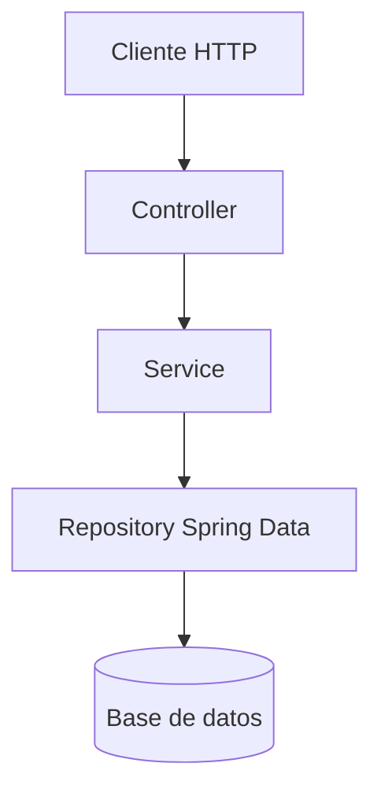
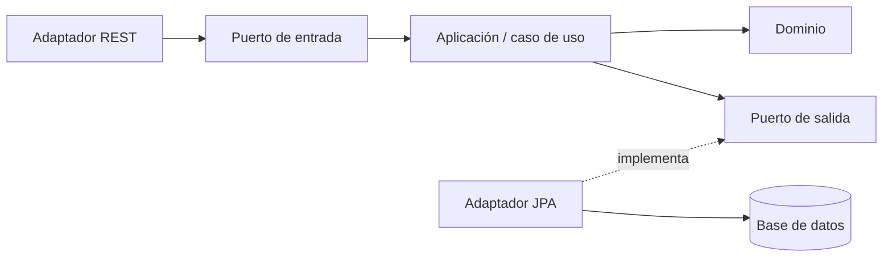

# Arquitectura en capas: por qué separamos la aplicación

**Idea que debes poder explicar:** separamos el código para que las reglas de
la aplicación no dependan de cómo llega una petición ni de cómo se guardan los
datos. Así podemos cambiar, probar y reutilizar cada responsabilidad con menos
acoplamiento.

Spring Boot nos ayuda a conectar los componentes, pero **la división tiene una
razón de diseño**. No consiste en crear carpetas porque lo diga el framework ni
en añadir una clase por cada anotación.

## 1. Nuestro controlador ya funcionaba: ¿por qué cambiarlo?

En los primeros pasos podemos recibir una petición, consultar un repositorio y
devolver JSON desde el mismo controlador. Eso permite construir un primer
comportamiento pequeño y entender el recorrido HTTP.

El problema aparece al crecer la aplicación. Imagina que el mismo método acaba
haciendo todo esto:

```text
Recibir POST y leer el JSON
Comprobar los datos de entrada
Buscar la partida
Decidir si su estado permite la operación
Comprobar que un barco cabe y no se solapa
Guardar los cambios
Preparar los campos de salida
Elegir código HTTP, cabeceras y cuerpo
```

Todo puede estar escrito en Java y funcionar. Sin embargo, hemos mezclado
**decisiones que cambian por motivos diferentes**: protocolo HTTP, reglas del
juego, almacenamiento y representación pública.

Ahora necesitamos responder tres preguntas:

1. **¿Cómo probamos el solapamiento de barcos sin construir peticiones HTTP?**
2. **¿Cómo usamos esa misma regla desde otro punto de entrada sin copiarla?**
3. **¿Cómo cambiamos el JSON sin tocar la regla que decide si un movimiento es válido?**

La separación en capas nos proporciona lugares y límites para resolverlas.

> **Que funcione es necesario; que podamos entenderlo, cambiarlo y comprobarlo
> sin mezclarlo todo es lo que estamos buscando con esta estructura.**

## 2. Un cambio concreto explica mejor el motivo

Pensemos en tres cambios sobre la misma aplicación:

| Necesidad | Si todo vive en el controlador | Con responsabilidades separadas |
|---|---|---|
| Usar una operación desde una API y desde un proceso automático | Se copia lógica o se intenta llamar al controlador, arrastrando HTTP | Los dos puntos de entrada utilizan el mismo caso de uso del servicio |
| Cambiar el código HTTP de una respuesta o añadir una cabecera | Hay que encontrar ese detalle entre reglas y acceso a datos | Se cambia el borde web y se comprueba su contrato |
| Probar que no se puede colocar un barco tras ganar | El test necesita recorrer el controlador y preparar detalles web | Se prueba la regla en dominio/servicio; otro test comprueba su traducción HTTP |

**La lógica no desaparece ni se ejecuta dos veces:** se coloca en el componente
responsable y los demás colaboran con él.

La separación reduce el alcance de muchos cambios; no garantiza que cualquier
cambio afecte a una sola clase. Una nueva funcionalidad puede recorrer varias
capas. La diferencia es que sabemos qué debe cambiar en cada una y qué pruebas
lo protegen.

## 3. Qué significa «capa»

Una capa es una **separación lógica de responsabilidades**. En nuestra aplicación
las clases siguen ejecutándose dentro del mismo proceso Java. No estamos
creando un servidor distinto por carpeta ni convirtiendo cada capa en un
microservicio.

La organización habitual del curso puede verse así:

```text
Cliente HTTP
    │ petición y DTO de entrada
    ▼
Controlador                 adapta HTTP al caso de uso
    ▼
Servicio                    ejecuta y coordina el caso de uso
    │ utiliza el modelo de dominio y sus reglas
    ▼
Repositorio                 obtiene y guarda datos
    ▼
Base de datos / almacenamiento

Respuesta: servicio → DTO de salida → controlador → cliente
```

El flujo de llamadas es principalmente **controlador → servicio → repositorio**.
Las entidades y los DTOs son tipos que participan en ese recorrido: **no tienen
por qué ser dos capas secuenciales adicionales**. Un mapper transforma datos;
tampoco necesita convertirse por sí solo en una capa independiente.

Las carpetas ayudan a reconocer la organización, pero lo importante son las
dependencias reales. Un método situado en `service/` que recibe un request HTTP
y devuelve un `ResponseEntity` sigue mezclando responsabilidades.

## 4. Para qué sirve cada parte

### 4.1. Controladores: hablar HTTP

El controlador es un **adaptador de entrada**. En una API REST:

- Relaciona rutas y verbos con operaciones.
- Recibe parámetros, cabeceras y cuerpos.
- Activa la validación de entrada cuando corresponde, por ejemplo con `@Valid`.
- Invoca el caso de uso.
- Construye la respuesta HTTP: código, cabeceras y representación.

Por ejemplo, decide que crear una tarea devuelve `201 Created` y una cabecera
`Location`. La geometría de un barco o la condición que permite cancelar una
partida no son detalles de HTTP y no deberían quedar enterradas en ese método.

**Pregunta guía:** «¿Esta decisión existe porque estamos atendiendo una petición
HTTP?». Si la respuesta es sí, probablemente pertenece al borde web.

### 4.2. Servicios: ejecutar casos de uso

El servicio expresa operaciones de la aplicación: crear una partida, colocar un
barco, completar una tarea o registrar un usuario. Coordina el modelo de dominio,
los repositorios y, si hace falta, otras colaboraciones.

En el diseño sencillo del curso incluye buena parte de las reglas de negocio.
También puede delegarlas en el dominio: por ejemplo, `Game.cancel()` puede
proteger una transición de estado, mientras el servicio busca la partida,
solicita la cancelación y guarda el cambio.

El servicio no necesita conocer URLs, códigos HTTP ni `ResponseEntity`. Puede
devolver un DTO de resultado o lanzar una excepción de aplicación que el punto
de entrada traducirá adecuadamente.

**Pregunta guía:** «¿Esta decisión seguiría siendo necesaria si la operación se
ejecutase desde una consola o una tarea programada?». Si es así, no debería
depender del controlador REST.

#### Por qué al principio el servicio parece pequeño

En el checkpoint 04 acabamos de extraer creación, consulta y listado. Es normal
que el servicio todavía tenga poca lógica y que parte de su trabajo sea delegar
y transformar datos.

En 04b aparecen las decisiones que justifican todavía más esa separación:
estados permitidos, límites, solapamiento, ataques repetidos, hundimiento y
cancelación. **Queremos construirlas y probarlas sin convertir el controlador
en el motor del juego.**

La cantidad de líneas no determina la calidad de un servicio. Lo importante es
que tenga una responsabilidad coherente; tampoco hay que inventar complejidad
para que una clase parezca más importante.

### 4.3. Repositorios: obtener y guardar datos

El repositorio abstrae operaciones de acceso a datos. Una interfaz que extiende
`JpaRepository` permite que Spring Data proporcione una implementación para
operaciones habituales; también podemos definir consultas específicas.

El repositorio sabe buscar o persistir. No decide si la respuesta de una API será
`404` o `409`, ni construye cabeceras HTTP.

Esta abstracción reduce la dispersión del acceso a datos. Cambiar de base de
datos, sin embargo, puede requerir revisar también entidades, consultas,
migraciones y configuración: tener un repositorio no elimina esas diferencias.

**Pregunta guía:** «¿Estamos decidiendo cómo acceder a los datos o si una acción
está permitida por el negocio?». La primera responsabilidad corresponde al
acceso a datos; la segunda debe quedar en la aplicación o el dominio.

### 4.4. Dominio y entidades: representar el problema

El dominio representa conceptos con significado para la aplicación: una tarea,
una partida, un barco o un usuario. Una entidad tiene identidad y puede cambiar
de estado a lo largo de su vida.

En nuestro ejemplo, una entidad JPA anotada con `@Entity` conecta ese modelo con
su representación persistente. Las entidades **no tienen por qué limitarse a
una bolsa de campos**: pueden contener comportamientos e invariantes que les
correspondan.

El modelo de dominio y el modelo de persistencia pueden separarse en diseños
más complejos. No necesitamos imponer esa duplicación ahora para entender las
responsabilidades básicas.

**Pregunta guía:** «¿Qué debe seguir siendo cierto para que este objeto
represente un estado válido del problema?».

### 4.5. DTOs y mappers: elegir qué datos cruzan un límite

Un DTO transporta datos de entrada o salida. En Java podemos expresarlo mediante
una clase sencilla o un record. Por ejemplo:

```java
public record TaskResponseDTO(Long id, String title, boolean done) {}
```

El DTO nos permite definir qué recibe o devuelve la API sin exponer directamente
todo el objeto persistente. Esto ayuda a:

- Evitar publicar por accidente campos internos o sensibles.
- Mantener un contrato público deliberado.
- Separar formatos de entrada y salida.
- Reducir el acoplamiento a relaciones, carga diferida y detalles de JPA.

Un DTO **no garantiza seguridad por sí solo**: hay que elegir sus campos y
comprobar permisos. Si copiamos todos los campos sensibles a un DTO, los
seguiremos exponiendo.

El mapper transforma entre modelos y DTOs. Puede ser un método pequeño escrito
a mano; herramientas como MapStruct pueden automatizarlo cuando compense. La
transformación no necesita una biblioteca adicional en los primeros ejemplos.

## 5. Seguir una petición de principio a fin

Supongamos esta entrada de Mini Tasks:

```http
POST /api/tasks
Content-Type: application/json

{"title":"  Repasar Spring Boot  "}
```

1. **El controlador** recibe el DTO y activa sus restricciones de entrada.
2. **El servicio** aplica el caso de uso: normaliza el título y establece que
   una tarea nueva comienza sin completar.
3. **El repositorio** guarda la tarea y obtiene su identificador.
4. **El servicio o mapper** prepara el DTO de salida con los campos públicos.
5. **El controlador** devuelve `201`, `Location` y el DTO como JSON.

Una respuesta ilustrativa sería:

```http
HTTP/1.1 201 Created
Location: /api/tasks/17
Content-Type: application/json

{"id":17,"title":"Repasar Spring Boot","done":false}
```

El id es un ejemplo, no una constante que deba fijar la implementación. Adapta
el prefijo de la ruta al contrato de tu propio proyecto.

**¿Por qué normalizar en el servicio?** Porque queremos la misma regla si mañana
se crea una tarea desde otro punto de entrada. Si solo se normaliza en el
controlador, otro cliente del servicio puede saltarse esa política.

## 6. Qué podemos probar gracias a la separación

Cada nivel responde una pregunta diferente:

| Prueba | Pregunta que responde | Dependencias necesarias |
|---|---|---|
| Dominio, con JUnit | ¿Se respeta una transición o invariante? | Objetos del dominio; a menudo sin Spring |
| Servicio, con JUnit y mocks | ¿Se ejecuta correctamente el caso de uso? | Colaboradores simulados cuando convenga; sin necesidad de HTTP o BD real |
| MVC, con `@WebMvcTest` | ¿Son correctos ruta, código, cabeceras y JSON? | Servicio simulado, por ejemplo con `@MockitoBean` |
| Persistencia, con `@DataJpaTest` | ¿Funcionan el mapeo y las consultas? | Infraestructura de persistencia configurada para el test |
| Integración, con `@SpringBootTest` | ¿Colaboran correctamente las piezas reales? | Contexto y componentes reales del escenario |

Una prueba del servicio no demuestra que el controlador devuelva `201`.
Una prueba web con un repositorio o servicio mock no demuestra que se haya
guardado una fila. **Las pruebas se complementan.**

Probar el servicio directamente con `new` o Mockito tampoco activa por sí solo
el proxy transaccional de Spring. Esa lógica se comprueba mediante integración
cuando forme parte de lo que queremos verificar.

## 7. Otras responsabilidades que podemos separar

No todas son capas colocadas una detrás de otra. Algunas son adaptadores y
otras son preocupaciones transversales:

| Responsabilidad | Qué concentra | Límite importante |
|---|---|---|
| **Integraciones o clientes externos** | Acceso a APIs, pasarelas de pago, correo o mensajería | El servicio coordina la operación; un adaptador encapsula el protocolo externo. En Spring existen `RestClient` para HTTP síncrono, `WebClient` para escenarios reactivos y clientes mediante interfaces. |
| **Seguridad** | Autenticación y autorización, con filtros y seguridad de métodos cuando corresponda | Parte actúa antes del controlador, pero los permisos también pueden comprobarse en métodos y reglas de acceso al recurso. |
| **Manejo de excepciones** | Traducción de excepciones de la aplicación a respuestas HTTP coherentes | Un advice MVC no es el manejador universal de procesos por lotes, hilos o filtros anteriores a MVC. |
| **Vistas** | HTML renderizado en servidor con motores como Thymeleaf | Otra presentación puede reutilizar los mismos casos de uso sin obligar al servicio a devolver HTML. |
| **Configuración** | Ensamblaje de componentes, propiedades y adaptación al entorno | Las reglas del dominio no deberían depender de detalles de configuración HTTP. |
| **Aspectos y mecanismos transversales** | Transacciones, auditoría o instrumentación | Pueden aplicarse a varias partes; no constituyen necesariamente una capa secuencial más. |

### Transacciones y sistemas externos

Una transacción de base de datos puede agrupar las escrituras que corresponden
a un caso de uso. **No puede deshacer automáticamente un correo ya enviado o
un cobro realizado por una API externa.**

Separar la integración hace visible ese límite y permite diseñar cómo gestionar
errores, reintentos y coordinación cuando sea necesario. No basta con poner
`@Transactional` en un método para que todos sus efectos sean reversibles.

## 8. Qué ganamos y qué no debemos prometer

- **Mantenibilidad:** localizamos responsabilidades y reducimos la mezcla de
  motivos de cambio. No prometemos que ningún cambio tenga efectos en otras partes.
- **Testabilidad:** elegimos el alcance del test y sustituimos colaboradores
  cuando corresponde. No sustituimos toda la integración por mocks.
- **Reutilización:** varios puntos de entrada pueden utilizar la misma operación
  sin duplicar sus reglas.
- **Comprensión:** al leer una clase sabemos qué decisiones esperamos encontrar.
- **Colaboración:** los límites ayudan a coordinar cambios y revisar su contrato;
  los conflictos no desaparecen solo por crear carpetas.

La separación introduce clases, interfaces de colaboración y transformaciones.
Debe aportar claridad. No necesitamos crear una interfaz por cada clase, una
jerarquía de servicios o un mapper automático si el problema todavía no lo pide.

## 9. Trabajo en equipo: funcionalidades completas

Las capas permiten colaborar, pero organizarse permanentemente como «una persona
solo hace controladores y otra solo repositorios» puede crear esperas y dejar
a cada integrante sin comprender el recorrido completo.

En las prácticas de grupo del módulo trabajamos por **slices verticales**:
funcionalidades pequeñas que atraviesan las partes necesarias y terminan con
pruebas. Cada integrante debe comprender su recorrido y revisar otro cambio.

Mini Tasks se realiza **individualmente desde cero** para practicar ese recorrido
completo. Book Catalog y Gestión de eventos mantienen el trabajo en grupo.

## 10. Arquitectura en capas no significa Clean Architecture

La estructura `Controller → Service → Repository` suele ser una **arquitectura
en capas** (también llamada *layered* o, según el contexto, *N-tier*). Es una
forma de organizar responsabilidades. No es automáticamente Clean Architecture
ni arquitectura hexagonal: para distinguirlas hay que mirar sobre todo la
dirección de las dependencias, no los nombres de los paquetes.

### En capas tradicional

Las capas superiores llaman a las inferiores. Es directa y suficiente para
muchas APIs, pero el servicio puede depender de tipos o interfaces de
persistencia definidos por Spring Data/JPA.



### Hexagonal, Onion y Clean Architecture

Son enfoques relacionados, no tres recetas idénticas. Comparten la intención de
proteger las reglas y casos de uso de detalles externos, pero usan vocabulario y
estructuras distintas. En una versión hexagonal, los **puertos** son contratos
que necesita o expone la aplicación y los **adaptadores** conectan esos contratos
con HTTP, JPA, mensajería u otros sistemas. La regla clave es que el código
externo dependa de contratos hacia dentro, no que el núcleo conozca la tecnología
externa.



El flujo de ejecución va del controlador al puerto de entrada y al caso de uso;
cuando necesita persistir, el caso de uso invoca el puerto de salida y se ejecuta
el adaptador JPA conectado por Spring.

| Enfoque | Idea que lo caracteriza | Pregunta para reconocerlo |
|---|---|---|
| Capas tradicional | Organización horizontal por responsabilidades técnicas; llamadas normalmente descendentes. | ¿Qué capa llama a cuál? |
| Hexagonal | Aplicación aislada mediante puertos y adaptadores reemplazables. | ¿Puede cambiarse el adaptador sin cambiar el caso de uso? |
| Onion | Dependencias dirigidas hacia el centro; el dominio queda en el núcleo. | ¿El centro conoce infraestructura? No debería. |
| Clean Architecture | Formaliza entidades, casos de uso, adaptadores de interfaz y mecanismos externos; las dependencias apuntan hacia dentro. | ¿Los casos de uso están protegidos de HTTP y persistencia? |

No hay una frontera universal entre estos nombres y algunas implementaciones
combinan sus ideas. Una carpeta `domain/` o una interfaz llamada `Port` por sí
solas no demuestran que se aplique una arquitectura concreta.

### Cómo implementarlo en Spring Boot

Spring Boot no obliga a organizar todo el código por capas. Se puede mantener
Spring como mecanismo de ensamblaje y colocar los casos de uso detrás de
interfaces. Por ejemplo, un puerto de salida podría ser `BookStore`, el caso de
uso depender de ese contrato y un adaptador JPA implementarlo mediante Spring
Data. El controlador REST sería un adaptador de entrada.

Una estructura posible —no una plantilla obligatoria— sería:

```text
com.example.catalog
├── domain/                 # Modelo y reglas sin dependencias web
├── application/
│   ├── port/in/            # Operaciones que la aplicación ofrece
│   ├── port/out/           # Colaboraciones que la aplicación necesita
│   └── usecase/            # Orquestación de casos de uso
└── infrastructure/
    ├── web/                # Controladores, DTOs y traducción HTTP
    └── persistence/        # Entidades JPA, Spring Data y adaptadores
```

Si los casos de uso son Java puro y no llevan `@Component`, Spring puede
construirlos desde una clase `@Configuration` con métodos `@Bean`. No es
obligatorio hacerlo así: también se puede usar escaneo de componentes en la capa
de aplicación, aceptando esa dependencia de Spring. Elegimos según cuánto
aislamiento aporte al proyecto, no para evitar una anotación a cualquier precio.

Separar el modelo de dominio de las entidades JPA también tiene un coste: hay
que mapear entre ambos y mantener los dos modelos. Para una aplicación pequeña
puede ser una complejidad innecesaria; para un dominio con reglas importantes,
puede ser una frontera útil. Y adoptar hexagonal no garantiza que cambiar de
framework o base de datos sea automático: los adaptadores, el esquema y la
configuración también deben migrarse.

### Arquitecturas que responden a otras preguntas

No todas estas opciones compiten en el mismo nivel:

- **Monolito modular**: una aplicación desplegable, dividida en módulos de
  negocio con límites explícitos. Cada módulo puede organizarse en capas o usar
  puertos y adaptadores.
- **Microservicios**: divide el sistema en servicios desplegables y operables de
  forma independiente; no prescribe cómo organizar internamente cada servicio.
- **Orientada a eventos**: coordina componentes mediante eventos y mensajería.
  Puede coexistir con un monolito modular, microservicios o una arquitectura
  hexagonal.

Por tanto, un sistema puede ser un **monolito modular**, tener módulos con
**arquitectura hexagonal** y comunicarse mediante **eventos**. Antes de elegir,
preguntamos qué límite queremos proteger y qué coste de complejidad podemos
asumir.

## 11. Comprobar si hemos entendido el motivo

Antes de seguir con el código, explica con tus propias palabras:

1. El controlador inicial funcionaba. ¿Qué ganamos al extraer el servicio?
2. Si mañana ejecutamos la operación desde una consola, ¿qué reutilizamos y qué
   parte HTTP deja de hacer falta?
3. ¿Por qué el test de solapamiento no debería depender del código `201`?
4. Si el servicio lanza una excepción de aplicación, ¿quién decide su código HTTP?
5. ¿Qué prueba falta si solo hemos comprobado el controlador con un servicio mock?
6. ¿Por qué devolver un DTO no garantiza por sí solo que los datos sean seguros?

**Frase de cierre:** el controlador habla HTTP; el servicio coordina casos de
uso; el dominio representa conceptos y reglas; el repositorio accede a datos;
los DTOs definen qué datos cruzan el límite. **Separamos estas responsabilidades
para poder cambiar y comprobar cada decisión con un alcance claro.**

## 12. Para continuar

- [Capa de servicio: conceptos y ejemplos](04-capa-servicios.md).
- [Referencia de anotaciones](../05-referencias/anexo-anotaciones-spring-boot.md).
- [Errores y respuestas HTTP coherentes](../02-api-rest/05-tdd-manejo-errores.md).
- Plantilla general de máquina de estados:
  `00-recursos-comunes/plantillas/plantilla-maquina-estados.md`, en la raíz de DWES.

El apunte explica la razón de la estructura; los pasos concretos de construcción
se siguen en el code-along y en el proyecto propio de cada estudiante.
