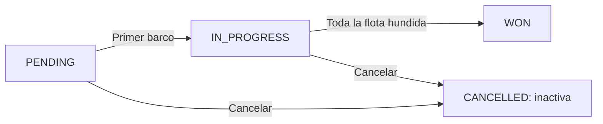

# Tramo 4b — Construir el modelo y las reglas de Battleship

**Continuación del checkpoint de [sesión 4](04-capa-servicios-dtos.md)**:
`bshipAlong`, Boot **4.1.1**, Java 25, paquete `es.daw2a.bshipalong`.

> Este documento contiene varios ciclos de construcción. **No se presupone que
> quepa entero en una sola clase de 3 horas**. Se guarda el último ciclo
> verde y se continúa desde allí. Mini Tasks sigue siendo individual.

## 0. Alcance y relación con la referencia final

### Cómo leer las capas de prueba y los cambios

Antes de cambiar código, sitúa **archivo, clase, método y capa**:

- **Servicio unitario — `GameServiceTest`:** JUnit y Mockito para repositorios;
  prueba el servicio sin arrancar Spring, HTTP ni base de datos.
- **Servicio con persistencia — `GameRulesTest`:** `@SpringBootTest` y
  `@Transactional`; servicio y repositorios reales. No es un `@DataJpaTest`.
- **Controlador MVC — `GameControllerTest` y `GameOperationsWebTest`:**
  `@WebMvcTest`, MockMvc y servicio mock; prueban enlace, respuesta y delegación,
  no las reglas reales ni JPA.
- **Integración con MVC — `GameHttpIntegrationTest` y `GameRulesHttpTest`:**
  `@SpringBootTest` y `@AutoConfigureMockMvc`; conectan MVC, servicio y persistencia.
  MockMvc no abre un puerto ni convierte el escenario en un cliente HTTP por red.

`when(service...)` configura el colaborador de una prueba MVC;
`when(repository...)` configura el de una prueba unitaria de servicio. Reutiliza
las clases y campos existentes; no declares un segundo mock al pasar de capa.
`GameService` recibe sus repositorios por inyección de constructor: Spring aporta
los beans y, en el test unitario, `@InjectMocks` aporta los mocks. Si se añade un
repositorio al constructor, añade su `@Mock` al test unitario. No construimos
manualmente el servicio ni pasamos DTOs a su constructor.

**Rótulos visibles:** «Archivo» corresponde a un archivo completo; «Método», a
sustituir solo el indicado; «Añadir», a incorporar el miembro dentro de la clase;
«Imports», a la cabecera; «Dependencia», a `pom.xml`. Conserva las anotaciones
cuando se indique y evita duplicar métodos. Los marcadores internos se dejan
pegados a su bloque de código para que el verificador existente siga funcionando.

### Ritmo de clase: demostrar y aplicar

Cada explicación o demo dura como máximo veinte minutos. Después se trabaja
en la tarea propia con un objetivo concreto. Las etiquetas B/A/C/D… son puntos
de corte del guion 06b, no un permiso para saltarse reglas. Blue forma parte del
cierre de cada ciclo. En jueves tampoco se garantiza terminar toda la guía.

Entramos con entidad mínima, servicio, DTO de salida y doce pruebas verdes.
Salimos con tamaño/fecha, barcos, ataques, hundimiento, victoria y cancelación
lógica, expuestos por HTTP y probados. Seguridad, paginación, payload uniforme
de errores, OpenAPI y producción se construirán después.

### Puntos de corte: no hay que terminar todo de una vez

La tabla describe el **recorrido completo desde el checkpoint de doce pruebas**,
no el estado actual de una clase que ya ha avanzado. Se continúa desde el último
ciclo trabajado, sin reconstruir lo que ya funciona ni saltar al final para abrir 05.

**Retoma actual:** veintiuna pruebas con el rojo intencionado de agua/tocado y dos
tests HTTP pendientes. El caso MVC que aún envía el POST sin cuerpo no se borra:
se convierte en `rejectsGameWithoutBody`, que fija el `400` correcto ante una
petición sin carga. Al adaptar la integración quedan veintiuna pruebas con un solo
rojo previsto; el green de agua/tocado cierra con veintiuna verdes. No volver a
añadir tests o helpers ya existentes.

**Un test en rojo no se elimina para dejar la suite verde.** Si su expectativa ya
no representa el contrato, se migra con el contrato nuevo; si el comportamiento
observado es el correcto, se convierte en la nueva expectativa. Borrarlo oculta la
decisión y enseña lo contrario de lo que buscamos.

| Tramo terminado | Pruebas de la suite completa | Qué se puede demostrar |
|---|---:|---|
| Preparación del contrato, apartado 2.1 | 12 | Firma migrada y comportamiento anterior conservado en verde |
| Tamaño solicitado, apartados 2.2/2.3 | 13 | Test nuevo de tamaño y contrato POST comprobado |
| Guardado del barco, apartado 3.3 | 14 | Barco persistido y representado, antes de cambiar el estado |
| Transición, final del apartado 3 | 15 | Primer barco pasa a `IN_PROGRESS` |
| Límites, primer ciclo del apartado 4 | 16 | Rechazo de barcos que no caben |
| Nombre y solapamiento, final del apartado 4 | 18 | Restricciones de colocación |
| Estado y agua/impacto, primeros ciclos del apartado 5 | 20 | Disparos básicos |
| Coordenada repetida, final del apartado 5 | 21 | Rechazo de disparos duplicados |
| Hundimiento y victoria, antes del último ciclo del apartado 6 | 23 | Flota hundida y `WON` |
| Restricción tras victoria y cancelación, final del apartado 7 | 26 | No colocar tras ganar; cancelación con histórico |
| Contrato MVC, primer tramo del apartado 8 | 32 | Endpoints y códigos locales por ciclos independientes |
| Flujo HTTP real, apartado 8 | 35 | Web, servicio y persistencia juntos |
| Actualización con datos anteriores, apartado 8.1 | 36 | Checkpoint completo para empezar 05 |

Estos recuentos corresponden a los archivos de esta guía. Si añadiste tests
propios, el número puede ser mayor: conserva sus comportamientos. La retoma
actual conserva además `rejectsGameWithoutBody`: tiene **una prueba más** que
este recorrido base al alcanzar los mismos hitos. Hasta completar
un caso, las firmas preparadas para operaciones posteriores no se consideran
funcionalidad disponible. Demuestra solo lo que ya está probado.

Esta API es el juego simplificado de la referencia: **no tiene todavía jugadores
ni turnos alternos**. Al colocar el primer barco pasa a `IN_PROGRESS`; se pueden
añadir más barcos mientras esté en curso. Gana al hundir la flota. Una partida
pendiente o en curso puede cancelarse; una ganada no. No introducir aquí reglas
del juego de mesa que el proyecto de referencia no implementa.



Sin visor Mermaid: `PENDING → IN_PROGRESS → WON`; desde los dos primeros se
puede pasar a `CANCELLED`. Los estados actuales son exactamente `PENDING`,
`IN_PROGRESS`, `WON` y `CANCELLED`. En datos antiguos, `FINISHED` representaba
una partida ya terminada y se migra a `WON`: en este modelo simplificado terminar
la partida al hundirse toda la flota equivale a ganar. `CANCELLED` es una cancelación independiente, no el
reemplazo de `FINISHED`. Las peticiones no aceptan un campo `status` para forzar
estas transiciones.

## 1. Preparar las piezas que antes faltaban

Este apartado es **preparación estructural**, no prueba de haber implementado
reglas. No saltes directamente a los métodos del servicio.

### 1.1. Validación y migraciones nuevas

Añade al POM, dentro de `<dependencies>`, y recarga Maven:

**Dependencia — `pom.xml`**

<!-- dependencia: pom.xml -->
```xml
<dependency>
    <groupId>org.springframework.boot</groupId>
    <artifactId>spring-boot-starter-validation</artifactId>
</dependency>
```

Conserva V1 sin editar. Crea **V2**, que evoluciona la tabla existente y mantiene
las filas que se hubieran creado con el POST anterior:

**Archivo — `src/main/resources/db/migration/V2__evolve_game.sql`**

<!-- archivo: src/main/resources/db/migration/V2__evolve_game.sql -->
```sql
ALTER TABLE games RENAME TO game;
ALTER TABLE game ADD COLUMN board_size INT NOT NULL DEFAULT 10;
ALTER TABLE game ADD COLUMN created_at TIMESTAMP NOT NULL DEFAULT CURRENT_TIMESTAMP;
ALTER TABLE game ADD COLUMN active BOOLEAN NOT NULL DEFAULT TRUE;
ALTER TABLE game ADD COLUMN cancelled_at TIMESTAMP;
UPDATE game SET status = 'WON' WHERE status = 'FINISHED';
```

La conversión conserva esas partidas como `WON`: `FINISHED` representaba una
partida ya terminada por el modelo anterior y, en el flujo simplificado actual,
la finalización de la flota es una victoria. `CANCELLED` sigue siendo una
cancelación distinta. Si V2 ya se aplicó, no reescribas la versión aplicada. Si
esa versión no incluía la conversión, crea una migración posterior (la siguiente
versión libre) con este `UPDATE` antes de que la aplicación lea esas filas con
el enum revisado.

Ahora crea V3 para las tablas nuevas:

**Archivo — `src/main/resources/db/migration/V3__create_ships_attacks.sql`**

<!-- archivo: src/main/resources/db/migration/V3__create_ships_attacks.sql -->
```sql
CREATE TABLE ship (
    id BIGINT GENERATED BY DEFAULT AS IDENTITY PRIMARY KEY,
    game_id BIGINT NOT NULL REFERENCES game(id),
    ship_name VARCHAR(50) NOT NULL,
    length INT NOT NULL,
    start_x INT NOT NULL,
    start_y INT NOT NULL,
    is_horizontal BOOLEAN NOT NULL,
    sunk BOOLEAN NOT NULL DEFAULT FALSE
);
CREATE TABLE attack (
    id BIGINT GENERATED BY DEFAULT AS IDENTITY PRIMARY KEY,
    game_id BIGINT NOT NULL REFERENCES game(id),
    x INT NOT NULL,
    y INT NOT NULL,
    hit BOOLEAN NOT NULL DEFAULT FALSE,
    created_at TIMESTAMP NOT NULL DEFAULT CURRENT_TIMESTAMP
);
```

La numeración refleja **nuestro historial de construcción**; no coincide con la
referencia, que ya creó las tres tablas en V1. Cuando llegue autenticación,
usuarios tendrá una nueva migración posterior a estas. No copies la V3 de
usuarios de la referencia encima de esta V3.

### 1.2. Entidades completas de este checkpoint

El POM de clase ya contiene Lombok y su procesador. Aquí usamos `@Getter` y
`@Setter` para evitar escribir accesores repetitivos. El constructor de `Game`
sigue garantizando `PENDING`, por lo que `GameTest` se conserva.

**Archivo — `src/main/java/es/daw2a/bshipalong/domain/GameStatus.java`**

<!-- archivo: src/main/java/es/daw2a/bshipalong/domain/GameStatus.java -->
```java
package es.daw2a.bshipalong.domain;

public enum GameStatus { PENDING, IN_PROGRESS, WON, CANCELLED }
```

**Archivo — `src/main/java/es/daw2a/bshipalong/domain/Game.java`**

<!-- archivo: src/main/java/es/daw2a/bshipalong/domain/Game.java -->
```java
package es.daw2a.bshipalong.domain;

import jakarta.persistence.*;
import lombok.Getter;
import lombok.Setter;
import java.time.LocalDateTime;

@Entity
@Table(name = "game")
@Getter @Setter
public class Game {
    @Id @GeneratedValue(strategy = GenerationType.IDENTITY)
    private Long id;
    @Column(name = "board_size", nullable = false)
    private int boardSize;
    @Enumerated(EnumType.STRING)
    @Column(nullable = false, length = 20)
    private GameStatus status;
    @Column(name = "created_at", nullable = false)
    private LocalDateTime createdAt;
    @Column(nullable = false)
    private boolean active = true;
    @Column(name = "cancelled_at")
    private LocalDateTime cancelledAt;

    public Game() { this(10); }
    public Game(int boardSize) {
        this.boardSize = boardSize;
        this.status = GameStatus.PENDING;
    }
    @PrePersist
    void onCreate() {
        if (createdAt == null) createdAt = LocalDateTime.now();
    }
}
```

La cancelación se añadirá cuando tenga su test; no se prepara un método vacío
para ella ahora. Los setters permiten
el mapeo y preparar pruebas; ningún endpoint expone una asignación arbitraria
de estado.

Si vienes de la versión anterior, retira de esta preparación **solo los stubs de
reglas futuras aún no implementadas**, como un `Game.cancel()` que lance
`UnsupportedOperationException`. No borres lógica funcional protegida por tests.
El recorrido nuevo incorpora cada firma cuando su caso la necesita y evita
duplicarla al llegar a ese apartado.

**Archivo — `src/main/java/es/daw2a/bshipalong/domain/Ship.java`**

<!-- archivo: src/main/java/es/daw2a/bshipalong/domain/Ship.java -->
```java
package es.daw2a.bshipalong.domain;

import jakarta.persistence.*;
import lombok.*;

@Entity
@Getter @Setter @NoArgsConstructor @AllArgsConstructor @Builder
public class Ship {
    @Id @GeneratedValue(strategy = GenerationType.IDENTITY)
    private Long id;
    @Column(name = "game_id", nullable = false)
    private Long gameId;
    @Column(name = "ship_name", nullable = false, length = 50)
    private String shipName;
    @Column(nullable = false)
    private int length;
    @Column(name = "start_x", nullable = false)
    private int startX;
    @Column(name = "start_y", nullable = false)
    private int startY;
    @Column(name = "is_horizontal", nullable = false)
    private boolean isHorizontal;
    @Column(nullable = false)
    private boolean sunk;
}
```

**Archivo — `src/main/java/es/daw2a/bshipalong/domain/Attack.java`**

<!-- archivo: src/main/java/es/daw2a/bshipalong/domain/Attack.java -->
```java
package es.daw2a.bshipalong.domain;

import jakarta.persistence.*;
import lombok.*;
import java.time.LocalDateTime;

@Entity
@Getter @Setter @NoArgsConstructor @AllArgsConstructor @Builder
public class Attack {
    @Id @GeneratedValue(strategy = GenerationType.IDENTITY)
    private Long id;
    @Column(name = "game_id", nullable = false)
    private Long gameId;
    @Column(nullable = false)
    private int x;
    @Column(nullable = false)
    private int y;
    @Column(nullable = false)
    private boolean hit;
    @Column(name = "created_at", nullable = false)
    private LocalDateTime createdAt;

    @PrePersist
    void onCreate() {
        if (createdAt == null) createdAt = LocalDateTime.now();
    }
}
```

### 1.3. DTOs y repositorios

El POST ahora sí recibirá `{"boardSize":8}`. Es un cambio deliberado del contrato
anterior, no una petición que llevase funcionando desde la sesión 3.

`CreateGameDTO` es el dato de entrada: contiene solo lo que el cliente puede
solicitar. `GameResponseDTO` es el dato de salida: describe lo que la API decide
devolver. No son entidades ni tablas; sirven para definir el contrato JSON.

**Archivo — `src/main/java/es/daw2a/bshipalong/dto/CreateGameDTO.java`**

<!-- archivo: src/main/java/es/daw2a/bshipalong/dto/CreateGameDTO.java -->
```java
package es.daw2a.bshipalong.dto;
import jakarta.validation.constraints.*;
public record CreateGameDTO(@Min(5) @Max(20) int boardSize) {}
```

**Archivo — `src/main/java/es/daw2a/bshipalong/dto/PlaceShipDTO.java`**

<!-- archivo: src/main/java/es/daw2a/bshipalong/dto/PlaceShipDTO.java -->
```java
package es.daw2a.bshipalong.dto;
import jakarta.validation.constraints.*;
public record PlaceShipDTO(
        @NotBlank String shipName,
        @NotNull @Min(1) Integer length,
        @NotNull @Min(0) Integer startX,
        @NotNull @Min(0) Integer startY,
        @NotNull Boolean isHorizontal) {}
```

**Archivo — `src/main/java/es/daw2a/bshipalong/dto/AttackDTO.java`**

<!-- archivo: src/main/java/es/daw2a/bshipalong/dto/AttackDTO.java -->
```java
package es.daw2a.bshipalong.dto;
import jakarta.validation.constraints.*;
public record AttackDTO(@NotNull @Min(0) Integer x, @NotNull @Min(0) Integer y) {}
```

**Archivo — `src/main/java/es/daw2a/bshipalong/dto/GameResponseDTO.java`**

<!-- archivo: src/main/java/es/daw2a/bshipalong/dto/GameResponseDTO.java -->
```java
package es.daw2a.bshipalong.dto;
import java.time.LocalDateTime;
import java.util.List;

public record GameResponseDTO(Long id, int boardSize, String status,
        LocalDateTime createdAt, List<ShipDTO> ships, List<AttackDTO> attacks) {
    // Tipos de salida incluidos dentro de la respuesta de una partida.
    public record ShipDTO(Long id, String shipName, int length,
            int startX, int startY, boolean isHorizontal, boolean sunk) {}
    public record AttackDTO(Long id, int x, int y, boolean hit, LocalDateTime createdAt) {}
}
```

Los records anidados `ShipDTO` y `AttackDTO` son tipos de datos pequeños que
agrupan la información pública de cada barco y ataque dentro de `GameResponseDTO`.
No son clases JPA ni endpoints. En Java son miembros implícitamente `static` y se
usan como `GameResponseDTO.ShipDTO`; el `AttackDTO` anidado no es el `AttackDTO`
de entrada del paquete `dto`.

Por ejemplo, una partida sin barcos ni ataques podría representarse así:

```json
{
  "id": 17,
  "boardSize": 8,
  "status": "PENDING",
  "createdAt": "2026-10-28T10:30:00",
  "ships": [],
  "attacks": []
}
```

Las listas vacías son parte del contrato: en los siguientes ciclos se llenarán
al persistir barcos y ataques.

**Archivo — `src/main/java/es/daw2a/bshipalong/repository/ShipRepository.java`**

<!-- archivo: src/main/java/es/daw2a/bshipalong/repository/ShipRepository.java -->
```java
package es.daw2a.bshipalong.repository;
import es.daw2a.bshipalong.domain.Ship;
import org.springframework.data.jpa.repository.JpaRepository;
import java.util.List;
public interface ShipRepository extends JpaRepository<Ship, Long> {
    List<Ship> findByGameId(Long gameId);
}
```

**Archivo — `src/main/java/es/daw2a/bshipalong/repository/AttackRepository.java`**

<!-- archivo: src/main/java/es/daw2a/bshipalong/repository/AttackRepository.java -->
```java
package es.daw2a.bshipalong.repository;
import es.daw2a.bshipalong.domain.Attack;
import org.springframework.data.jpa.repository.JpaRepository;
import java.util.List;
public interface AttackRepository extends JpaRepository<Attack, Long> {
    List<Attack> findByGameId(Long gameId);
    boolean existsByGameIdAndXAndY(Long gameId, int x, int y);
}
```

`GameRepository` conserva `JpaRepository<Game,Long>`. En este checkpoint haremos
explícito el filtro `active` en el servicio; más adelante se podrá trasladar a
métodos derivados o Specifications sin cambiar el contrato.

Estas interfaces son la preparación del acceso a datos. Spring Data genera su
implementación al arrancar la aplicación; `findByGameId` y
`existsByGameIdAndXAndY` expresan consultas a partir del nombre. Crear los
repositorios **no implementa todavía** las reglas del juego.

## 2. Preparar el contrato sin empezar todavía el ciclo TDD

Los repositorios y los DTOs ya están definidos. Ahora conectamos el nuevo dato de
entrada con el endpoint sin implementar aún la regla «crear con el tamaño
solicitado». Esta preparación puede tocar varias llamadas porque cambia una
firma pública; no la presentemos como el ciclo rojo-verde.

### 2.1. Migrar la firma manteniendo el comportamiento anterior

Haz solo estos cambios estructurales:

1. En `GameService`, cambia `createGame()` por `createGame(CreateGameDTO dto)`.
   Conserva temporalmente el comportamiento anterior: crea `new Game()` (tamaño
   predeterminado 10) y guarda el resultado. No añadas todavía métodos auxiliares.
2. En `GameController`, modifica únicamente el método POST existente para recibir
   `@Valid @RequestBody CreateGameDTO dto` y llamar a `service.createGame(dto)`.
   Conserva su respuesta actual (`201 Created` y `Location`). No sustituyas el
   controlador completo ni añadas endpoints de barcos, ataques o cancelación.
3. Actualiza las llamadas al servicio en los tests para pasar `CreateGameDTO`.
   En esta preparación, conserva la expectativa anterior: manda 10 y comprueba
   que la partida sigue teniendo el tamaño predeterminado 10. Si el test actual
   pedía 8, cambia temporalmente su entrada y expectativa a 10; el requisito de
   tamaño solicitado tendrá su test nuevo en el ciclo siguiente.
4. En los tests web, configura el mock con `new CreateGameDTO(10)` y envía
   `{"boardSize":10}`. En el test de integración, añade el mismo cuerpo JSON al
   POST y conserva la expectativa 10. Así se adapta el contrato HTTP sin afirmar
   todavía que el servicio aplique el valor recibido.
5. Busca y actualiza cualquier otra llamada a `createGame()` con la firma nueva.
   Ejecuta todos los tests. Si no compilan, aún estamos en preparación: resuelve
   esas referencias. No avances al rojo hasta tener compilación y suite verde.

**Checklist exhaustivo de llamadas conocidas:** `GameServiceTest`,
`GameControllerTest`, `GameHttpIntegrationTest`, los tests de creación heredados,
los métodos del controlador y cualquier fixture/helper que invoque el servicio.
Después usa IntelliJ **Find Usages** sobre `createGame` y una búsqueda textual de
`createGame()` en `src/main` y `src/test`.
Cada llamada a **`service.createGame(...)`** debe pasar un `CreateGameDTO`.
Es un argumento del método de creación de partidas, no del constructor de
`GameService`, que recibe los repositorios por inyección de dependencias.
Como `CreateGameDTO` es un record,
`new CreateGameDTO(10)` compara por valor al configurar Mockito, no por identidad.

**Tramo B de la retoma — deuda HTTP del caso MVC.**

`createsPendingGameWithLocation` todavía hace `POST` sin cuerpo y recibe `400`
porque el controlador exige `@RequestBody`. No es un fallo del servicio: la
lectura del cuerpo falla antes de llamarlo (`HttpMessageNotReadableException`),
no por las restricciones `@Min`/`@Max` del DTO. Tampoco es motivo para borrar el test; ese
`400` es ahora la respuesta correcta. Convierte el caso en una expectativa propia:

Sustituye el método completo en **`web/GameControllerTest.java`**, incluido su
`@Test` original: el bloque siguiente ya contiene esa anotación una vez.

```java
    @Test
    void rejectsGameWithoutBody() throws Exception {
        mvc.perform(post("/api/games").contentType("application/json"))
                .andExpect(status().isBadRequest());
    }
```

Retira el `when(service.createGame(...))` del método antiguo: esta petición no
llega al servicio y no necesita un stub. El caso de creación con
JSON conserva `201`, `Location`, `PENDING` y el tamaño pedido. Así el rojo
observado se transforma en especificación y la suite pierde la deuda HTTP sin
perder cobertura.

**Tramo B de la retoma — pasar a integración: `GameHttpIntegrationTest`.**

Conserva la clase, `@SpringBootTest`, `@AutoConfigureMockMvc`, `@Transactional`,
`MockMvc` y sus imports. Sustituye solo este método; su `@Test` permanece una vez.
No sustituir el archivo completo por un bloque de imports o un método suelto.

**Método — `src/test/java/es/daw2a/bshipalong/web/GameHttpIntegrationTest.java#createsPersistsAndRetrievesGame`**

<!-- método: src/test/java/es/daw2a/bshipalong/web/GameHttpIntegrationTest.java#createsPersistsAndRetrievesGame -->
```java
    void createsPersistsAndRetrievesGame() throws Exception {
        String location = mvc.perform(post("/api/games")
                        .contentType("application/json")
                        .content("{\"boardSize\":10}"))
                .andExpect(status().isCreated())
                .andExpect(header().string("Location", startsWith("/api/games/")))
                .andExpect(jsonPath("$.status").value("PENDING"))
                .andReturn().getResponse().getHeader("Location");

        mvc.perform(get(location))
                .andExpect(status().isOk())
                .andExpect(jsonPath("$.status").value("PENDING"))
                .andExpect(jsonPath("$.boardSize").value(10));

        mvc.perform(get("/api/games").param("status", "PENDING"))
                .andExpect(status().isOk())
                .andExpect(jsonPath("$", hasSize(1)));
    }
```

En este escenario MockMvc trabaja en el hilo de la prueba y las operaciones
participan en la transacción del test; sus datos se revierten al terminar.
La persistencia y las consultas son reales, pero esto no demuestra un commit
ni la recuperación desde una transacción o proceso independiente.

El cambio del controlador y la actualización de los tests no son el rojo TDD:
son migración del contrato para que el proyecto siga compilando. La validación
`@Valid` puede probarse aparte; no demuestra que el servicio use el tamaño.

La firma nueva conserva este cuerpo mientras se prepara el contrato. Añade el
import de `CreateGameDTO` al servicio y cambia solo ese método:

**Imports — `src/main/java/es/daw2a/bshipalong/service/GameService.java`**

<!-- imports: src/main/java/es/daw2a/bshipalong/service/GameService.java -->
```java
import es.daw2a.bshipalong.dto.CreateGameDTO;
```

**Método — `src/main/java/es/daw2a/bshipalong/service/GameService.java#createGame`**

<!-- método: src/main/java/es/daw2a/bshipalong/service/GameService.java#createGame -->
```java
    public GameResponseDTO createGame(CreateGameDTO dto) {
        return toResponse(repository.save(new Game()));
    }
```

En el controlador añade los imports necesarios y adapta **solo el POST**:

**Imports — `src/main/java/es/daw2a/bshipalong/web/GameController.java`**

<!-- imports: src/main/java/es/daw2a/bshipalong/web/GameController.java -->
```java
import es.daw2a.bshipalong.dto.CreateGameDTO;
import jakarta.validation.Valid;
```

**Método — `src/main/java/es/daw2a/bshipalong/web/GameController.java#create`**

<!-- método: src/main/java/es/daw2a/bshipalong/web/GameController.java#create -->
```java
    public ResponseEntity<GameResponseDTO> create(@Valid @RequestBody CreateGameDTO dto) {
        var created = service.createGame(dto);
        return ResponseEntity.created(URI.create("/api/games/" + created.id())).body(created);
    }
```

#### Detalle del mapper que ya existe

Como el DTO de respuesta ha crecido, adapta **el método existente** `toResponse`.
Todavía no consultamos barcos ni ataques ni inyectamos sus repositorios en el
servicio: las dos listas siguen vacías, igual que en una partida recién creada.

**Método — `src/main/java/es/daw2a/bshipalong/service/GameService.java#toResponse`**

<!-- método: src/main/java/es/daw2a/bshipalong/service/GameService.java#toResponse -->
```java
    private GameResponseDTO toResponse(Game game) {
        return new GameResponseDTO(game.getId(), game.getBoardSize(), game.getStatus().name(),
                game.getCreatedAt(), List.of(), List.of());
    }
```

En los mocks web sustituye también los constructores antiguos del DTO. Por
ejemplo, `new GameResponseDTO(17L, 10, "PENDING", null, List.of(), List.of())`.
No es necesario inventar una fecha para un mock que no comprueba persistencia.
El servicio conserva por ahora **solo `GameRepository`** como colaborador.

Los tests que pasan el DTO al servicio necesitan también este import:

**Imports — `src/test/java/es/daw2a/bshipalong/service/GameServiceTest.java`**

<!-- imports: src/test/java/es/daw2a/bshipalong/service/GameServiceTest.java -->
```java
import es.daw2a.bshipalong.dto.CreateGameDTO;
```

**Imports — `src/test/java/es/daw2a/bshipalong/web/GameControllerTest.java`**

<!-- imports: src/test/java/es/daw2a/bshipalong/web/GameControllerTest.java -->
```java
import es.daw2a.bshipalong.dto.CreateGameDTO;
```

Para no repetir esa preparación en los casos web, puedes añadir a
`GameControllerTest` este helper de fixture y usar `pending(17L)`, `pending(99L)`,
etc. donde antes construías un DTO de dos argumentos. No añadirlo otra vez si
ya existe un helper equivalente:

**Añadir — `src/test/java/es/daw2a/bshipalong/web/GameControllerTest.java`**

<!-- añadir: src/test/java/es/daw2a/bshipalong/web/GameControllerTest.java -->
```java
    private GameResponseDTO pending(long id) {
        return new GameResponseDTO(id, 10, "PENDING", null, List.of(), List.of());
    }
```

```bash
./mvnw test
```
<!-- comprobar: verde * -->

**Punto de partida obligatorio: suite verde con la entrada 10.** Guarda ese
checkpoint antes de añadir el siguiente test.

### 2.2. Ciclo TDD de servicio: aplicar el tamaño solicitado

Con la preparación verde, añade un test nuevo a `GameServiceTest`. No cambies
ningún test existente ni el controlador en este paso:

**Añadir — `src/test/java/es/daw2a/bshipalong/service/GameServiceTest.java`**

<!-- añadir: src/test/java/es/daw2a/bshipalong/service/GameServiceTest.java -->
```java
@Test
void createsGameWithRequestedBoardSize() {
    when(repository.save(any(Game.class))).thenAnswer(call -> {
        Game game = call.getArgument(0);
        game.setId(17L);
        return game;
    });

    var result = service.createGame(new CreateGameDTO(8));

    assertThat(result.boardSize()).isEqualTo(8);
}
```

Imports necesarios si aún no están presentes:

```java
import es.daw2a.bshipalong.dto.CreateGameDTO;
import static org.mockito.ArgumentMatchers.any;
import static org.mockito.Mockito.when;
```

Ejecuta solo este test:

```bash
./mvnw -Dtest=GameServiceTest#createsGameWithRequestedBoardSize test
```

<!-- comprobar: rojo GameServiceTest#createsGameWithRequestedBoardSize -->

Este es el rojo útil: el test compila, se ejecuta y observa el valor predeterminado
10 en lugar del valor pedido 8. Si el error es de compilación, no hemos seguido
el checkpoint verde de preparación y todavía no estamos en TDD.

Ahora cambia únicamente el cuerpo de `createGame` para pasar el tamaño al
constructor de `Game`:

**Método — `src/main/java/es/daw2a/bshipalong/service/GameService.java#createGame`**

<!-- método: src/main/java/es/daw2a/bshipalong/service/GameService.java#createGame -->
```java
    public GameResponseDTO createGame(CreateGameDTO dto) {
        return toResponse(repository.save(new Game(dto.boardSize())));
    }
```

Vuelve a ejecutar el test dirigido; debe quedar verde. Después ejecuta la suite
completa para comprobar que los clientes antiguos, la persistencia y el endpoint
siguen funcionando:

```bash
./mvnw -Dtest=GameServiceTest#createsGameWithRequestedBoardSize test
./mvnw test
```

<!-- comprobar: verde * -->

El ciclo ha cambiado una regla y una sola implementación: el tamaño de la partida
creada. La conversión a `GameResponseDTO` ya estaba preparada antes del ciclo; no
la ampliamos ahora con mappers, helpers ni reglas futuras.

**Blue — refactorizar sin cambiar el comportamiento:** revisar nombres, imports
y duplicaciones reales. No hay que crear un método nuevo para «cumplir» la fase
azul si el código ya es sencillo. Repetir la suite y mantener el verde antes de
pasar al siguiente caso. No modificar los tests anteriores para que toleren un
resultado incorrecto ni añadir otra regla durante este paso.

### 2.3. Comprobar el contrato HTTP por separado

**Cambio de capa: ahora dejamos `GameServiceTest` y pasamos a la prueba de
controlador `GameControllerTest`.** Una vez verde el servicio, adapta el test web
de creación que ya existe para que envíe 8 y compruebe que el controlador lo
enlaza correctamente. No crees otro caso: renombra y reemplaza el existente.

**Ubicación — `src/test/java/es/daw2a/bshipalong/web/GameControllerTest.java`**
**Clase — `GameControllerTest` (reutiliza la existente).** Comprueba, sin
duplicarlos, estos elementos: `@WebMvcTest(GameController.class)`,
`@Autowired MockMvc mvc` y `@MockitoBean GameService service`. Añade en la
cabecera solo los imports que falten. Este es el bloque exacto de referencia
(omite los que ya existan; `GameController` está en el mismo paquete y no se
importa):

```java
import es.daw2a.bshipalong.dto.CreateGameDTO;
import es.daw2a.bshipalong.dto.GameResponseDTO;
import java.util.List;
import org.junit.jupiter.api.Test;
import org.springframework.beans.factory.annotation.Autowired;
import org.springframework.boot.webmvc.test.autoconfigure.WebMvcTest;
import org.springframework.test.context.bean.override.mockito.MockitoBean;
import org.springframework.test.web.servlet.MockMvc;
import es.daw2a.bshipalong.service.GameService;
import static org.mockito.Mockito.when;
import static org.springframework.test.web.servlet.request.MockMvcRequestBuilders.post;
import static org.springframework.test.web.servlet.result.MockMvcResultMatchers.header;
import static org.springframework.test.web.servlet.result.MockMvcResultMatchers.jsonPath;
import static org.springframework.test.web.servlet.result.MockMvcResultMatchers.status;
```

Mantén `@WebMvcTest(GameController.class)`, `@Autowired MockMvc mvc` y
`@MockitoBean GameService service` donde ya estén; no reemplaces la clase completa
ni declares un segundo mock.

El mock `service` solo prepara una respuesta para esta petición; no ejecuta
`GameService`, JPA, Flyway ni las reglas de tamaño. Esta prueba demuestra enlace
JSON, llamada al servicio, `201`, `Location` y respuesta HTTP. La regla real de
crear con tamaño 8 la demuestra `GameServiceTest` en 2.2; la persistencia real se
comprueba en las pruebas JPA/integración de los apartados posteriores.

Evita duplicar la cobertura del mismo escenario. Si el contrato cambia, **evoluciona el test que ya
existe**: actualiza su petición y añade las comprobaciones que falten. Añadir un
segundo test de creación deja al anterior sin propósito y obliga después a
reconvertirlo o borrarlo, que es justo lo que queremos evitar.

**Recorrido completo desde el checkpoint de entrada:** el bloque siguiente
migra y renombra el único test de creación antiguo. **En la retoma actual, con
los dos casos ya escritos, no lo apliques sobre `rejectsGameWithoutBody`**:
conserva ese rechazo y completa el test con JSON que ya existe.

**Método — `src/test/java/es/daw2a/bshipalong/web/GameControllerTest.java#createsPendingGameWithLocation`**

<!-- método: src/test/java/es/daw2a/bshipalong/web/GameControllerTest.java#createsPendingGameWithLocation -->
```java
    void createAcceptsBoardSizeAndReturnsCreatedLocation() throws Exception {
        when(service.createGame(new CreateGameDTO(8))).thenReturn(
                new GameResponseDTO(17L, 8, "PENDING", null, List.of(), List.of()));

        mvc.perform(post("/api/games").contentType("application/json")
                        .content("{\"boardSize\":8}"))
                .andExpect(status().isCreated())
                .andExpect(header().string("Location", "/api/games/17"))
                .andExpect(jsonPath("$.boardSize").value(8));
    }
```

Conserva el `@Test` que ya tenía el método; el bloque anterior no lo repite.
Si todavía se llama `createsPendingGameWithLocation`, renómbralo y reemplaza su
cuerpo. Si ya existe `createAcceptsBoardSizeAndReturnsCreatedLocation`, actualiza
ese caso: no renombres otro con el mismo identificador. En la retoma del aula
quedaron dos casos de creación: incorpora las comprobaciones de id y `PENDING` al
caso nuevo con JSON y **no borres** el que envía el POST sin cuerpo; conviértelo
en `rejectsGameWithoutBody` con `400`, como se indica en el tramo B. Un test en
rojo por contrato obsoleto se migra o se convierte, nunca se retira para dejar la
suite verde. La respuesta usa `GameResponseDTO`; `ships` y `attacks` pueden ser
listas vacías porque la partida recién creada aún no tiene esos elementos.

```bash
./mvnw test
```
<!-- comprobar: verde * -->

**No adelantes** las funciones de validación de barcos, colisiones, hundimiento o
victoria. Cada regla empieza en su propio test de comportamiento, antes de su
implementación. Las firmas de esos casos se incorporan cuando toque cada ciclo;
no se crean stubs ni métodos auxiliares vacíos por anticipado.

## 3. Banco incremental de reglas: guardar un barco y después iniciar la partida

Partimos de la **suite completa verde del apartado 2**. Separamos dos decisiones:
primero guardar y devolver un barco; después cambiar el estado al colocar el
primero. Ningún cambio de firma o colaborador se presenta como un rojo funcional.

### 3.1. Preparación pequeña: disponer del repositorio de barcos

Añade estos imports a `GameService`:

**Imports — `src/main/java/es/daw2a/bshipalong/service/GameService.java`**

<!-- imports: src/main/java/es/daw2a/bshipalong/service/GameService.java -->
```java
import es.daw2a.bshipalong.domain.Ship;
import es.daw2a.bshipalong.dto.PlaceShipDTO;
import es.daw2a.bshipalong.repository.ShipRepository;
```

Añade el campo junto al repositorio existente:

**Añadir — `src/main/java/es/daw2a/bshipalong/service/GameService.java`**

<!-- añadir: src/main/java/es/daw2a/bshipalong/service/GameService.java -->
```java
    private final ShipRepository shipRepository;
```

Sustituye el constructor actual, **sin conservar otro constructor de un solo
argumento**. El servicio debe tener un único constructor de inyección:

**Método — `src/main/java/es/daw2a/bshipalong/service/GameService.java#GameService`**

<!-- método: src/main/java/es/daw2a/bshipalong/service/GameService.java#GameService -->
```java
    public GameService(GameRepository repository, ShipRepository shipRepository) {
        this.repository = repository;
        this.shipRepository = shipRepository;
    }
```

En el test unitario del servicio, añade el import y el colaborador mock. No
cambies las expectativas de creación, consulta y listado:

**Imports — `src/test/java/es/daw2a/bshipalong/service/GameServiceTest.java`**

<!-- imports: src/test/java/es/daw2a/bshipalong/service/GameServiceTest.java -->
```java
import es.daw2a.bshipalong.repository.ShipRepository;
```

**Añadir — `src/test/java/es/daw2a/bshipalong/service/GameServiceTest.java`**

<!-- añadir: src/test/java/es/daw2a/bshipalong/service/GameServiceTest.java -->
```java
    @Mock ShipRepository shipRepository;
```

```bash
./mvnw test
```
<!-- comprobar: verde * -->

Hasta aquí solo hemos cambiado el ensamblaje; no se guardan barcos todavía.
`AttackRepository`, geometría y reglas futuras aún no se añaden al servicio.

### 3.2. Red — un barco guardado debe aparecer en la respuesta

Crea esta clase de integración de servicio con JPA real. No necesita MockMvc:
la pregunta es si el caso de uso guarda y devuelve el barco.

**Archivo — `src/test/java/es/daw2a/bshipalong/service/GameRulesTest.java`**

<!-- archivo: src/test/java/es/daw2a/bshipalong/service/GameRulesTest.java -->
```java
package es.daw2a.bshipalong.service;

import es.daw2a.bshipalong.domain.*;
import es.daw2a.bshipalong.domain.exceptions.GameNotFoundException;
import es.daw2a.bshipalong.dto.*;
import es.daw2a.bshipalong.repository.GameRepository;
import es.daw2a.bshipalong.repository.ShipRepository;
import org.junit.jupiter.api.Test;
import org.springframework.beans.factory.annotation.Autowired;
import org.springframework.boot.test.context.SpringBootTest;
import org.springframework.transaction.annotation.Transactional;
import static org.assertj.core.api.Assertions.*;

@SpringBootTest @Transactional
class GameRulesTest {
    @Autowired GameService service;
    @Autowired GameRepository repository;
    @Autowired ShipRepository ships;

    private Long game() { return service.createGame(new CreateGameDTO(8)).id(); }
    private PlaceShipDTO ship(String name, int length, int x, int y, boolean horizontal) {
        return new PlaceShipDTO(name, length, x, y, horizontal);
    }
    @Test void placesShipOnGame() {
        Long id = game();
        var result = service.placeShip(id, ship("A", 2, 0, 0, true));
        assertThat(result.ships()).hasSize(1);
        assertThat(result.ships().getFirst().shipName()).isEqualTo("A");
        assertThat(ships.findByGameId(id)).hasSize(1);
    }
}
```

Faltará la firma. Añade únicamente un método que devuelva la partida actual,
sin guardar ni cambiar el estado. Así podemos compilar y observar el fallo real:

**Añadir — `src/main/java/es/daw2a/bshipalong/service/GameService.java`**

<!-- añadir: src/main/java/es/daw2a/bshipalong/service/GameService.java -->
```java
    public GameResponseDTO placeShip(Long id, PlaceShipDTO dto) {
        return getGame(id);
    }
```

```bash
./mvnw -Dtest=GameRulesTest#placesShipOnGame test
```
<!-- comprobar: rojo GameRulesTest#placesShipOnGame -->

**Rojo esperado:** la lista tiene cero barcos y el test pide uno. La firma ya
existe y el contexto arranca; no es un fallo de compilación.

### 3.3. Green — guardar y representar el barco, sin cambiar aún el estado

Sustituye solo `placeShip`. Reutiliza la consulta que ya conocemos; todavía no
existe un auxiliar `findGame` ni se llama a validadores de reglas futuras:

**Método — `src/main/java/es/daw2a/bshipalong/service/GameService.java#placeShip`**

<!-- método: src/main/java/es/daw2a/bshipalong/service/GameService.java#placeShip -->
```java
    public GameResponseDTO placeShip(Long id, PlaceShipDTO dto) {
        Game game = repository.findById(id)
                .orElseThrow(() -> new GameNotFoundException(id));
        shipRepository.save(Ship.builder().gameId(id).shipName(dto.shipName())
                .length(dto.length()).startX(dto.startX()).startY(dto.startY())
                .isHorizontal(dto.isHorizontal()).sunk(false).build());
        return toResponse(game);
    }
```

El mapper también debe devolver los barcos existentes. Sustituye su método;
la lista de ataques continúa vacía porque ese caso de uso aún no se ha construido:

**Método — `src/main/java/es/daw2a/bshipalong/service/GameService.java#toResponse`**

<!-- método: src/main/java/es/daw2a/bshipalong/service/GameService.java#toResponse -->
```java
    private GameResponseDTO toResponse(Game game) {
        var ships = shipRepository.findByGameId(game.getId()).stream()
                .map(s -> new GameResponseDTO.ShipDTO(s.getId(), s.getShipName(),
                        s.getLength(), s.getStartX(), s.getStartY(), s.isHorizontal(), s.isSunk()))
                .toList();
        return new GameResponseDTO(game.getId(), game.getBoardSize(), game.getStatus().name(),
                game.getCreatedAt(), ships, List.of());
    }
```

```bash
./mvnw -Dtest=GameRulesTest#placesShipOnGame test
./mvnw test
```
<!-- comprobar: verde * -->

El test unitario usa un `ShipRepository` mock; Mockito devuelve una lista vacía
por defecto cuando esa consulta no se configura. La integración usa el repositorio
real. No se cambian los tests anteriores para ocultar un error del nuevo mapper.

### 3.4. Blue — extraer la consulta repetida manteniendo el verde

La búsqueda de una partida aparece en `getGame` y `placeShip`. Ahora sí tiene
sentido extraerla. Añade un auxiliar **con la lógica que ya existe**:

**Añadir — `src/main/java/es/daw2a/bshipalong/service/GameService.java`**

<!-- añadir: src/main/java/es/daw2a/bshipalong/service/GameService.java -->
```java
    private Game findGame(Long id) {
        return repository.findById(id).orElseThrow(() -> new GameNotFoundException(id));
    }
```

Sustituye el cuerpo de `getGame`, conservando su anotación transaccional:

**Método — `src/main/java/es/daw2a/bshipalong/service/GameService.java#getGame`**

<!-- método: src/main/java/es/daw2a/bshipalong/service/GameService.java#getGame -->
```java
    public GameResponseDTO getGame(Long id) {
        return toResponse(findGame(id));
    }
```

Y reutiliza ese auxiliar en `placeShip`:

**Método — `src/main/java/es/daw2a/bshipalong/service/GameService.java#placeShip`**

<!-- método: src/main/java/es/daw2a/bshipalong/service/GameService.java#placeShip -->
```java
    public GameResponseDTO placeShip(Long id, PlaceShipDTO dto) {
        Game game = findGame(id);
        shipRepository.save(Ship.builder().gameId(id).shipName(dto.shipName())
                .length(dto.length()).startX(dto.startX()).startY(dto.startY())
                .isHorizontal(dto.isHorizontal()).sunk(false).build());
        return toResponse(game);
    }
```

```bash
./mvnw test
```
<!-- comprobar: verde * -->

No hemos añadido una regla en blue: únicamente eliminado duplicación. La partida
sigue `PENDING`; el cambio de estado tendrá **su propio test nuevo**.

### 3.5. Red — el primer barco inicia la partida

Añade este caso a `GameRulesTest`. No alteres `placesShipOnGame`:

**Añadir — `src/test/java/es/daw2a/bshipalong/service/GameRulesTest.java`**

<!-- añadir: src/test/java/es/daw2a/bshipalong/service/GameRulesTest.java -->
```java
    @Test void firstShipStartsGame() {
        Long id = game();
        var result = service.placeShip(id, ship("A", 2, 0, 0, true));
        assertThat(result.status()).isEqualTo("IN_PROGRESS");
        assertThat(service.getGame(id).status()).isEqualTo("IN_PROGRESS");
    }
```

```bash
./mvnw -Dtest=GameRulesTest#firstShipStartsGame test
```
<!-- comprobar: rojo GameRulesTest#firstShipStartsGame -->

Debe obtener `PENDING` donde se exige `IN_PROGRESS`. El barco ya se guarda:
el test anterior sigue protegiendo esa capacidad.

### 3.6. Green y blue — cambiar solo la transición que falta

Después de guardar el barco, cambia el estado si estaba pendiente:

**Método — `src/main/java/es/daw2a/bshipalong/service/GameService.java#placeShip`**

<!-- método: src/main/java/es/daw2a/bshipalong/service/GameService.java#placeShip -->
```java
    public GameResponseDTO placeShip(Long id, PlaceShipDTO dto) {
        Game game = findGame(id);
        shipRepository.save(Ship.builder().gameId(id).shipName(dto.shipName())
                .length(dto.length()).startX(dto.startX()).startY(dto.startY())
                .isHorizontal(dto.isHorizontal()).sunk(false).build());
        if (game.getStatus() == GameStatus.PENDING) {
            game.setStatus(GameStatus.IN_PROGRESS);
            repository.save(game);
        }
        return toResponse(game);
    }
```

```bash
./mvnw -Dtest=GameRulesTest#firstShipStartsGame test
./mvnw test
```
<!-- comprobar: verde * -->

**Blue:** revisar la legibilidad y repetir la suite sin cambiar expectativas.
No añadir todavía límites, solapamiento, ataques ni cancelación. El siguiente
test se escribirá antes de introducir el primer validador del apartado 4.

## 4. Límites, nombre y solapamiento

Desde aquí se repite **red → green → blue**: añadir solo la expectativa nueva,
verla fallar con el proyecto compilado, implementar la regla y refactorizar
manteniendo la suite completa verde. En cada cierre, además de la prueba
focalizada indicada, ejecutar `./mvnw test` antes del siguiente test nuevo.

Añade este test a `GameRulesTest`, antes de la última llave:

**Añadir — `src/test/java/es/daw2a/bshipalong/service/GameRulesTest.java`**

<!-- añadir: src/test/java/es/daw2a/bshipalong/service/GameRulesTest.java -->
```java
    @Test void rejectsShipOutsideBoard() {
        Long id = game();
        assertThatThrownBy(() -> service.placeShip(id, ship("A", 2, 7, 0, true)))
                .isInstanceOf(IllegalArgumentException.class);
        assertThatThrownBy(() -> service.placeShip(id, ship("B", 2, 0, 7, false)))
                .isInstanceOf(IllegalArgumentException.class);
        assertThatThrownBy(() -> service.placeShip(id, ship("C", 1, 0, 8, true)))
                .isInstanceOf(IllegalArgumentException.class);
        assertThatThrownBy(() -> service.placeShip(id, ship("D", 1, 8, 0, false)))
                .isInstanceOf(IllegalArgumentException.class);
    }
```

```bash
./mvnw -Dtest=GameRulesTest#rejectsShipOutsideBoard test
```
<!-- comprobar: rojo GameRulesTest#rejectsShipOutsideBoard -->

**Green:** añade `validatePlacement` con la regla que acaba de fallar. No existía
un validador vacío. Después conéctalo antes de guardar el barco:

**Añadir — `src/main/java/es/daw2a/bshipalong/service/GameService.java`**

<!-- añadir: src/main/java/es/daw2a/bshipalong/service/GameService.java -->
```java
    private void validatePlacement(Game game, PlaceShipDTO dto) {
        if (dto.startX() < 0 || dto.startY() < 0
                || dto.startX() >= game.getBoardSize() || dto.startY() >= game.getBoardSize()) {
            throw new IllegalArgumentException("Position out of bounds");
        }
        if (dto.isHorizontal() && (long) dto.startX() + dto.length() > game.getBoardSize()) {
            throw new IllegalArgumentException("Ship does not fit horizontally");
        }
        if (!dto.isHorizontal() && (long) dto.startY() + dto.length() > game.getBoardSize()) {
            throw new IllegalArgumentException("Ship does not fit vertically");
        }
    }
```

**Método — `src/main/java/es/daw2a/bshipalong/service/GameService.java#placeShip`**

<!-- método: src/main/java/es/daw2a/bshipalong/service/GameService.java#placeShip -->
```java
    public GameResponseDTO placeShip(Long id, PlaceShipDTO dto) {
        Game game = findGame(id);
        validatePlacement(game, dto);
        shipRepository.save(Ship.builder().gameId(id).shipName(dto.shipName())
                .length(dto.length()).startX(dto.startX()).startY(dto.startY())
                .isHorizontal(dto.isHorizontal()).sunk(false).build());
        if (game.getStatus() == GameStatus.PENDING) {
            game.setStatus(GameStatus.IN_PROGRESS);
            repository.save(game);
        }
        return toResponse(game);
    }
```

```bash
./mvnw -Dtest=GameRulesTest test
```
<!-- comprobar: verde GameRulesTest -->

**Blue:** revisar que el control está antes del `save` y que las operaciones
válidas anteriores siguen funcionando. No añadir aún nombre ni solapamiento.

**Nuevo red:** el nombre no se puede repetir dentro de la misma partida:

**Añadir — `src/test/java/es/daw2a/bshipalong/service/GameRulesTest.java`**

<!-- añadir: src/test/java/es/daw2a/bshipalong/service/GameRulesTest.java -->
```java
    @Test void rejectsRepeatedShipName() {
        Long id = game();
        service.placeShip(id, ship("A", 2, 0, 0, true));
        assertThatThrownBy(() -> service.placeShip(id, ship("A", 2, 0, 2, true)))
                .isInstanceOf(IllegalArgumentException.class)
                .hasMessage("Ship name already used");
    }
```

```bash
./mvnw -Dtest=GameRulesTest#rejectsRepeatedShipName test
```
<!-- comprobar: rojo GameRulesTest#rejectsRepeatedShipName -->

Reemplaza `validatePlacement` conservando los límites y añadiendo esta regla:

**Método — `src/main/java/es/daw2a/bshipalong/service/GameService.java#validatePlacement`**

<!-- método: src/main/java/es/daw2a/bshipalong/service/GameService.java#validatePlacement -->
```java
    private void validatePlacement(Game game, PlaceShipDTO dto) {
        if (dto.startX() < 0 || dto.startY() < 0
                || dto.startX() >= game.getBoardSize() || dto.startY() >= game.getBoardSize()) {
            throw new IllegalArgumentException("Position out of bounds");
        }
        if (dto.isHorizontal() && (long) dto.startX() + dto.length() > game.getBoardSize()) {
            throw new IllegalArgumentException("Ship does not fit horizontally");
        }
        if (!dto.isHorizontal() && (long) dto.startY() + dto.length() > game.getBoardSize()) {
            throw new IllegalArgumentException("Ship does not fit vertically");
        }
        if (shipRepository.findByGameId(game.getId()).stream()
                .anyMatch(ship -> ship.getShipName().equals(dto.shipName()))) {
            throw new IllegalArgumentException("Ship name already used");
        }
    }
```

```bash
./mvnw -Dtest=GameRulesTest test
```
<!-- comprobar: verde GameRulesTest -->

**Blue:** conservar los límites en el mismo validador y repetir la suite. No
introducir otra regla ni retocar los tests para admitir duplicados.

**Nuevo red:** un barco vertical cruza a otro horizontal. El test expresa una decisión del
juego; todavía no menciona el algoritmo que usaremos:

**Añadir — `src/test/java/es/daw2a/bshipalong/service/GameRulesTest.java`**

<!-- añadir: src/test/java/es/daw2a/bshipalong/service/GameRulesTest.java -->
```java
    @Test void rejectsOverlappingShips() {
        Long id = game();
        service.placeShip(id, ship("A", 3, 0, 1, true));
        assertThatThrownBy(() -> service.placeShip(id, ship("B", 3, 1, 0, false)))
                .isInstanceOf(IllegalArgumentException.class)
                .hasMessage("Ships cannot overlap");
    }
```

```bash
./mvnw -Dtest=GameRulesTest#rejectsOverlappingShips test
```
<!-- comprobar: rojo GameRulesTest#rejectsOverlappingShips -->

**Green:** ahora se necesitan dos auxiliares nuevos: uno recorre las posiciones
de un barco y otro busca el solapamiento. Se introducen **por este test**, no en
la preparación de la aplicación. Añade ambos y llama al validador desde la
colocación:

**Añadir — `src/main/java/es/daw2a/bshipalong/service/GameService.java`**

<!-- añadir: src/main/java/es/daw2a/bshipalong/service/GameService.java -->
```java
    private boolean occupies(Ship ship, int x, int y) {
        for (int i = 0; i < ship.getLength(); i++) {
            int sx = ship.getStartX() + (ship.isHorizontal() ? i : 0);
            int sy = ship.getStartY() + (ship.isHorizontal() ? 0 : i);
            if (sx == x && sy == y) return true;
        }
        return false;
    }

    private void validateNoOverlap(Long id, PlaceShipDTO dto) {
        for (Ship existing : shipRepository.findByGameId(id)) {
            for (int i = 0; i < dto.length(); i++) {
                int x = dto.startX() + (dto.isHorizontal() ? i : 0);
                int y = dto.startY() + (dto.isHorizontal() ? 0 : i);
                if (occupies(existing, x, y)) {
                    throw new IllegalArgumentException("Ships cannot overlap");
                }
            }
        }
    }
```

**Método — `src/main/java/es/daw2a/bshipalong/service/GameService.java#placeShip`**

<!-- método: src/main/java/es/daw2a/bshipalong/service/GameService.java#placeShip -->
```java
    public GameResponseDTO placeShip(Long id, PlaceShipDTO dto) {
        Game game = findGame(id);
        validatePlacement(game, dto);
        validateNoOverlap(id, dto);
        shipRepository.save(Ship.builder().gameId(id).shipName(dto.shipName())
                .length(dto.length()).startX(dto.startX()).startY(dto.startY())
                .isHorizontal(dto.isHorizontal()).sunk(false).build());
        if (game.getStatus() == GameStatus.PENDING) {
            game.setStatus(GameStatus.IN_PROGRESS);
            repository.save(game);
        }
        return toResponse(game);
    }
```

```bash
./mvnw -Dtest=GameRulesTest test
```
<!-- comprobar: verde GameRulesTest -->

## 5. Atacar: estado, agua/impacto y coordenada repetida

**Blue del ciclo anterior:** la geometría de ocupación ya tiene un nombre y se
puede reutilizar. Repetir la suite antes de escribir la primera regla de ataque.

Añade el caso pendiente. En el proyecto final, **primero** se comprueba el estado;
la condición `status != IN_PROGRESS` rechaza cualquier estado que no esté en
curso (las filas antiguas `FINISHED` deben haberse migrado antes de leerse),
sin transición automática;
el mensaje esperado es `Game is not in progress`, no `No ships placed`.

**Añadir — `src/test/java/es/daw2a/bshipalong/service/GameRulesTest.java`**

<!-- añadir: src/test/java/es/daw2a/bshipalong/service/GameRulesTest.java -->
```java
    @Test void cannotAttackPendingGame() {
        Long id = game();
        assertThatThrownBy(() -> service.attack(id, new AttackDTO(0, 0)))
                .isInstanceOf(IllegalStateException.class)
                .hasMessage("Game is not in progress");
    }
```

Aún no existe `attack`. Después de escribir el test, crea **solo esta firma**
que devuelve el comportamiento de lectura existente y permite compilar:

**Imports — `src/main/java/es/daw2a/bshipalong/service/GameService.java`**

<!-- imports: src/main/java/es/daw2a/bshipalong/service/GameService.java -->
```java
import es.daw2a.bshipalong.dto.AttackDTO;
```

**Añadir — `src/main/java/es/daw2a/bshipalong/service/GameService.java`**

<!-- añadir: src/main/java/es/daw2a/bshipalong/service/GameService.java -->
```java
    public GameResponseDTO attack(Long id, AttackDTO dto) {
        return getGame(id);
    }
```

```bash
./mvnw -Dtest=GameRulesTest#cannotAttackPendingGame test
```
<!-- comprobar: rojo GameRulesTest#cannotAttackPendingGame -->

Red: no se lanza la excepción esperada. **Green:** sustituye `attack` por el
mínimo que comprueba el estado:

**Método — `src/main/java/es/daw2a/bshipalong/service/GameService.java#attack`**

<!-- método: src/main/java/es/daw2a/bshipalong/service/GameService.java#attack -->
```java
    public GameResponseDTO attack(Long id, AttackDTO dto) {
        Game game = findGame(id);
        if (game.getStatus() != GameStatus.IN_PROGRESS) {
            throw new IllegalStateException("Game is not in progress");
        }
        return toResponse(game);
    }
```

```bash
./mvnw -Dtest=GameRulesTest test
```
<!-- comprobar: verde GameRulesTest -->

**Blue:** revisar que la decisión por estado está en el servicio y mantener
verdes los casos anteriores. No añadir todavía el guardado de ataques.

### Preparar el siguiente colaborador con la suite verde

Ahora se va a necesitar `AttackRepository`. Añade los imports y el campo al
servicio, y sustituye su único constructor por el de tres colaboradores:

**Imports — `src/main/java/es/daw2a/bshipalong/service/GameService.java`**

<!-- imports: src/main/java/es/daw2a/bshipalong/service/GameService.java -->
```java
import es.daw2a.bshipalong.domain.Attack;
import es.daw2a.bshipalong.repository.AttackRepository;
```

**Añadir — `src/main/java/es/daw2a/bshipalong/service/GameService.java`**

<!-- añadir: src/main/java/es/daw2a/bshipalong/service/GameService.java -->
```java
    private final AttackRepository attackRepository;
```

**Método — `src/main/java/es/daw2a/bshipalong/service/GameService.java#GameService`**

<!-- método: src/main/java/es/daw2a/bshipalong/service/GameService.java#GameService -->
```java
    public GameService(GameRepository repository, ShipRepository shipRepository,
            AttackRepository attackRepository) {
        this.repository = repository;
        this.shipRepository = shipRepository;
        this.attackRepository = attackRepository;
    }
```

En `GameServiceTest`, añade únicamente el colaborador simulado:

**Imports — `src/test/java/es/daw2a/bshipalong/service/GameServiceTest.java`**

<!-- imports: src/test/java/es/daw2a/bshipalong/service/GameServiceTest.java -->
```java
import es.daw2a.bshipalong.repository.AttackRepository;
```

**Añadir — `src/test/java/es/daw2a/bshipalong/service/GameServiceTest.java`**

<!-- añadir: src/test/java/es/daw2a/bshipalong/service/GameServiceTest.java -->
```java
    @Mock AttackRepository attackRepository;
```

```bash
./mvnw test
```
<!-- comprobar: verde * -->

**Tramo A — agua/tocado.** Si `recordsWaterAndHit` ya está escrito y rojo,
no lo añadas otra vez ni repitas el constructor: retoma desde su ejecución y el
green de `attack` y `toResponse`. Comprueba que `GameService` importe
`es.daw2a.bshipalong.domain.Attack`, incluido en la preparación anterior;
en la copia de aula ese import falta y debe incorporarse al hacer el green.
Tras green y blue, turno de Mini Tasks.

Con el ensamblaje verde, ahora sí pedimos un resultado observable de disparo:

**Añadir — `src/test/java/es/daw2a/bshipalong/service/GameRulesTest.java`**

<!-- añadir: src/test/java/es/daw2a/bshipalong/service/GameRulesTest.java -->
```java
    @Test void recordsWaterAndHit() {
        Long id = game();
        service.placeShip(id, ship("A", 2, 0, 0, true));
        var water = service.attack(id, new AttackDTO(7, 7));
        assertThat(water.attacks()).hasSize(1);
        assertThat(water.attacks().getFirst().hit()).isFalse();
        var hit = service.attack(id, new AttackDTO(0, 0));
        assertThat(hit.attacks()).anyMatch(a -> a.x() == 0 && a.y() == 0 && a.hit());
    }
```

```bash
./mvnw -Dtest=GameRulesTest#recordsWaterAndHit test
```
<!-- comprobar: rojo GameRulesTest#recordsWaterAndHit -->

**Green:** guardar el ataque y devolverlo. No se invocan todavía métodos de
hundimiento/victoria porque aún no existen ni hay tests que los exijan:

**Método — `src/main/java/es/daw2a/bshipalong/service/GameService.java#attack`**

<!-- método: src/main/java/es/daw2a/bshipalong/service/GameService.java#attack -->
```java
    public GameResponseDTO attack(Long id, AttackDTO dto) {
        Game game = findGame(id);
        if (game.getStatus() != GameStatus.IN_PROGRESS) {
            throw new IllegalStateException("Game is not in progress");
        }
        List<Ship> ships = shipRepository.findByGameId(id);
        if (ships.isEmpty()) throw new IllegalStateException("No ships placed");
        boolean hit = ships.stream().anyMatch(s -> occupies(s, dto.x(), dto.y()));
        attackRepository.save(Attack.builder().gameId(id).x(dto.x()).y(dto.y()).hit(hit).build());
        return toResponse(game);
    }
```

Actualiza el mapper para representar también los ataques guardados:

**Método — `src/main/java/es/daw2a/bshipalong/service/GameService.java#toResponse`**

<!-- método: src/main/java/es/daw2a/bshipalong/service/GameService.java#toResponse -->
```java
    private GameResponseDTO toResponse(Game game) {
        var ships = shipRepository.findByGameId(game.getId()).stream()
                .map(s -> new GameResponseDTO.ShipDTO(s.getId(), s.getShipName(),
                        s.getLength(), s.getStartX(), s.getStartY(), s.isHorizontal(), s.isSunk()))
                .toList();
        var attacks = attackRepository.findByGameId(game.getId()).stream()
                .map(a -> new GameResponseDTO.AttackDTO(a.getId(), a.getX(), a.getY(),
                        a.isHit(), a.getCreatedAt())).toList();
        return new GameResponseDTO(game.getId(), game.getBoardSize(), game.getStatus().name(),
                game.getCreatedAt(), ships, attacks);
    }
```

```bash
./mvnw -Dtest=GameRulesTest test
```
<!-- comprobar: verde GameRulesTest -->

**Blue:** revisar el flujo guardar → representar y ejecutar la suite completa.
`occupies` se reutiliza; no hace falta reescribir la geometría para atacar.

**Tramo C — no repetir ataque.** Este caso todavía no está hecho en la
retoma; no saltar directamente a hundimiento. Test, red, green y blue antes del
siguiente turno.

**Nuevo red:** la misma coordenada no se dispara dos veces:

**Añadir — `src/test/java/es/daw2a/bshipalong/service/GameRulesTest.java`**

<!-- añadir: src/test/java/es/daw2a/bshipalong/service/GameRulesTest.java -->
```java
    @Test void rejectsRepeatedAttack() {
        Long id = game();
        service.placeShip(id, ship("A", 2, 0, 0, true));
        service.attack(id, new AttackDTO(7, 7));
        assertThatThrownBy(() -> service.attack(id, new AttackDTO(7, 7)))
                .isInstanceOf(IllegalArgumentException.class)
                .hasMessage("Position already attacked");
    }
```

```bash
./mvnw -Dtest=GameRulesTest#rejectsRepeatedAttack test
```
<!-- comprobar: rojo GameRulesTest#rejectsRepeatedAttack -->

Conserva el método y añade el control antes de guardar:

**Método — `src/main/java/es/daw2a/bshipalong/service/GameService.java#attack`**

<!-- método: src/main/java/es/daw2a/bshipalong/service/GameService.java#attack -->
```java
    public GameResponseDTO attack(Long id, AttackDTO dto) {
        Game game = findGame(id);
        if (game.getStatus() != GameStatus.IN_PROGRESS) {
            throw new IllegalStateException("Game is not in progress");
        }
        if (attackRepository.existsByGameIdAndXAndY(id, dto.x(), dto.y())) {
            throw new IllegalArgumentException("Position already attacked");
        }
        List<Ship> ships = shipRepository.findByGameId(id);
        if (ships.isEmpty()) throw new IllegalStateException("No ships placed");
        boolean hit = ships.stream().anyMatch(s -> occupies(s, dto.x(), dto.y()));
        attackRepository.save(Attack.builder().gameId(id).x(dto.x()).y(dto.y()).hit(hit).build());
        return toResponse(game);
    }
```

```bash
./mvnw -Dtest=GameRulesTest test
```
<!-- comprobar: verde GameRulesTest -->

## 6. Hundimiento y victoria

**Tramo D:** hundimiento; **tramo E:** victoria. Son ciclos y cortes separados.

**Blue del ciclo anterior:** conservar el rechazo antes del `save` y repetir
la suite. Hundimiento y victoria se construyen ahora como dos reglas distintas.

No basta con acertar una celda: deben estar alcanzadas todas las del barco.
Dejamos un segundo barco a flote para distinguir hundimiento de victoria.

**Añadir — `src/test/java/es/daw2a/bshipalong/service/GameRulesTest.java`**

<!-- añadir: src/test/java/es/daw2a/bshipalong/service/GameRulesTest.java -->
```java
    @Test void sinksOnlyWhenAllCellsAreHit() {
        Long id = game();
        service.placeShip(id, ship("A", 2, 0, 0, true));
        service.placeShip(id, ship("B", 1, 4, 4, false));
        var first = service.attack(id, new AttackDTO(0, 0));
        assertThat(first.ships()).noneMatch(GameResponseDTO.ShipDTO::sunk);
        var second = service.attack(id, new AttackDTO(1, 0));
        assertThat(second.ships()).anyMatch(s -> s.shipName().equals("A") && s.sunk());
        assertThat(second.status()).isEqualTo("IN_PROGRESS");
    }
```

```bash
./mvnw -Dtest=GameRulesTest#sinksOnlyWhenAllCellsAreHit test
```
<!-- comprobar: rojo GameRulesTest#sinksOnlyWhenAllCellsAreHit -->

**Green:** añade el auxiliar de hundimiento por primera vez:

**Añadir — `src/main/java/es/daw2a/bshipalong/service/GameService.java`**

<!-- añadir: src/main/java/es/daw2a/bshipalong/service/GameService.java -->
```java
    private void checkSunkShips(Game game, List<Ship> ships) {
        var attacks = attackRepository.findByGameId(game.getId());
        for (Ship ship : ships) {
            boolean allHit = true;
            for (int i = 0; i < ship.getLength(); i++) {
                int x = ship.getStartX() + (ship.isHorizontal() ? i : 0);
                int y = ship.getStartY() + (ship.isHorizontal() ? 0 : i);
                if (attacks.stream().noneMatch(a -> a.getX() == x && a.getY() == y && a.isHit())) {
                    allHit = false;
                    break;
                }
            }
            if (allHit && !ship.isSunk()) {
                ship.setSunk(true);
                shipRepository.save(ship);
            }
        }
    }
```

Conéctalo después de guardar el ataque, sin añadir aún victoria:

**Método — `src/main/java/es/daw2a/bshipalong/service/GameService.java#attack`**

<!-- método: src/main/java/es/daw2a/bshipalong/service/GameService.java#attack -->
```java
    public GameResponseDTO attack(Long id, AttackDTO dto) {
        Game game = findGame(id);
        if (game.getStatus() != GameStatus.IN_PROGRESS) {
            throw new IllegalStateException("Game is not in progress");
        }
        if (attackRepository.existsByGameIdAndXAndY(id, dto.x(), dto.y())) {
            throw new IllegalArgumentException("Position already attacked");
        }
        List<Ship> ships = shipRepository.findByGameId(id);
        if (ships.isEmpty()) throw new IllegalStateException("No ships placed");
        boolean hit = ships.stream().anyMatch(s -> occupies(s, dto.x(), dto.y()));
        attackRepository.save(Attack.builder().gameId(id).x(dto.x()).y(dto.y()).hit(hit).build());
        checkSunkShips(game, ships);
        return toResponse(game);
    }
```

```bash
./mvnw -Dtest=GameRulesTest test
```
<!-- comprobar: verde GameRulesTest -->

**Blue:** comprobar que el hundimiento no termina la partida mientras queda
otro barco a flote. Mantener las pruebas anteriores y mejorar solo nombres o
legibilidad si hace falta.

Después, un **nuevo red** propio para la victoria:

**Añadir — `src/test/java/es/daw2a/bshipalong/service/GameRulesTest.java`**

<!-- añadir: src/test/java/es/daw2a/bshipalong/service/GameRulesTest.java -->
```java
    @Test void winsWhenFleetIsSunk() {
        Long id = game();
        service.placeShip(id, ship("A", 1, 0, 0, true));
        assertThat(service.attack(id, new AttackDTO(0, 0)).status()).isEqualTo("WON");
    }
```

```bash
./mvnw -Dtest=GameRulesTest#winsWhenFleetIsSunk test
```
<!-- comprobar: rojo GameRulesTest#winsWhenFleetIsSunk -->

**Green:** añade `checkGameOver`; no se había creado un stub anticipado:

**Añadir — `src/main/java/es/daw2a/bshipalong/service/GameService.java`**

<!-- añadir: src/main/java/es/daw2a/bshipalong/service/GameService.java -->
```java
    private void checkGameOver(Game game, List<Ship> ships) {
        if (!ships.isEmpty() && ships.stream().allMatch(Ship::isSunk)) {
            game.setStatus(GameStatus.WON);
            repository.save(game);
        }
    }
```

Y conecta la nueva regla después del hundimiento:

**Método — `src/main/java/es/daw2a/bshipalong/service/GameService.java#attack`**

<!-- método: src/main/java/es/daw2a/bshipalong/service/GameService.java#attack -->
```java
    public GameResponseDTO attack(Long id, AttackDTO dto) {
        Game game = findGame(id);
        if (game.getStatus() != GameStatus.IN_PROGRESS) {
            throw new IllegalStateException("Game is not in progress");
        }
        if (attackRepository.existsByGameIdAndXAndY(id, dto.x(), dto.y())) {
            throw new IllegalArgumentException("Position already attacked");
        }
        List<Ship> ships = shipRepository.findByGameId(id);
        if (ships.isEmpty()) throw new IllegalStateException("No ships placed");
        boolean hit = ships.stream().anyMatch(s -> occupies(s, dto.x(), dto.y()));
        attackRepository.save(Attack.builder().gameId(id).x(dto.x()).y(dto.y()).hit(hit).build());
        checkSunkShips(game, ships);
        checkGameOver(game, ships);
        return toResponse(game);
    }
```

```bash
./mvnw -Dtest=GameRulesTest test
```
<!-- comprobar: verde GameRulesTest -->

**Blue:** verificar el orden impacto → hundimiento → victoria y repetir la suite.
No añadir todavía la siguiente restricción.

**Tramo F — partida ganada.** Otro ciclo propio; no añadirlo durante el
blue de victoria.

**Nuevo red:** la partida terminada no admite barcos nuevos:

**Añadir — `src/test/java/es/daw2a/bshipalong/service/GameRulesTest.java`**

<!-- añadir: src/test/java/es/daw2a/bshipalong/service/GameRulesTest.java -->
```java
    @Test void cannotPlaceShipAfterVictory() {
        Long id = game();
        service.placeShip(id, ship("A", 1, 0, 0, true));
        service.attack(id, new AttackDTO(0, 0));
        assertThatThrownBy(() -> service.placeShip(id, ship("B", 1, 4, 4, true)))
                .isInstanceOf(IllegalStateException.class);
    }
```

```bash
./mvnw -Dtest=GameRulesTest#cannotPlaceShipAfterVictory test
```
<!-- comprobar: rojo GameRulesTest#cannotPlaceShipAfterVictory -->

Reemplaza `placeShip`, añadiendo la comprobación antes de los validadores:

**Método — `src/main/java/es/daw2a/bshipalong/service/GameService.java#placeShip`**

<!-- método: src/main/java/es/daw2a/bshipalong/service/GameService.java#placeShip -->
```java
    public GameResponseDTO placeShip(Long id, PlaceShipDTO dto) {
        Game game = findGame(id);
        if (game.getStatus() == GameStatus.WON || game.getStatus() == GameStatus.CANCELLED) {
            throw new IllegalStateException("Cannot place ships on a finished or cancelled game");
        }
        validatePlacement(game, dto);
        validateNoOverlap(id, dto);
        shipRepository.save(Ship.builder().gameId(id).shipName(dto.shipName())
                .length(dto.length()).startX(dto.startX()).startY(dto.startY())
                .isHorizontal(dto.isHorizontal()).sunk(false).build());
        if (game.getStatus() == GameStatus.PENDING) {
            game.setStatus(GameStatus.IN_PROGRESS);
            repository.save(game);
        }
        return toResponse(game);
    }
```

```bash
./mvnw -Dtest=GameRulesTest test
```
<!-- comprobar: verde GameRulesTest -->

## 7. Cancelar conserva los datos

**Tramo G1:** archivar y ocultar; **G2:** rechazar la cancelación tras ganar.
No se presupone que los dos casos quepan en una única demo.

**Blue del ciclo anterior:** conservar el rechazo por estado antes de guardar
el barco y mantener la suite verde.

En este dominio queremos guardar el histórico; no es una prohibición universal
de usar DELETE físico en cualquier aplicación. Añade:

**Añadir — `src/test/java/es/daw2a/bshipalong/service/GameRulesTest.java`**

<!-- añadir: src/test/java/es/daw2a/bshipalong/service/GameRulesTest.java -->
```java
    @Test void cancellationKeepsHistoryAndHidesGame() {
        Long id = game();
        service.cancelGame(id);
        Game stored = repository.findById(id).orElseThrow();
        assertThat(stored.isActive()).isFalse();
        assertThat(stored.getStatus()).isEqualTo(GameStatus.CANCELLED);
        assertThat(stored.getCancelledAt()).isNotNull();
        assertThat(service.listGames(null)).noneMatch(g -> g.id().equals(id));
        assertThatThrownBy(() -> service.getGame(id)).isInstanceOf(GameNotFoundException.class);
    }
```

Después de escribir la prueba, añade solo la firma del caso de uso, sin cambiar
ningún estado. Así la expectativa de archivo puede fallar en ejecución:

**Añadir — `src/main/java/es/daw2a/bshipalong/service/GameService.java`**

<!-- añadir: src/main/java/es/daw2a/bshipalong/service/GameService.java -->
```java
    public void cancelGame(Long id) {
    }
```

```bash
./mvnw -Dtest=GameRulesTest#cancellationKeepsHistoryAndHidesGame test
```
<!-- comprobar: rojo GameRulesTest#cancellationKeepsHistoryAndHidesGame -->

Red: la partida sigue activa. **Green:** añade `cancel` a **`Game.java`**, ahora
que su transición tiene una expectativa. La prohibición sobre partidas ganadas
se probará en el ciclo siguiente:

**Añadir — `src/main/java/es/daw2a/bshipalong/domain/Game.java`**

<!-- añadir: src/main/java/es/daw2a/bshipalong/domain/Game.java -->
```java
    public void cancel() {
        status = GameStatus.CANCELLED;
        active = false;
        cancelledAt = LocalDateTime.now();
    }
```

Después reemplaza `cancelGame` en el servicio para guardar ese cambio:

**Método — `src/main/java/es/daw2a/bshipalong/service/GameService.java#cancelGame`**

<!-- método: src/main/java/es/daw2a/bshipalong/service/GameService.java#cancelGame -->
```java
    public void cancelGame(Long id) {
        Game game = findGame(id);
        game.cancel();
        repository.save(game);
    }
```

Para que las partidas archivadas dejen de ser visibles, adapta los dos puntos
de lectura existentes. Es parte del comportamiento exigido por el mismo test:

**Método — `src/main/java/es/daw2a/bshipalong/service/GameService.java#findGame`**

<!-- método: src/main/java/es/daw2a/bshipalong/service/GameService.java#findGame -->
```java
    private Game findGame(Long id) {
        return repository.findById(id).filter(Game::isActive)
                .orElseThrow(() -> new GameNotFoundException(id));
    }
```

**Método — `src/main/java/es/daw2a/bshipalong/service/GameService.java#listGames`**

<!-- método: src/main/java/es/daw2a/bshipalong/service/GameService.java#listGames -->
```java
    public List<GameResponseDTO> listGames(GameStatus status) {
        return repository.findAll().stream().filter(Game::isActive)
                .filter(game -> status == null || game.getStatus() == status)
                .map(this::toResponse).toList();
    }
```

```bash
./mvnw -Dtest=GameRulesTest test
```
<!-- comprobar: verde GameRulesTest -->

**Blue:** las lecturas comparten el criterio de actividad. Mantener las
expectativas y repetir la suite; no introducir aún la restricción nueva.

**Nuevo red:** se puede cancelar en curso, pero no después de ganar:

**Añadir — `src/test/java/es/daw2a/bshipalong/service/GameRulesTest.java`**

<!-- añadir: src/test/java/es/daw2a/bshipalong/service/GameRulesTest.java -->
```java
    @Test void canCancelInProgressButNotWon() {
        Long active = game();
        service.placeShip(active, ship("A", 2, 0, 0, true));
        service.cancelGame(active);
        assertThat(repository.findById(active).orElseThrow().isActive()).isFalse();
        Long won = game();
        service.placeShip(won, ship("A", 1, 0, 0, true));
        service.attack(won, new AttackDTO(0, 0));
        assertThatThrownBy(() -> service.cancelGame(won)).isInstanceOf(IllegalStateException.class);
        assertThatThrownBy(() -> service.attack(won, new AttackDTO(1, 1)))
                .isInstanceOf(IllegalStateException.class);
    }
```

```bash
./mvnw -Dtest=GameRulesTest#canCancelInProgressButNotWon test
```
<!-- comprobar: rojo GameRulesTest#canCancelInProgressButNotWon -->

**Green:** cambiar solo la regla de cancelación de la entidad:

El mensaje «finished game» significa partida terminada: aquí corresponde a
`WON`, no a una constante `FINISHED` del enum actual.

**Método — `src/main/java/es/daw2a/bshipalong/domain/Game.java#cancel`**

<!-- método: src/main/java/es/daw2a/bshipalong/domain/Game.java#cancel -->
```java
    public void cancel() {
        if (status == GameStatus.WON) {
            throw new IllegalStateException("Cannot cancel a finished game");
        }
        status = GameStatus.CANCELLED;
        active = false;
        cancelledAt = LocalDateTime.now();
    }
```

```bash
./mvnw test
```
<!-- comprobar: verde * -->

**Blue:** revisar que el servicio coordina búsqueda/guardado y la entidad protege
la transición. Guardar el checkpoint verde antes de exponer las operaciones por HTTP.

## 8. Verificar el flujo HTTP de las operaciones nuevas

La lógica ya está probada en el servicio. Los endpoints nuevos **no se añadieron
en la preparación del punto 2**: ahora se construye su contrato MVC, uno por uno.
Después se comprueba el flujo real. No sustituimos todo el controlador de golpe.

### H1. Endpoint de barcos: red → green

Crea un slice web con servicio mock. Su primer caso solo pide la ruta de barcos:

**Archivo — `src/test/java/es/daw2a/bshipalong/web/GameOperationsWebTest.java`**

<!-- archivo: src/test/java/es/daw2a/bshipalong/web/GameOperationsWebTest.java -->
```java
package es.daw2a.bshipalong.web;

import es.daw2a.bshipalong.domain.exceptions.GameNotFoundException;
import es.daw2a.bshipalong.dto.*;
import es.daw2a.bshipalong.service.GameService;
import org.junit.jupiter.api.Test;
import org.springframework.beans.factory.annotation.Autowired;
import org.springframework.boot.webmvc.test.autoconfigure.WebMvcTest;
import org.springframework.test.context.bean.override.mockito.MockitoBean;
import org.springframework.test.web.servlet.MockMvc;
import java.util.List;
import static org.mockito.Mockito.*;
import static org.springframework.test.web.servlet.request.MockMvcRequestBuilders.*;
import static org.springframework.test.web.servlet.result.MockMvcResultMatchers.*;

@WebMvcTest(GameController.class)
class GameOperationsWebTest {
    @Autowired MockMvc mvc;
    @MockitoBean GameService service;

    private GameResponseDTO game(String status) {
        return new GameResponseDTO(1L, 8, status, null, List.of(), List.of());
    }
    @Test void placeShipUsesService() throws Exception {
        var request = new PlaceShipDTO("A", 2, 0, 0, true);
        when(service.placeShip(1L, request)).thenReturn(game("IN_PROGRESS"));
        mvc.perform(post("/api/games/1/ships").contentType("application/json").content("""
                {"shipName":"A","length":2,"startX":0,"startY":0,"isHorizontal":true}
                """))
                .andExpect(status().isCreated())
                .andExpect(header().string("Location", "/api/games/1"))
                .andExpect(jsonPath("$.status").value("IN_PROGRESS"));
        verify(service).placeShip(1L, request);
    }
}
```

```bash
./mvnw -Dtest=GameOperationsWebTest#placeShipUsesService test
```
<!-- comprobar: rojo GameOperationsWebTest#placeShipUsesService -->

Falta la ruta, no el caso de uso. Añade el import y el método al controlador:

**Imports — `src/main/java/es/daw2a/bshipalong/web/GameController.java`**

<!-- imports: src/main/java/es/daw2a/bshipalong/web/GameController.java -->
```java
import es.daw2a.bshipalong.dto.PlaceShipDTO;
```

**Añadir — `src/main/java/es/daw2a/bshipalong/web/GameController.java`**

<!-- añadir: src/main/java/es/daw2a/bshipalong/web/GameController.java -->
```java
    @PostMapping("/{id}/ships")
    public ResponseEntity<GameResponseDTO> place(
            @PathVariable("id") Long id, @Valid @RequestBody PlaceShipDTO dto) {
        var game = service.placeShip(id, dto);
        return ResponseEntity.created(URI.create("/api/games/" + game.id())).body(game);
    }
```

```bash
./mvnw test
```
<!-- comprobar: verde * -->

**Blue:** el controlador se limita a HTTP y delegación; no copiar aquí la
geometría ni la transición. El test con mock no prueba la colocación real.

### H2. Endpoint de ataques: siguiente red → green

Añade a `GameOperationsWebTest`:

**Añadir — `src/test/java/es/daw2a/bshipalong/web/GameOperationsWebTest.java`**

<!-- añadir: src/test/java/es/daw2a/bshipalong/web/GameOperationsWebTest.java -->
```java
    @Test void attackUsesService() throws Exception {
        var request = new AttackDTO(0, 0);
        when(service.attack(1L, request)).thenReturn(game("IN_PROGRESS"));
        mvc.perform(post("/api/games/1/attacks").contentType("application/json")
                .content("{\"x\":0,\"y\":0}"))
                .andExpect(status().isCreated())
                .andExpect(header().string("Location", "/api/games/1"));
        verify(service).attack(1L, request);
    }
```

```bash
./mvnw -Dtest=GameOperationsWebTest#attackUsesService test
```
<!-- comprobar: rojo GameOperationsWebTest#attackUsesService -->

**Imports — `src/main/java/es/daw2a/bshipalong/web/GameController.java`**

<!-- imports: src/main/java/es/daw2a/bshipalong/web/GameController.java -->
```java
import es.daw2a.bshipalong.dto.AttackDTO;
```

**Añadir — `src/main/java/es/daw2a/bshipalong/web/GameController.java`**

<!-- añadir: src/main/java/es/daw2a/bshipalong/web/GameController.java -->
```java
    @PostMapping("/{id}/attacks")
    public ResponseEntity<GameResponseDTO> attack(
            @PathVariable("id") Long id, @Valid @RequestBody AttackDTO dto) {
        var game = service.attack(id, dto);
        return ResponseEntity.created(URI.create("/api/games/" + game.id())).body(game);
    }
```

```bash
./mvnw test
```
<!-- comprobar: verde * -->

**Blue:** revisar nombres y conservar el contrato de creación. El siguiente caso
de cancelación aún no se implementa durante esta revisión.

### H3. Endpoint de cancelación: siguiente red → green

**Añadir — `src/test/java/es/daw2a/bshipalong/web/GameOperationsWebTest.java`**

<!-- añadir: src/test/java/es/daw2a/bshipalong/web/GameOperationsWebTest.java -->
```java
    @Test void cancelUsesService() throws Exception {
        mvc.perform(delete("/api/games/1"))
                .andExpect(status().isNoContent()).andExpect(content().string(""));
        verify(service).cancelGame(1L);
    }
```

```bash
./mvnw -Dtest=GameOperationsWebTest#cancelUsesService test
```
<!-- comprobar: rojo GameOperationsWebTest#cancelUsesService -->

**Añadir — `src/main/java/es/daw2a/bshipalong/web/GameController.java`**

<!-- añadir: src/main/java/es/daw2a/bshipalong/web/GameController.java -->
```java
    @DeleteMapping("/{id}")
    public ResponseEntity<Void> cancel(@PathVariable("id") Long id) {
        service.cancelGame(id);
        return ResponseEntity.noContent().build();
    }
```

```bash
./mvnw test
```
<!-- comprobar: verde * -->

### Blue: reducir la construcción repetida de respuestas

Las tres respuestas `201 + Location` tienen el mismo patrón. Extrae ese patrón
sin cambiar códigos ni cuerpos:

**Añadir — `src/main/java/es/daw2a/bshipalong/web/GameController.java`**

<!-- añadir: src/main/java/es/daw2a/bshipalong/web/GameController.java -->
```java
    private ResponseEntity<GameResponseDTO> created(GameResponseDTO game) {
        return ResponseEntity.created(URI.create("/api/games/" + game.id())).body(game);
    }
```

**Método — `src/main/java/es/daw2a/bshipalong/web/GameController.java#create`**

<!-- método: src/main/java/es/daw2a/bshipalong/web/GameController.java#create -->
```java
    public ResponseEntity<GameResponseDTO> create(@Valid @RequestBody CreateGameDTO dto) {
        return created(service.createGame(dto));
    }
```

**Método — `src/main/java/es/daw2a/bshipalong/web/GameController.java#place`**

<!-- método: src/main/java/es/daw2a/bshipalong/web/GameController.java#place -->
```java
    public ResponseEntity<GameResponseDTO> place(
            @PathVariable("id") Long id, @Valid @RequestBody PlaceShipDTO dto) {
        return created(service.placeShip(id, dto));
    }
```

**Método — `src/main/java/es/daw2a/bshipalong/web/GameController.java#attack`**

<!-- método: src/main/java/es/daw2a/bshipalong/web/GameController.java#attack -->
```java
    public ResponseEntity<GameResponseDTO> attack(
            @PathVariable("id") Long id, @Valid @RequestBody AttackDTO dto) {
        return created(service.attack(id, dto));
    }
```

```bash
./mvnw test
```
<!-- comprobar: verde * -->

### H4–H6. Errores locales, un ciclo por código antes del advice de la sesión 5

Por ahora los errores esperables llevan código correcto y cuerpo vacío. Primero
un caso inexistente por el nuevo endpoint de cancelación:

**Añadir — `src/test/java/es/daw2a/bshipalong/web/GameOperationsWebTest.java`**

<!-- añadir: src/test/java/es/daw2a/bshipalong/web/GameOperationsWebTest.java -->
```java
    @Test void missingCancelReturns404() throws Exception {
        doThrow(new GameNotFoundException(999L)).when(service).cancelGame(999L);
        mvc.perform(delete("/api/games/999")).andExpect(status().isNotFound());
    }
```

```bash
./mvnw -Dtest=GameOperationsWebTest#missingCancelReturns404 test
```
<!-- comprobar: rojo GameOperationsWebTest#missingCancelReturns404 -->

**Añadir — `src/main/java/es/daw2a/bshipalong/web/GameController.java`**

<!-- añadir: src/main/java/es/daw2a/bshipalong/web/GameController.java -->
```java
    @ExceptionHandler(GameNotFoundException.class)
    public ResponseEntity<Void> missing(GameNotFoundException ex) {
        return ResponseEntity.notFound().build();
    }
```

```bash
./mvnw test
```
<!-- comprobar: verde * -->

**Blue:** el GET ya no necesita su `try/catch`; el handler local lo cubre igual:

**Método — `src/main/java/es/daw2a/bshipalong/web/GameController.java#get`**

<!-- método: src/main/java/es/daw2a/bshipalong/web/GameController.java#get -->
```java
    public ResponseEntity<GameResponseDTO> get(@PathVariable("id") Long id) {
        return ResponseEntity.ok(service.getGame(id));
    }
```

```bash
./mvnw test
```
<!-- comprobar: verde * -->

El rechazo de datos tiene otro significado. Añade su test antes del handler:

**Añadir — `src/test/java/es/daw2a/bshipalong/web/GameOperationsWebTest.java`**

<!-- añadir: src/test/java/es/daw2a/bshipalong/web/GameOperationsWebTest.java -->
```java
    @Test void invalidPlacementReturns400() throws Exception {
        var request = new PlaceShipDTO("A", 2, 7, 0, true);
        when(service.placeShip(1L, request)).thenThrow(new IllegalArgumentException("Outside board"));
        mvc.perform(post("/api/games/1/ships").contentType("application/json").content("""
                {"shipName":"A","length":2,"startX":7,"startY":0,"isHorizontal":true}
                """))
                .andExpect(status().isBadRequest());
    }
```

```bash
./mvnw -Dtest=GameOperationsWebTest#invalidPlacementReturns400 test
```
<!-- comprobar: rojo GameOperationsWebTest#invalidPlacementReturns400 -->

**Añadir — `src/main/java/es/daw2a/bshipalong/web/GameController.java`**

<!-- añadir: src/main/java/es/daw2a/bshipalong/web/GameController.java -->
```java
    @ExceptionHandler(IllegalArgumentException.class)
    public ResponseEntity<Void> badRequest(IllegalArgumentException ex) {
        return ResponseEntity.badRequest().build();
    }
```

```bash
./mvnw test
```
<!-- comprobar: verde * -->

**Blue:** conservar 404 para la excepción específica y 400 para el rechazo.
El último caso es un estado incompatible:

**Añadir — `src/test/java/es/daw2a/bshipalong/web/GameOperationsWebTest.java`**

<!-- añadir: src/test/java/es/daw2a/bshipalong/web/GameOperationsWebTest.java -->
```java
    @Test void invalidStateReturns409() throws Exception {
        when(service.attack(1L, new AttackDTO(0, 0)))
                .thenThrow(new IllegalStateException("Game is not in progress"));
        mvc.perform(post("/api/games/1/attacks").contentType("application/json")
                .content("{\"x\":0,\"y\":0}"))
                .andExpect(status().isConflict());
    }
```

```bash
./mvnw -Dtest=GameOperationsWebTest#invalidStateReturns409 test
```
<!-- comprobar: rojo GameOperationsWebTest#invalidStateReturns409 -->

**Añadir — `src/main/java/es/daw2a/bshipalong/web/GameController.java`**

<!-- añadir: src/main/java/es/daw2a/bshipalong/web/GameController.java -->
```java
    @ExceptionHandler(IllegalStateException.class)
    public ResponseEntity<Void> conflict(IllegalStateException ex) {
        return ResponseEntity.status(409).build();
    }
```

```bash
./mvnw test
```
<!-- comprobar: verde * -->

**Blue:** revisar que solo se traduce a HTTP; las reglas siguen en el servicio
y el dominio. El payload uniforme se construirá después, en el documento 05.

### H7. Regresión del recorrido real

Con los endpoints y sus errores ya probados, estos escenarios comprueban web,
servicio y persistencia juntos. Son integración de lo que acabamos de construir,
no hay que inventar una nueva fase roja si pasan a la primera. Crea:

**Archivo — `src/test/java/es/daw2a/bshipalong/web/GameRulesHttpTest.java`**

<!-- archivo: src/test/java/es/daw2a/bshipalong/web/GameRulesHttpTest.java -->
```java
package es.daw2a.bshipalong.web;

import org.junit.jupiter.api.Test;
import org.springframework.beans.factory.annotation.Autowired;
import org.springframework.boot.test.context.SpringBootTest;
import org.springframework.boot.webmvc.test.autoconfigure.AutoConfigureMockMvc;
import org.springframework.test.web.servlet.MockMvc;
import org.springframework.transaction.annotation.Transactional;
import static org.springframework.test.web.servlet.request.MockMvcRequestBuilders.*;
import static org.springframework.test.web.servlet.result.MockMvcResultMatchers.*;

@SpringBootTest @AutoConfigureMockMvc @Transactional
class GameRulesHttpTest {
    @Autowired MockMvc mvc;
    private String create() throws Exception {
        return mvc.perform(post("/api/games").contentType("application/json")
                .content("{\"boardSize\":8}"))
                .andExpect(status().isCreated()).andReturn().getResponse().getHeader("Location");
    }
    @Test void playsAndWinsThroughHttp() throws Exception {
        String game = create();
        mvc.perform(post(game + "/ships").contentType("application/json").content("""
                {"shipName":"A","length":1,"startX":0,"startY":0,"isHorizontal":true}
                """))
                .andExpect(status().isCreated()).andExpect(header().string("Location", game))
                .andExpect(jsonPath("$.status").value("IN_PROGRESS"));
        mvc.perform(post(game + "/attacks").contentType("application/json")
                .content("{\"x\":0,\"y\":0}"))
                .andExpect(status().isCreated()).andExpect(jsonPath("$.status").value("WON"));
        mvc.perform(post(game + "/attacks").contentType("application/json")
                .content("{\"x\":1,\"y\":1}"))
                .andExpect(status().isConflict());
    }
    @Test void cancelsAndReturns404() throws Exception {
        String game = create();
        mvc.perform(delete(game)).andExpect(status().isNoContent());
        mvc.perform(get(game)).andExpect(status().isNotFound());
    }
    @Test void rejectsInvalidShipAndConflict() throws Exception {
        String game = create();
        mvc.perform(post(game + "/ships").contentType("application/json")
                .content("{}"))
                .andExpect(status().isBadRequest());
        mvc.perform(post(game + "/attacks").contentType("application/json")
                .content("{\"x\":0,\"y\":0}"))
                .andExpect(status().isConflict());
        mvc.perform(post(game + "/ships").contentType("application/json").content("""
                {"shipName":"A","length":2,"startX":7,"startY":0,"isHorizontal":true}
                """))
                .andExpect(status().isBadRequest());
    }
}
```

```bash
./mvnw test
```
<!-- comprobar: verde * -->

### 8.1. Comprobar también una base que ya tiene datos

**Tramo I:** comprobación de migración; no omitir los flujos reales de H7.

Arrancar siempre sobre una base vacía no comprueba por sí solo la actualización
de filas antiguas. Esta prueba aplica V1, inserta datos del checkpoint previo y
después ejecuta V2/V3. Es una comprobación de migración, no otra regla del juego:

**Archivo — `src/test/java/es/daw2a/bshipalong/SchemaEvolutionTest.java`**

<!-- archivo: src/test/java/es/daw2a/bshipalong/SchemaEvolutionTest.java -->
```java
package es.daw2a.bshipalong;

import org.flywaydb.core.Flyway;
import org.junit.jupiter.api.Test;
import org.springframework.jdbc.core.JdbcTemplate;
import org.springframework.jdbc.datasource.DriverManagerDataSource;
import java.util.UUID;
import static org.assertj.core.api.Assertions.assertThat;

class SchemaEvolutionTest {
    @Test void upgradesExistingGamesWithoutLosingRows() {
        String url = "jdbc:h2:mem:upgrade_" + UUID.randomUUID() + ";DB_CLOSE_DELAY=-1";
        var source = new DriverManagerDataSource(url, "sa", "");
        Flyway.configure().dataSource(source).target("1").load().migrate();
        var jdbc = new JdbcTemplate(source);
        jdbc.update("INSERT INTO games(status) VALUES (?)", "PENDING");
        jdbc.update("INSERT INTO games(status) VALUES (?)", "FINISHED");

        Flyway.configure().dataSource(source).load().migrate();

        assertThat(jdbc.queryForObject("SELECT COUNT(*) FROM game", Integer.class)).isEqualTo(2);
        assertThat(jdbc.queryForObject("SELECT board_size FROM game WHERE id=1", Integer.class))
                .isEqualTo(10);
        assertThat(jdbc.queryForObject("SELECT active FROM game WHERE id=1", Boolean.class)).isTrue();
        assertThat(jdbc.queryForObject("SELECT status FROM game WHERE id=2", String.class))
                .isEqualTo("WON");
        assertThat(jdbc.queryForObject("SELECT created_at FROM game WHERE id=1", Object.class))
                .isNotNull();
    }
}
```

```bash
./mvnw test
```
<!-- comprobar: verde * -->

Checkpoint completo: **36 pruebas verdes**, incluidas las reglas, los flujos
HTTP y la actualización de una base con datos anteriores.

## 9. Checkpoint y siguiente tramo

- [ ] Entidades y migraciones coherentes, sin modificar V1.
- [ ] POST con tamaño, DTOs y validación; fechas persistidas.
- [ ] Colocación: límites, nombre, solapamiento y estado.
- [ ] Ataques: estado, agua/impacto, repetición, hundimiento y victoria.
- [ ] Cancelación lógica: filas conservadas, lectura/listado de activos.
- [ ] Servicio probado y flujo HTTP comprobado; ningún método pendiente vacío.

El [siguiente documento de errores](05-manejo-errores.md) parte de **este checkpoint**, mantiene
`GameNotFoundException → 404`, `IllegalArgumentException → 400` e
`IllegalStateException → 409` y sustituye handlers locales por advice/payload.
No copiar el handler antiguo que traduce todos los argumentos inválidos a 404.
La comparación con la referencia es de comportamiento y esquema final; nuestros
paquetes, historia de migraciones y algoritmo de solapamiento pueden diferir.

## 10. Mini Tasks individual — cuando lleguemos a estas reglas

Continúa la misma tarea individual. Primero termina la normalización del título
de sesión 4. Después plantea una operación **idempotente para completar una tarea**,
distinta de invertir el estado con `toggle`, si ya lo has implementado:

1. Test `completeMarksTaskDone`: la tarea queda con `done=true`.
2. Test `completeTwiceKeepsTaskDone`: repetir no la desmarca.
3. Implementación en `TaskService`, probada con repositorio mock; conserva título e id.
4. Conectar el slice a un endpoint propio, por ejemplo
   `PATCH /api/tasks/{id}/complete`, con DTO de salida y test MVC. Adapta el
   prefijo al contrato de tu propio proyecto; no hay una plantilla V4 que copiar.
5. Probar recurso inexistente y concretar su `404` al trabajar el manejo de errores.

Si existe `toggle`, no lo sustituyas: son contratos distintos. Guarda commits, pruebas y
`aprendizaje.md` en el repositorio propio individual. Book Catalog no se abre hasta cerrar Mini
Tasks; las tareas posteriores mantienen modalidad grupal.
