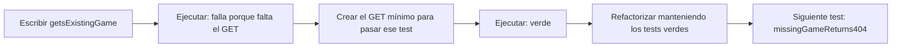

# Sesión 3 — Construir los primeros endpoints de Battleship con TDD

**Proyecto de trabajo:** `02-ejemplos/bshipAlong/`, Spring Boot **4.1.1**, Java 25.
Todos los comandos se ejecutan desde su raíz. En Windows, usa `mvnw.cmd`.

> **Dos trabajos diferentes:** en el code-along construimos **Battleship desde
> cero**. Al terminar, cada estudiante trabaja **individualmente en Mini Tasks**.
> Book Catalog y Gestión de eventos serán tareas **en grupo**, por ese orden,
> cuando se cierre la anterior. Battleship no es una entrega evaluable.

## 0. Punto de partida y contrato de esta sesión

Partimos de lo construido en la sesión 2, no de abrir el Battleship terminado:

- Paquete raíz `es.daw2a.bshipalong` y clase `BattleShipAlongApplication`.
- `domain/Game`: `id`, `status`, constructor que fija `PENDING` y dos getters.
- `domain/GameStatus`: `PENDING`, `IN_PROGRESS`, `FINISHED`.
- `GameTest.newGameShouldBePending` y test de carga de contexto.
- `db/migration/V1__create_games_table.sql`, con tabla **`games`**, `id` y `status`.

```bash
./mvnw test
```

Hoy vamos a construir este contrato **intermedio**:

| Petición | Respuesta |
|---|---|
| `GET /api/games/{id}` existente | `200`, JSON con `id` y `status` |
| `GET /api/games/{id}` inexistente | `404`, sin cuerpo |
| `POST /api/games` sin cuerpo | `201`, `Location` y JSON de la partida `PENDING` |
| `GET /api/games` | `200`, array JSON |
| `GET /api/games?status=PENDING` | `200`, array filtrado |

Todavía no hay tamaño de tablero en el contrato, DTOs, servicio, barcos, ataques
ni autenticación. Son evoluciones que construiremos después. No se envía aún
`{"boardSize":10}` ni se necesita un token. En cada ciclo: **test → rojo →
implementación mínima → verde → refactor**.

## 1. Preparar JPA sin adelantar funcionalidad

El proyecto de clase tiene `jakarta.persistence-api`: eso permite compilar
`@Entity`, pero **no instala Hibernate ni Spring Data JPA**. Añade esta dependencia
dentro de `<dependencies>` del POM (sin repetirla si ya está):

<!-- dependencia: pom.xml -->
```xml
<dependency>
    <groupId>org.springframework.boot</groupId>
    <artifactId>spring-boot-starter-data-jpa</artifactId>
</dependency>
```

Puedes retirar la dependencia explícita `jakarta.persistence-api:3.2.0`: el starter
ya aporta la versión gestionada por Boot. Conserva las dependencias actuales de
Web MVC, H2, Flyway y `spring-boot-starter-webmvc-test`. **No añadas Spring Security
ahora**: cambiaría las respuestas antes de construir la autenticación.

Recarga Maven en IntelliJ. Sustituye `src/main/resources/application.yaml` por:

<!-- archivo: src/main/resources/application.yaml -->
```yaml
spring:
  application:
    name: bshipAlong
  datasource:
    url: jdbc:h2:mem:bshipalong;DB_CLOSE_DELAY=-1
    username: sa
    password: ""
  jpa:
    open-in-view: false
    hibernate:
      ddl-auto: validate
  flyway:
    enabled: true
```

Mantén **sin modificar** la migración V1 de la sesión anterior:

```sql
CREATE TABLE games (
    id BIGINT GENERATED BY DEFAULT AS IDENTITY PRIMARY KEY,
    status VARCHAR(20) NOT NULL
);
```

No añadimos una migración con datos de ejemplo: las pruebas crean sus propios
datos. La configuración fija la base local y obliga a Hibernate a **validar** lo
que Flyway crea. Antes, el test de contexto no comprobaba el mapeo JPA; ahora sí.

```bash
./mvnw test
```
<!-- comprobar: verde * -->

Si falla aquí, es un problema de preparación; no es el rojo del endpoint.

## 2. Preparar el límite del test web

El repositorio es una interfaz; Spring Data proporciona su implementación:

<!-- archivo: src/main/java/es/daw2a/bshipalong/repository/GameRepository.java -->
```java
package es.daw2a.bshipalong.repository;

import es.daw2a.bshipalong.domain.Game;
import org.springframework.data.jpa.repository.JpaRepository;

public interface GameRepository extends JpaRepository<Game, Long> {
}
```

Para preparar partidas con un id conocido en los mocks, añade `setId`. El resto
de la entidad sigue igual:

<!-- archivo: src/main/java/es/daw2a/bshipalong/domain/Game.java -->
```java
package es.daw2a.bshipalong.domain;

import jakarta.persistence.*;

@Entity
@Table(name = "games")
public class Game {
    @Id
    @GeneratedValue(strategy = GenerationType.IDENTITY)
    private Long id;

    @Enumerated(EnumType.STRING)
    private GameStatus status;

    public Game() {
        this.status = GameStatus.PENDING;
    }

    public GameStatus getStatus() {
        return status;
    }

    public Long getId() {
        return id;
    }

    public void setId(Long id) {
        this.id = id;
    }
}
```

En una creación real el id lo genera la base de datos, no el cliente. El setter
nos permite simular ese resultado; el POST no recibe una entidad del usuario.

## 3. Primer ciclo: consultar una partida existente

### Mapa del ciclo (para no empezar por la solución)



Si el visor de Markdown no dibuja Mermaid, la lectura es la misma:
**test concreto → ejecutar y entender el rojo → código mínimo para ese test →
verde → refactorizar → siguiente test**. No se escribe todo el controlador y
después se buscan tests que lo confirmen. Refactorizar mejora la estructura sin
añadir comportamiento ni cambiar el resultado observado.

### Rojo: escribir primero el test

Crea este archivo completo. Los imports y el método auxiliar servirán también
para los siguientes casos; **todavía no escribas el controlador funcional**.

<!-- archivo: src/test/java/es/daw2a/bshipalong/web/GameControllerTest.java -->
```java
package es.daw2a.bshipalong.web;

import es.daw2a.bshipalong.domain.Game;
import es.daw2a.bshipalong.repository.GameRepository;
import org.junit.jupiter.api.Test;
import org.springframework.beans.factory.annotation.Autowired;
import org.springframework.boot.webmvc.test.autoconfigure.WebMvcTest;
import org.springframework.test.context.bean.override.mockito.MockitoBean;
import org.springframework.test.web.servlet.MockMvc;

import java.util.List;
import java.util.Optional;

import static org.hamcrest.Matchers.hasSize;
import static org.mockito.ArgumentMatchers.any;
import static org.mockito.Mockito.when;
import static org.springframework.test.web.servlet.request.MockMvcRequestBuilders.*;
import static org.springframework.test.web.servlet.result.MockMvcResultMatchers.*;

@WebMvcTest(GameController.class)
class GameControllerTest {
    @Autowired MockMvc mvc;
    @MockitoBean GameRepository repository;

    private Game pendingGame(long id) {
        Game game = new Game();
        game.setId(id);
        return game;
    }

    @Test
    void getsExistingGame() throws Exception {
        when(repository.findById(17L)).thenReturn(Optional.of(pendingGame(17L)));

        mvc.perform(get("/api/games/17"))
                .andExpect(status().isOk())
                .andExpect(jsonPath("$.id").value(17))
                .andExpect(jsonPath("$.status").value("PENDING"));
    }
}
```

Al ejecutar, primero faltará `GameController`: es una carencia de estructura.
Crea **solo el esqueleto** para poder observar después un fallo HTTP:

<!-- archivo: src/main/java/es/daw2a/bshipalong/web/GameController.java -->
```java
package es.daw2a.bshipalong.web;

import es.daw2a.bshipalong.repository.GameRepository;
import org.springframework.web.bind.annotation.*;

@RestController
@RequestMapping("/api/games")
public class GameController {
    private final GameRepository repository;

    public GameController(GameRepository repository) {
        this.repository = repository;
    }
}
```

```bash
./mvnw -Dtest=GameControllerTest#getsExistingGame test
```
<!-- comprobar: rojo GameControllerTest#getsExistingGame -->

Ahora compila, pero devuelve `404` en lugar de `200`: falta la ruta. MockMvc
ejecuta MVC sin abrir un puerto; el repositorio es un mock, no una base de datos.
En Boot 4 el import de `WebMvcTest` es **`org.springframework.boot.webmvc.test.autoconfigure`**.

### Verde: resolver la consulta conocida

Sustituye el controlador completo por:

<!-- archivo: src/main/java/es/daw2a/bshipalong/web/GameController.java -->
```java
package es.daw2a.bshipalong.web;

import es.daw2a.bshipalong.domain.Game;
import es.daw2a.bshipalong.repository.GameRepository;
import org.springframework.http.ResponseEntity;
import org.springframework.web.bind.annotation.*;

@RestController
@RequestMapping("/api/games")
public class GameController {
    private final GameRepository repository;

    public GameController(GameRepository repository) {
        this.repository = repository;
    }

    @GetMapping("/{id}")
    public ResponseEntity<Game> get(@PathVariable("id") Long id) {
        return ResponseEntity.ok(repository.findById(id).orElseThrow());
    }
}
```

```bash
./mvnw -Dtest=GameControllerTest test
```
<!-- comprobar: verde GameControllerTest -->

La consulta existente pasa. No hemos definido aún cómo traducir un `Optional`
vacío a HTTP: ese será el siguiente comportamiento, no un arreglo improvisado.

## 4. Segundo ciclo: recurso inexistente → 404

Añade este método **dentro de `GameControllerTest`**, antes de su última llave:

<!-- añadir: src/test/java/es/daw2a/bshipalong/web/GameControllerTest.java -->
```java
    @Test
    void missingGameReturns404() throws Exception {
        when(repository.findById(999L)).thenReturn(Optional.empty());

        mvc.perform(get("/api/games/999"))
                .andExpect(status().isNotFound())
                .andExpect(content().string(""));
    }
```

```bash
./mvnw -Dtest=GameControllerTest#missingGameReturns404 test
```
<!-- comprobar: rojo GameControllerTest#missingGameReturns404 -->

Falla porque `orElseThrow()` lanza una excepción sin traducción HTTP. Cambia el
controlador por esta versión, que conserva el caso anterior:

<!-- archivo: src/main/java/es/daw2a/bshipalong/web/GameController.java -->
```java
package es.daw2a.bshipalong.web;

import es.daw2a.bshipalong.domain.Game;
import es.daw2a.bshipalong.repository.GameRepository;
import org.springframework.http.ResponseEntity;
import org.springframework.web.bind.annotation.*;

@RestController
@RequestMapping("/api/games")
public class GameController {
    private final GameRepository repository;

    public GameController(GameRepository repository) {
        this.repository = repository;
    }

    @GetMapping("/{id}")
    public ResponseEntity<Game> get(@PathVariable("id") Long id) {
        return repository.findById(id)
                .map(ResponseEntity::ok)
                .orElseGet(() -> ResponseEntity.notFound().build());
    }
}
```

```bash
./mvnw -Dtest=GameControllerTest test
```
<!-- comprobar: verde GameControllerTest -->

Dos tests verdes. Por ahora el 404 no lleva cuerpo; el payload común de errores
se construirá en su sesión. No añadimos todavía un handler genérico.

## 5. Tercer ciclo: crear → 201 + Location

Añade a la clase de test:

<!-- añadir: src/test/java/es/daw2a/bshipalong/web/GameControllerTest.java -->
```java
    @Test
    void createsPendingGameWithLocation() throws Exception {
        when(repository.save(any(Game.class))).thenAnswer(invocation -> {
            Game game = invocation.getArgument(0);
            game.setId(99L);
            return game;
        });

        mvc.perform(post("/api/games"))
                .andExpect(status().isCreated())
                .andExpect(header().string("Location", "/api/games/99"))
                .andExpect(jsonPath("$.id").value(99))
                .andExpect(jsonPath("$.status").value("PENDING"));
    }
```

```bash
./mvnw -Dtest=GameControllerTest#createsPendingGameWithLocation test
```
<!-- comprobar: rojo GameControllerTest#createsPendingGameWithLocation -->

Falta el endpoint de creación. Sustituye el controlador completo:

<!-- archivo: src/main/java/es/daw2a/bshipalong/web/GameController.java -->
```java
package es.daw2a.bshipalong.web;

import es.daw2a.bshipalong.domain.Game;
import es.daw2a.bshipalong.repository.GameRepository;
import org.springframework.http.ResponseEntity;
import org.springframework.web.bind.annotation.*;

import java.net.URI;

@RestController
@RequestMapping("/api/games")
public class GameController {
    private final GameRepository repository;

    public GameController(GameRepository repository) {
        this.repository = repository;
    }

    @GetMapping("/{id}")
    public ResponseEntity<Game> get(@PathVariable("id") Long id) {
        return repository.findById(id)
                .map(ResponseEntity::ok)
                .orElseGet(() -> ResponseEntity.notFound().build());
    }

    @PostMapping
    public ResponseEntity<Game> create() {
        Game saved = repository.save(new Game());
        return ResponseEntity.created(URI.create("/api/games/" + saved.getId()))
                .body(saved);
    }
}
```

```bash
./mvnw -Dtest=GameControllerTest test
```
<!-- comprobar: verde GameControllerTest -->

El mock simula que la base asigna `99`; no estamos fijando ese id en producción.
`201` significa que se ha creado el recurso y `Location` dice dónde consultarlo.

## 6. Cuarto ciclo: listar

Añade al test:

<!-- añadir: src/test/java/es/daw2a/bshipalong/web/GameControllerTest.java -->
```java
    @Test
    void listsGames() throws Exception {
        when(repository.findAll()).thenReturn(List.of(pendingGame(1L), pendingGame(2L)));

        mvc.perform(get("/api/games"))
                .andExpect(status().isOk())
                .andExpect(jsonPath("$", hasSize(2)))
                .andExpect(jsonPath("$[0].id").value(1));
    }
```

```bash
./mvnw -Dtest=GameControllerTest#listsGames test
```
<!-- comprobar: rojo GameControllerTest#listsGames -->

Falta el GET de colección. Para dejarlo verde, añade este método al controlador,
junto a los anteriores, antes de la última llave. El tipo de lista se escribe
completo para no necesitar otro import en este paso:

<!-- añadir: src/main/java/es/daw2a/bshipalong/web/GameController.java -->
```java
    @GetMapping
    public java.util.List<Game> list() {
        return repository.findAll();
    }
```

```bash
./mvnw -Dtest=GameControllerTest test
```
<!-- comprobar: verde GameControllerTest -->

## 7. Quinto ciclo: filtrar con @RequestParam

Añade una prueba que distinga el resultado filtrado de listar todo:

<!-- añadir: src/test/java/es/daw2a/bshipalong/web/GameControllerTest.java -->
```java
    @Test
    void filtersByStatus() throws Exception {
        when(repository.findAll()).thenReturn(List.of(pendingGame(1L), pendingGame(2L)));

        mvc.perform(get("/api/games").param("status", "IN_PROGRESS"))
                .andExpect(status().isOk())
                .andExpect(jsonPath("$", hasSize(0)));
    }
```

```bash
./mvnw -Dtest=GameControllerTest#filtersByStatus test
```
<!-- comprobar: rojo GameControllerTest#filtersByStatus -->

El GET anterior ignora `status` y devuelve dos partidas en lugar de cero.
Sustituye el controlador por esta versión completa de cierre; en particular,
**reemplaza** el método `list`, no mantengas dos `@GetMapping` sin ruta:

<!-- archivo: src/main/java/es/daw2a/bshipalong/web/GameController.java -->
```java
package es.daw2a.bshipalong.web;

import es.daw2a.bshipalong.domain.Game;
import es.daw2a.bshipalong.domain.GameStatus;
import es.daw2a.bshipalong.repository.GameRepository;
import org.springframework.http.ResponseEntity;
import org.springframework.web.bind.annotation.*;

import java.net.URI;
import java.util.List;

@RestController
@RequestMapping("/api/games")
public class GameController {
    private final GameRepository repository;

    public GameController(GameRepository repository) {
        this.repository = repository;
    }

    @GetMapping("/{id}")
    public ResponseEntity<Game> get(@PathVariable("id") Long id) {
        return repository.findById(id)
                .map(ResponseEntity::ok)
                .orElseGet(() -> ResponseEntity.notFound().build());
    }

    @PostMapping
    public ResponseEntity<Game> create() {
        Game saved = repository.save(new Game());
        return ResponseEntity.created(URI.create("/api/games/" + saved.getId()))
                .body(saved);
    }

    @GetMapping
    public List<Game> list(@RequestParam(name = "status", required = false) GameStatus status) {
        List<Game> games = repository.findAll();
        if (status == null) return games;
        return games.stream().filter(game -> game.getStatus() == status).toList();
    }
}
```

```bash
./mvnw -Dtest=GameControllerTest test
```
<!-- comprobar: verde GameControllerTest -->

Refactor: revisa nombres y elimina imports sin uso. El filtrado está en el
controlador **solo en este checkpoint**. En la sesión 4 se trasladará al servicio
sin perder el comportamiento observado por estos tests.

## 8. Comprobar el ensamblaje con persistencia real

Los cinco tests MVC prueban las rutas y el JSON, pero **el repositorio es falso**:
nosotros le hemos indicado qué devolver. Podrían pasar aunque la tabla no
existiera o aunque la entidad estuviera mal mapeada.

El test de integración plantea otra pregunta: **«¿Colaboran de verdad todas las
piezas para crear una partida y recuperarla?»**. Antes de copiarlo, dibuja este
recorrido (MockMvc no abre un puerto):

```text
GameHttpIntegrationTest
    → MockMvc → GameController → GameRepository real → Hibernate → H2
                                                              ↑
                                   tablas creadas por Flyway al arrancar
```

- `@SpringBootTest` carga la aplicación, no solo el controlador.
- `@AutoConfigureMockMvc` permite enviar peticiones a ese contexto desde el test.
- No hay `@MockitoBean`: Spring inyecta el repositorio real.
- `@Transactional` revierte los datos al terminar para aislar este escenario.

Añade este archivo completo:

<!-- archivo: src/test/java/es/daw2a/bshipalong/web/GameHttpIntegrationTest.java -->
```java
package es.daw2a.bshipalong.web;

import org.junit.jupiter.api.Test;
import org.springframework.beans.factory.annotation.Autowired;
import org.springframework.boot.test.context.SpringBootTest;
import org.springframework.boot.webmvc.test.autoconfigure.AutoConfigureMockMvc;
import org.springframework.test.web.servlet.MockMvc;
import org.springframework.transaction.annotation.Transactional;

import static org.hamcrest.Matchers.hasSize;
import static org.hamcrest.Matchers.startsWith;
import static org.springframework.test.web.servlet.request.MockMvcRequestBuilders.*;
import static org.springframework.test.web.servlet.result.MockMvcResultMatchers.*;

@SpringBootTest
@AutoConfigureMockMvc
@Transactional
class GameHttpIntegrationTest {
    @Autowired MockMvc mvc;

    @Test
    void createsPersistsAndRetrievesGame() throws Exception {
        String location = mvc.perform(post("/api/games"))
                .andExpect(status().isCreated())
                .andExpect(header().string("Location", startsWith("/api/games/")))
                .andExpect(jsonPath("$.status").value("PENDING"))
                .andReturn().getResponse().getHeader("Location");

        mvc.perform(get(location))
                .andExpect(status().isOk())
                .andExpect(jsonPath("$.status").value("PENDING"));

        mvc.perform(get("/api/games").param("status", "PENDING"))
                .andExpect(status().isOk())
                .andExpect(jsonPath("$", hasSize(1)));
    }
}
```

Aquí no hay mocks: la petición pasa por controlador, repositorio y H2. Flyway
crea `games` y Hibernate valida el esquema. `@Transactional` revierte los datos
al terminar; no dependemos de un id concreto ni de filas sembradas previamente.
Esta es una comprobación de integración del comportamiento ya construido.

### Leer el test en tres pasos

1. **Crear:** el POST exige `201`, comprueba `PENDING` y captura `Location`.
   No suponemos que la base asigne el id 1 ni que las secuencias se reinicien
   después de cada test.
2. **Recuperar:** el GET a la URL capturada comprueba que la creación se puede
   consultar por el recorrido real. Si el POST no guardase la partida, fallaría.
3. **Listar:** el filtro `PENDING` debe encontrar la partida recién creada.
   Todo ocurre en un único escenario; no son tres tests que comparten estado.

Este test no pretende volver a comprobar todos los casos del controlador: une
las piezas. Un error de conexión, migración o mapeo se investiga en el arranque;
un `404` al seguir `Location` se investiga en guardado/consulta. La prueba usa una
transacción de test y puede reutilizar el contexto de persistencia: no demuestra
por sí sola que los datos sobrevivan a un reinicio de la aplicación.

Para explicarlo en clase: **«En el test MVC le digo al mock lo que debe devolver;
en la integración espero que la aplicación consiga el resultado por sí misma»**.

```bash
./mvnw test
```
<!-- comprobar: verde * -->

Resultado de cierre: **8 pruebas** (las 2 iniciales, 5 MVC y 1 de integración).
También puedes probarlo con red:

```bash
./mvnw spring-boot:run
# En otra terminal:
curl -i -X POST http://localhost:8080/api/games
# Copia la Location de la respuesta anterior; no supongas que el id es siempre 1.
curl -i http://localhost:8080/api/games/1
curl -i http://localhost:8080/api/games/999
curl 'http://localhost:8080/api/games?status=PENDING'
```

## 9. Checkpoint y enlace con la sesión 4

- [ ] `GameTest` sigue verde: `new Game()` es `PENDING`.
- [ ] `GameControllerTest`: cinco comportamientos HTTP comprobados.
- [ ] `GameHttpIntegrationTest`: creación y lectura sobre H2 real.
- [ ] `GameRepository` extiende `JpaRepository<Game, Long>`.
- [ ] Tabla `games`, V1 original y `ddl-auto: validate`, sin seed.
- [ ] No hay servicio ni DTOs todavía; el controlador devuelve `Game`.
- [ ] Guarda un commit propio que identifique este checkpoint de sesión 3.

La siguiente sesión partirá **exactamente de estos archivos** para introducir
servicio y DTOs. Documentará también cómo evolucionar `Game`, sus estados y el
esquema hasta la referencia final; no se sobrescribirá una migración ya aplicada.
Continúa con la [sesión 4, servicio y DTOs](04-capa-servicios-dtos.md), después de
completar la integración pendiente. El proyecto terminado `battleship/` sirve para
contrastar el destino, no para sustituir el proyecto que estamos construyendo.

## 10. Trabajo individual — Mini Tasks, avance de sesión 3

**Modalidad: individual.** Continúa tu propio fork según el
[enunciado de Mini Tasks](../../../03-ejercicios/01-mini-tasks/README.md).
Si antes se preparó un fork de grupo, cada estudiante debe disponer ahora de una
copia propia con historial y cambios personales identificables. La plantilla
conserva `main` en `v4`; las etiquetas sirven para estudiar la evolución. No
ejecutes `setup-history.sh` ni sustituyas `main` por una etiqueta para entregar.

### Qué hacer hoy

1. Localiza `TaskControllerV1`/`TaskControllerV2`, `SimpleTask` y `CreateTaskDTO`.
   Sus rutas son `/v1/tasks` y `/v2/tasks`; no las confundas con `/api/games`.
   El campo de estado es **`done`**, no `completed`.
2. Comprueba mediante tests MVC el listado y la creación de V1 y el `201` con
   `Location` de V2. Leer/probar lo ya implementado es reconocimiento del código,
   no evidencia de haberlo desarrollado con TDD.
3. Aplica un ciclo TDD propio a una capacidad que V1 aún no ofrece:
   **`GET /v1/tasks/{id}`**, primero para una tarea creada y después para un id
   inexistente (`404`). Cada caso debe fallar antes de su implementación.
   En V1 los datos están en memoria: crea la tarea y consúltala dentro del mismo
   test; no dependas de lo que hiciera otro método de prueba.
4. Ejecuta las pruebas y deja en `aprendizaje.md` qué test produjo el rojo,
   por qué falló y qué cambio lo hizo pasar. Registra commits pequeños propios.

Este avance no completa Mini Tasks: después se trabajará la funcionalidad
vertical con servicio, repositorio JPA y pruebas del enunciado. No se exige hoy
añadir validación, Flyway ni OpenAPI a Mini Tasks. No se abre todavía Book Catalog.

### Evidencia de este avance

- Código y tests en tu repositorio individual; URL en la tarea de Moodle de
  **Mini Tasks (15 % de UD2a)**, sin crear otro ítem de nota para «sesión 3».
- `aprendizaje.md`, declaración de IA y autoría individual de los commits.
- Al cierre, anota el último test verde o el bloqueo concreto si no lo terminaste.

El profesor reserva un bloque de trabajo para este avance. Book Catalog y
Gestión de eventos mantienen modalidad grupal y se habilitarán sucesivamente.
