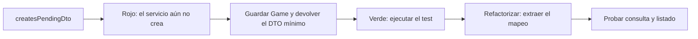

# Sesión 4 — Extraer el servicio y separar el DTO con pruebas

**Code-along:** `02-ejemplos/bshipAlong/`, Boot **4.1.1**, Java 25.
**Antes:** completar el [test de integración de sesión 3](03-controladores-rest.md#8-comprobar-el-ensamblaje-con-persistencia-real).
**Después:** [4b, construcción de las reglas](04b-reglas-de-negocio.md).

> Battleship se construye en clase. El trabajo final sigue siendo **Mini Tasks
> individual**; Book Catalog y Gestión de eventos vendrán después, en grupo.

## 1. Contrato que debemos conservar

Al comenzar hay ocho pruebas verdes. `Game` tiene `id` y `status`, la tabla sigue
siendo `games` y el POST todavía no recibe cuerpo. El listado es un array, con
filtro opcional `status`. El GET inexistente responde `404` sin cuerpo.

No añadimos tamaño de tablero ni editamos V1 durante esta extracción. Primero
cambiamos la estructura **sin cambiar el contrato**; el modelo crecerá en 4b.
Consulta la [teoría de servicios](../../../01-documentacion/04-capa-servicios.md)
como apoyo: el recorrido ejecutable de Battleship es este documento.

```text
ANTES: petición → controlador → repositorio → H2
AHORA: petición → controlador → servicio → repositorio → H2
                                  ↓
                         GameResponseDTO hacia HTTP
```

- **Controlador:** rutas, parámetros, códigos y `Location`.
- **Servicio:** casos de uso y transformación a DTO; después, reglas del juego.
- **Repositorio:** acceso a los datos.
- **Entidad:** representación persistente; **DTO:** representación pública.

## 2. Definir la salida y el fallo de consulta

Un DTO no necesita las columnas que tendrá la entidad dentro de tres sesiones.
Empezamos con los dos campos que el cliente ya conoce.

<!-- archivo: src/main/java/es/daw2a/bshipalong/dto/GameResponseDTO.java -->
```java
package es.daw2a.bshipalong.dto;

public record GameResponseDTO(Long id, String status) {
}
```

La ausencia de una partida tendrá una excepción propia, sin dependencia de HTTP:

<!-- archivo: src/main/java/es/daw2a/bshipalong/domain/exceptions/GameNotFoundException.java -->
```java
package es.daw2a.bshipalong.domain.exceptions;

public class GameNotFoundException extends RuntimeException {
    public GameNotFoundException(Long id) {
        super("Game not found: " + id);
    }
}
```

No usamos `IllegalArgumentException` para todo: después necesitaremos distinguir
un recurso inexistente de una regla incumplida.

## 3. Diseñar el servicio desde una primera prueba

Crea el test **antes** de la implementación. Es una prueba unitaria: JUnit y
Mockito, sin `@SpringBootTest`, servidor, Flyway ni base de datos.

<!-- archivo: src/test/java/es/daw2a/bshipalong/service/GameServiceTest.java -->
```java
package es.daw2a.bshipalong.service;

import es.daw2a.bshipalong.domain.Game;
import es.daw2a.bshipalong.domain.GameStatus;
import es.daw2a.bshipalong.domain.exceptions.GameNotFoundException;
import es.daw2a.bshipalong.repository.GameRepository;
import org.junit.jupiter.api.Test;
import org.junit.jupiter.api.extension.ExtendWith;
import org.mockito.InjectMocks;
import org.mockito.Mock;
import org.mockito.junit.jupiter.MockitoExtension;

import java.util.List;
import java.util.Optional;

import static org.assertj.core.api.Assertions.*;
import static org.mockito.ArgumentMatchers.any;
import static org.mockito.Mockito.*;

@ExtendWith(MockitoExtension.class)
class GameServiceTest {
    @Mock GameRepository repository;
    @InjectMocks GameService service;

    private Game pending(long id) {
        Game game = new Game();
        game.setId(id);
        return game;
    }

    @Test
    void createsPendingDto() {
        when(repository.save(any(Game.class))).thenAnswer(call -> {
            Game game = call.getArgument(0);
            game.setId(17L);
            return game;
        });
        var result = service.createGame();
        assertThat(result.id()).isEqualTo(17L);
        assertThat(result.status()).isEqualTo("PENDING");
    }
}
```

Primero faltará la clase. Añade únicamente la estructura que permita compilar:

<!-- archivo: src/main/java/es/daw2a/bshipalong/service/GameService.java -->
```java
package es.daw2a.bshipalong.service;

import es.daw2a.bshipalong.dto.GameResponseDTO;
import es.daw2a.bshipalong.repository.GameRepository;

public class GameService {
    private final GameRepository repository;

    public GameService(GameRepository repository) {
        this.repository = repository;
    }

    public GameResponseDTO createGame() {
        throw new UnsupportedOperationException("Pending implementation");
    }
}
```

```bash
./mvnw -Dtest=GameServiceTest#createsPendingDto test
```
<!-- comprobar: rojo GameServiceTest#createsPendingDto -->



Sin renderizador: **test → rojo → implementación mínima → verde → refactor**.
No se escribe un servicio completo antes de ejecutar la primera prueba.

Sustituye el servicio por la versión mínima de creación:

<!-- archivo: src/main/java/es/daw2a/bshipalong/service/GameService.java -->
```java
package es.daw2a.bshipalong.service;

import es.daw2a.bshipalong.domain.Game;
import es.daw2a.bshipalong.dto.GameResponseDTO;
import es.daw2a.bshipalong.repository.GameRepository;

public class GameService {
    private final GameRepository repository;

    public GameService(GameRepository repository) {
        this.repository = repository;
    }

    public GameResponseDTO createGame() {
        Game saved = repository.save(new Game());
        return new GameResponseDTO(saved.getId(), saved.getStatus().name());
    }
}
```

```bash
./mvnw -Dtest=GameServiceTest test
```
<!-- comprobar: verde GameServiceTest -->

## 4. Consulta y listado, una expectativa cada vez

Los siguientes métodos se añaden **dentro de la clase**, antes de la última
llave. Primero el caso de consulta:

<!-- añadir: src/test/java/es/daw2a/bshipalong/service/GameServiceTest.java -->
```java
    @Test
    void retrievesDto() {
        when(repository.findById(17L)).thenReturn(Optional.of(pending(17L)));
        assertThat(service.getGame(17L).id()).isEqualTo(17L);
    }
```

Para compilar, añade la firma todavía sin resolver el caso:

<!-- añadir: src/main/java/es/daw2a/bshipalong/service/GameService.java -->
```java
    public GameResponseDTO getGame(Long id) {
        throw new UnsupportedOperationException("Pending lookup");
    }
```

```bash
./mvnw -Dtest=GameServiceTest#retrievesDto test
```
<!-- comprobar: rojo GameServiceTest#retrievesDto -->

Sustituye **solo el método `getGame`**. Aquí se introduce el mapeo de consulta;
todavía no se trata la ausencia:

<!-- método: src/main/java/es/daw2a/bshipalong/service/GameService.java#getGame -->
```java
    public GameResponseDTO getGame(Long id) {
        Game game = repository.findById(id).orElseThrow();
        return new GameResponseDTO(game.getId(), game.getStatus().name());
    }
```

```bash
./mvnw -Dtest=GameServiceTest test
```
<!-- comprobar: verde GameServiceTest -->

Ahora la consulta inexistente:

<!-- añadir: src/test/java/es/daw2a/bshipalong/service/GameServiceTest.java -->
```java
    @Test
    void missingGameHasSpecificException() {
        when(repository.findById(999L)).thenReturn(Optional.empty());
        assertThatThrownBy(() -> service.getGame(999L))
                .isInstanceOf(GameNotFoundException.class);
    }
```

```bash
./mvnw -Dtest=GameServiceTest#missingGameHasSpecificException test
```
<!-- comprobar: rojo GameServiceTest#missingGameHasSpecificException -->

Sustituye `getGame`; el nombre completo evita necesitar otro import en este paso:

<!-- método: src/main/java/es/daw2a/bshipalong/service/GameService.java#getGame -->
```java
    public GameResponseDTO getGame(Long id) {
        Game game = repository.findById(id).orElseThrow(() ->
                new es.daw2a.bshipalong.domain.exceptions.GameNotFoundException(id));
        return new GameResponseDTO(game.getId(), game.getStatus().name());
    }
```

```bash
./mvnw -Dtest=GameServiceTest test
```
<!-- comprobar: verde GameServiceTest -->

Finalmente el listado con y sin filtro:

<!-- añadir: src/test/java/es/daw2a/bshipalong/service/GameServiceTest.java -->
```java
    @Test
    void listsAndFiltersDtos() {
        when(repository.findAll()).thenReturn(List.of(pending(1L), pending(2L)));
        assertThat(service.listGames(null)).hasSize(2);
        assertThat(service.listGames(GameStatus.PENDING)).hasSize(2);
        assertThat(service.listGames(GameStatus.IN_PROGRESS)).isEmpty();
    }
```

Añade una firma mínima que aún no resuelve el listado:

<!-- añadir: src/main/java/es/daw2a/bshipalong/service/GameService.java -->
```java
    public java.util.List<GameResponseDTO> listGames(
            es.daw2a.bshipalong.domain.GameStatus status) {
        return java.util.List.of();
    }
```

```bash
./mvnw -Dtest=GameServiceTest#listsAndFiltersDtos test
```
<!-- comprobar: rojo GameServiceTest#listsAndFiltersDtos -->

## 5. Verde del listado y refactor del servicio

Esta versión completa añade el listado y concentra el mapeo. Conserva los casos
anteriores. `@Service` permite que Spring cree el bean; `@Transactional` marca
las operaciones, pero **no se activa por hacer `new GameService(...)` en el test
unitario**: esa prueba comprueba lógica, no el proxy transaccional de Spring.

<!-- archivo: src/main/java/es/daw2a/bshipalong/service/GameService.java -->
```java
package es.daw2a.bshipalong.service;

import es.daw2a.bshipalong.domain.Game;
import es.daw2a.bshipalong.domain.GameStatus;
import es.daw2a.bshipalong.domain.exceptions.GameNotFoundException;
import es.daw2a.bshipalong.dto.GameResponseDTO;
import es.daw2a.bshipalong.repository.GameRepository;
import org.springframework.stereotype.Service;
import org.springframework.transaction.annotation.Transactional;

import java.util.List;

@Service
@Transactional
public class GameService {
    private final GameRepository repository;

    public GameService(GameRepository repository) {
        this.repository = repository;
    }

    public GameResponseDTO createGame() {
        return toResponse(repository.save(new Game()));
    }

    @Transactional(readOnly = true)
    public GameResponseDTO getGame(Long id) {
        return toResponse(repository.findById(id)
                .orElseThrow(() -> new GameNotFoundException(id)));
    }

    @Transactional(readOnly = true)
    public List<GameResponseDTO> listGames(GameStatus status) {
        return repository.findAll().stream()
                .filter(game -> status == null || game.getStatus() == status)
                .map(this::toResponse).toList();
    }

    private GameResponseDTO toResponse(Game game) {
        return new GameResponseDTO(game.getId(), game.getStatus().name());
    }
}
```

```bash
./mvnw -Dtest=GameServiceTest test
```
<!-- comprobar: verde GameServiceTest -->

## 6. Refactorizar el borde web manteniendo el contrato

El servicio nuevo todavía no se usa desde HTTP. Ahora sí se extrae el código
del controlador. Sus tests dejan de simular el repositorio y simulan **el servicio**.
Sustituye el archivo de test completo:

<!-- archivo: src/test/java/es/daw2a/bshipalong/web/GameControllerTest.java -->
```java
package es.daw2a.bshipalong.web;

import es.daw2a.bshipalong.domain.GameStatus;
import es.daw2a.bshipalong.domain.exceptions.GameNotFoundException;
import es.daw2a.bshipalong.dto.GameResponseDTO;
import es.daw2a.bshipalong.service.GameService;
import org.junit.jupiter.api.Test;
import org.springframework.beans.factory.annotation.Autowired;
import org.springframework.boot.webmvc.test.autoconfigure.WebMvcTest;
import org.springframework.test.context.bean.override.mockito.MockitoBean;
import org.springframework.test.web.servlet.MockMvc;

import java.util.List;

import static org.hamcrest.Matchers.hasSize;
import static org.mockito.Mockito.when;
import static org.springframework.test.web.servlet.request.MockMvcRequestBuilders.*;
import static org.springframework.test.web.servlet.result.MockMvcResultMatchers.*;

@WebMvcTest(GameController.class)
class GameControllerTest {
    @Autowired MockMvc mvc;
    @MockitoBean GameService service;

    @Test
    void getsExistingGame() throws Exception {
        when(service.getGame(17L)).thenReturn(new GameResponseDTO(17L, "PENDING"));
        mvc.perform(get("/api/games/17")).andExpect(status().isOk())
                .andExpect(jsonPath("$.id").value(17))
                .andExpect(jsonPath("$.status").value("PENDING"));
    }

    @Test
    void missingGameReturns404() throws Exception {
        when(service.getGame(999L)).thenThrow(new GameNotFoundException(999L));
        mvc.perform(get("/api/games/999")).andExpect(status().isNotFound())
                .andExpect(content().string(""));
    }

    @Test
    void createsPendingGameWithLocation() throws Exception {
        when(service.createGame()).thenReturn(new GameResponseDTO(99L, "PENDING"));
        mvc.perform(post("/api/games")).andExpect(status().isCreated())
                .andExpect(header().string("Location", "/api/games/99"))
                .andExpect(jsonPath("$.status").value("PENDING"));
    }

    @Test
    void listsGames() throws Exception {
        when(service.listGames(null)).thenReturn(List.of(new GameResponseDTO(1L, "PENDING")));
        mvc.perform(get("/api/games")).andExpect(status().isOk())
                .andExpect(jsonPath("$", hasSize(1)));
    }

    @Test
    void filtersByStatus() throws Exception {
        when(service.listGames(GameStatus.IN_PROGRESS)).thenReturn(List.of());
        mvc.perform(get("/api/games").param("status", "IN_PROGRESS"))
                .andExpect(status().isOk()).andExpect(jsonPath("$", hasSize(0)));
    }
}
```

Antes de cambiar el controlador, este contexto falla: aún pide un repositorio
que ya no simulamos. Es una incompatibilidad **durante el refactor**, no el rojo
de una funcionalidad nueva. Sustituye el controlador completo:

<!-- archivo: src/main/java/es/daw2a/bshipalong/web/GameController.java -->
```java
package es.daw2a.bshipalong.web;

import es.daw2a.bshipalong.domain.GameStatus;
import es.daw2a.bshipalong.domain.exceptions.GameNotFoundException;
import es.daw2a.bshipalong.dto.GameResponseDTO;
import es.daw2a.bshipalong.service.GameService;
import org.springframework.http.ResponseEntity;
import org.springframework.web.bind.annotation.*;

import java.net.URI;
import java.util.List;

@RestController
@RequestMapping("/api/games")
public class GameController {
    private final GameService service;

    public GameController(GameService service) {
        this.service = service;
    }

    @GetMapping("/{id}")
    public ResponseEntity<GameResponseDTO> get(@PathVariable("id") Long id) {
        try {
            return ResponseEntity.ok(service.getGame(id));
        } catch (GameNotFoundException ex) {
            return ResponseEntity.notFound().build();
        }
    }

    @PostMapping
    public ResponseEntity<GameResponseDTO> create() {
        var created = service.createGame();
        return ResponseEntity.created(URI.create("/api/games/" + created.id())).body(created);
    }

    @GetMapping
    public List<GameResponseDTO> list(
            @RequestParam(name = "status", required = false) GameStatus status) {
        return service.listGames(status);
    }
}
```

```bash
./mvnw test
```
<!-- comprobar: verde * -->

**Checkpoint: 12 pruebas verdes** (las ocho anteriores y cuatro del servicio).
El test de integración de sesión 3 se conserva **sin cambiar**: prueba el mismo
contrato aunque ahora el recorrido incluya el servicio y el DTO.

El `try/catch` específico es transitorio: en la sesión 5 se llevará a un advice.
Ninguna clase del servicio necesita importar `ResponseEntity` o `HttpStatus`.

## 7. Qué queda construido y cómo seguimos

Hoy no hemos creado un juego completo: hemos construido su separación por capas.
Se conserva V1 y no se necesita una dependencia nueva para este tramo. Guarda
un checkpoint antes de continuar con 4b, que sí añadirá:

1. Tamaño de tablero, fecha y DTO de entrada, con nuevas migraciones.
2. Estados finales, cancelación lógica, barcos y ataques.
3. Reglas y sus pruebas, una a una, más los endpoints que las exponen.

La guía 4b es la continuación; no basta con copiar sus métodos sobre el `Game`
mínimo de sesión 3. Sus pasos de preparación forman parte del recorrido.

## 8. Mini Tasks individual — trabajo de esta sesión

**Reserva de clase: al menos 40 minutos.** Continúa tu fork, sin abrir Book Catalog.

1. Si está pendiente, cierra el GET por id/404 de V1 de la sesión anterior.
2. Localiza `services.TaskService` y `web.TaskControllerV4` del starter `main`/v4.
   El servicio ya existe: no se considera trabajo nuevo copiarlo.
3. Implementa con TDD esta regla nueva de creación: **el título se guarda sin
   espacios en sus extremos**, manteniendo los interiores y `done=false`.
   Por ejemplo, `"  Repasar Spring Boot  "` se almacena como `"Repasar Spring Boot"`.
4. Antes de implementar, escribe `createStripsTitleEdges` con repositorio mock.
   Haz que `save` devuelva su argumento y comprueba el título de la tarea devuelta.
   Debe fallar con el servicio inicial, que guarda `dto.title()` sin normalizar.
5. Implementa lo mínimo en el servicio (`String.strip()` puede servir), vuelve a
   verde y añade un caso que conserve `"Repasar Spring Boot"` y `done=false`.
6. Conserva las pruebas MVC existentes y registra rojo, cambio y verde en
   `aprendizaje.md`, con commits y declaración de IA propios.

No cambies las rutas del starter para que coincidan con Battleship. Este avance
se añade a la misma actividad individual del 15 %, no a una entrega nueva.
Si tu copia ya normaliza títulos, comunícalo antes de elegir otro caso: no
simules un rojo sobre una capacidad ya resuelta.
