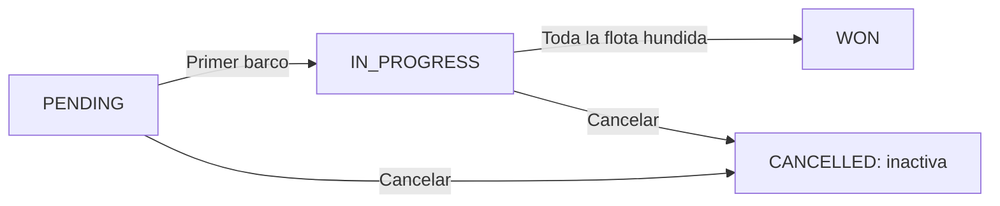

# Tramo 4b — Construir el modelo y las reglas de Battleship

**Continuación del checkpoint de [sesión 4](04-capa-servicios-dtos.md)**:
`bshipAlong`, Boot **4.1.1**, Java 25, paquete `es.daw2a.bshipalong`.

> Este documento contiene varios ciclos de construcción. **No se presupone que
> quepa entero en la clase de 3 horas de sesión 4**. Se guarda el último ciclo
> verde y se continúa desde allí. Mini Tasks sigue siendo individual.

## 0. Alcance y relación con la referencia final

Entramos con entidad mínima, servicio, DTO de salida y doce pruebas verdes.
Salimos con tamaño/fecha, barcos, ataques, hundimiento, victoria y cancelación
lógica, expuestos por HTTP y probados. Seguridad, paginación, payload uniforme
de errores, OpenAPI y producción se construirán después.

### Puntos de corte: no hay que terminar todo de una vez

El checkpoint de entrada tiene **12 pruebas**. Para una clase de dos horas, el
objetivo razonable es llegar a crear el tablero solicitado, colocar el primer
barco y, si el ritmo acompaña, comprobar sus límites. Se continúa desde el último
verde, no saltando a la implementación final para poder empezar 05.

| Tramo terminado | Pruebas de la suite completa | Qué se puede demostrar |
|---|---:|---|
| Preparación y creación con tamaño, apartado 2 | 13 | POST con `boardSize` y persistencia del nuevo modelo |
| Primer barco, apartado 3 | 14 | Colocación y paso a `IN_PROGRESS` |
| Límites, primer ciclo del apartado 4 | 15 | Rechazo de barcos que no caben |
| Nombre y solapamiento, final del apartado 4 | 17 | Restricciones de colocación |
| Estado y agua/impacto, primeros ciclos del apartado 5 | 19 | Disparos básicos |
| Coordenada repetida, final del apartado 5 | 20 | Rechazo de disparos duplicados |
| Hundimiento y victoria, antes del último ciclo del apartado 6 | 22 | Flota hundida y `WON` |
| Restricción tras victoria y cancelación, final del apartado 7 | 25 | No colocar tras ganar; cancelación con histórico |
| Flujo HTTP, apartado 8 | 28 | Operaciones reales por HTTP simulado |
| Actualización con datos anteriores, apartado 8.1 | 29 | Checkpoint completo para empezar 05 |

Estos recuentos corresponden a los archivos de esta guía. Si añadiste tests
propios, el número puede ser mayor: conserva sus comportamientos. Hasta completar
un caso, las firmas preparadas para operaciones posteriores no se consideran
funcionalidad disponible. Demuestra solo lo que ya está probado.

Esta API es el juego simplificado de la referencia: **no tiene todavía jugadores
ni turnos alternos**. Al colocar el primer barco pasa a `IN_PROGRESS`; se pueden
añadir más barcos mientras esté en curso. Gana al hundir la flota. Una partida
pendiente o en curso puede cancelarse; una ganada no. No introducir aquí reglas
del juego de mesa que el proyecto de referencia no implementa.



Sin visor Mermaid: `PENDING → IN_PROGRESS → WON`; desde los dos primeros se
puede pasar a `CANCELLED`. Las peticiones no aceptan un campo `status` para
forzar estas transiciones.

## 1. Preparar las piezas que antes faltaban

Este apartado es **preparación estructural**, no prueba de haber implementado
reglas. No saltes directamente a los métodos del servicio.

### 1.1. Validación y migraciones nuevas

Añade al POM, dentro de `<dependencies>`, y recarga Maven:

<!-- dependencia: pom.xml -->
```xml
<dependency>
    <groupId>org.springframework.boot</groupId>
    <artifactId>spring-boot-starter-validation</artifactId>
</dependency>
```

Conserva V1 sin editar. Crea **V2**, que evoluciona la tabla existente y mantiene
las filas que se hubieran creado con el POST anterior:

<!-- archivo: src/main/resources/db/migration/V2__evolve_game.sql -->
```sql
ALTER TABLE games RENAME TO game;
ALTER TABLE game ADD COLUMN board_size INT NOT NULL DEFAULT 10;
ALTER TABLE game ADD COLUMN created_at TIMESTAMP NOT NULL DEFAULT CURRENT_TIMESTAMP;
ALTER TABLE game ADD COLUMN active BOOLEAN NOT NULL DEFAULT TRUE;
ALTER TABLE game ADD COLUMN cancelled_at TIMESTAMP;
UPDATE game SET status = 'WON' WHERE status = 'FINISHED';
```

Ahora crea V3 para las tablas nuevas:

<!-- archivo: src/main/resources/db/migration/V3__create_ships_attacks.sql -->
```sql
CREATE TABLE ship (
    id BIGINT GENERATED BY DEFAULT AS IDENTITY PRIMARY KEY,
    game_id BIGINT NOT NULL REFERENCES game(id),
    ship_name VARCHAR(50) NOT NULL,
    length INT NOT NULL,
    start_x INT NOT NULL,
    start_y INT NOT NULL,
    is_horizontal BOOLEAN NOT NULL,
    sunk BOOLEAN NOT NULL DEFAULT FALSE
);
CREATE TABLE attack (
    id BIGINT GENERATED BY DEFAULT AS IDENTITY PRIMARY KEY,
    game_id BIGINT NOT NULL REFERENCES game(id),
    x INT NOT NULL,
    y INT NOT NULL,
    hit BOOLEAN NOT NULL DEFAULT FALSE,
    created_at TIMESTAMP NOT NULL DEFAULT CURRENT_TIMESTAMP
);
```

La numeración refleja **nuestro historial de construcción**; no coincide con la
referencia, que ya creó las tres tablas en V1. Cuando llegue autenticación,
usuarios tendrá una nueva migración posterior a estas. No copies la V3 de
usuarios de la referencia encima de esta V3.

### 1.2. Entidades completas de este checkpoint

El POM de clase ya contiene Lombok y su procesador. Aquí usamos `@Getter` y
`@Setter` para evitar escribir accesores repetitivos. El constructor de `Game`
sigue garantizando `PENDING`, por lo que `GameTest` se conserva.

<!-- archivo: src/main/java/es/daw2a/bshipalong/domain/GameStatus.java -->
```java
package es.daw2a.bshipalong.domain;

public enum GameStatus { PENDING, IN_PROGRESS, WON, CANCELLED }
```

<!-- archivo: src/main/java/es/daw2a/bshipalong/domain/Game.java -->
```java
package es.daw2a.bshipalong.domain;

import jakarta.persistence.*;
import lombok.Getter;
import lombok.Setter;
import java.time.LocalDateTime;

@Entity
@Table(name = "game")
@Getter @Setter
public class Game {
    @Id @GeneratedValue(strategy = GenerationType.IDENTITY)
    private Long id;
    @Column(name = "board_size", nullable = false)
    private int boardSize;
    @Enumerated(EnumType.STRING)
    @Column(nullable = false, length = 20)
    private GameStatus status;
    @Column(name = "created_at", nullable = false)
    private LocalDateTime createdAt;
    @Column(nullable = false)
    private boolean active = true;
    @Column(name = "cancelled_at")
    private LocalDateTime cancelledAt;

    public Game() { this(10); }
    public Game(int boardSize) {
        this.boardSize = boardSize;
        this.status = GameStatus.PENDING;
    }
    @PrePersist
    void onCreate() {
        if (createdAt == null) createdAt = LocalDateTime.now();
    }
    public void cancel() {
        throw new UnsupportedOperationException("Pending cancellation rule");
    }
}
```

`cancel()` solo tiene la firma; su transición y el caso de uso que la guarda se
construirán después del test de cancelación. Los setters permiten
el mapeo y preparar pruebas; ningún endpoint expone una asignación arbitraria
de estado.

<!-- archivo: src/main/java/es/daw2a/bshipalong/domain/Ship.java -->
```java
package es.daw2a.bshipalong.domain;

import jakarta.persistence.*;
import lombok.*;

@Entity
@Getter @Setter @NoArgsConstructor @AllArgsConstructor @Builder
public class Ship {
    @Id @GeneratedValue(strategy = GenerationType.IDENTITY)
    private Long id;
    @Column(name = "game_id", nullable = false)
    private Long gameId;
    @Column(name = "ship_name", nullable = false, length = 50)
    private String shipName;
    @Column(nullable = false)
    private int length;
    @Column(name = "start_x", nullable = false)
    private int startX;
    @Column(name = "start_y", nullable = false)
    private int startY;
    @Column(name = "is_horizontal", nullable = false)
    private boolean isHorizontal;
    @Column(nullable = false)
    private boolean sunk;
}
```

<!-- archivo: src/main/java/es/daw2a/bshipalong/domain/Attack.java -->
```java
package es.daw2a.bshipalong.domain;

import jakarta.persistence.*;
import lombok.*;
import java.time.LocalDateTime;

@Entity
@Getter @Setter @NoArgsConstructor @AllArgsConstructor @Builder
public class Attack {
    @Id @GeneratedValue(strategy = GenerationType.IDENTITY)
    private Long id;
    @Column(name = "game_id", nullable = false)
    private Long gameId;
    @Column(nullable = false)
    private int x;
    @Column(nullable = false)
    private int y;
    @Column(nullable = false)
    private boolean hit;
    @Column(name = "created_at", nullable = false)
    private LocalDateTime createdAt;

    @PrePersist
    void onCreate() {
        if (createdAt == null) createdAt = LocalDateTime.now();
    }
}
```

### 1.3. DTOs y repositorios

El POST ahora sí recibirá `{"boardSize":8}`. Es un cambio deliberado del contrato
anterior, no una petición que llevase funcionando desde la sesión 3.

<!-- archivo: src/main/java/es/daw2a/bshipalong/dto/CreateGameDTO.java -->
```java
package es.daw2a.bshipalong.dto;
import jakarta.validation.constraints.*;
public record CreateGameDTO(@Min(5) @Max(20) int boardSize) {}
```

<!-- archivo: src/main/java/es/daw2a/bshipalong/dto/PlaceShipDTO.java -->
```java
package es.daw2a.bshipalong.dto;
import jakarta.validation.constraints.*;
public record PlaceShipDTO(
        @NotBlank String shipName,
        @NotNull @Min(1) Integer length,
        @NotNull @Min(0) Integer startX,
        @NotNull @Min(0) Integer startY,
        @NotNull Boolean isHorizontal) {}
```

<!-- archivo: src/main/java/es/daw2a/bshipalong/dto/AttackDTO.java -->
```java
package es.daw2a.bshipalong.dto;
import jakarta.validation.constraints.*;
public record AttackDTO(@NotNull @Min(0) Integer x, @NotNull @Min(0) Integer y) {}
```

<!-- archivo: src/main/java/es/daw2a/bshipalong/dto/GameResponseDTO.java -->
```java
package es.daw2a.bshipalong.dto;
import java.time.LocalDateTime;
import java.util.List;

public record GameResponseDTO(Long id, int boardSize, String status,
        LocalDateTime createdAt, List<ShipDTO> ships, List<AttackDTO> attacks) {
    public record ShipDTO(Long id, String shipName, int length,
            int startX, int startY, boolean isHorizontal, boolean sunk) {}
    public record AttackDTO(Long id, int x, int y, boolean hit, LocalDateTime createdAt) {}
}
```

<!-- archivo: src/main/java/es/daw2a/bshipalong/repository/ShipRepository.java -->
```java
package es.daw2a.bshipalong.repository;
import es.daw2a.bshipalong.domain.Ship;
import org.springframework.data.jpa.repository.JpaRepository;
import java.util.List;
public interface ShipRepository extends JpaRepository<Ship, Long> {
    List<Ship> findByGameId(Long gameId);
}
```

<!-- archivo: src/main/java/es/daw2a/bshipalong/repository/AttackRepository.java -->
```java
package es.daw2a.bshipalong.repository;
import es.daw2a.bshipalong.domain.Attack;
import org.springframework.data.jpa.repository.JpaRepository;
import java.util.List;
public interface AttackRepository extends JpaRepository<Attack, Long> {
    List<Attack> findByGameId(Long gameId);
    boolean existsByGameIdAndXAndY(Long gameId, int x, int y);
}
```

`GameRepository` conserva `JpaRepository<Game,Long>`. En este checkpoint haremos
explícito el filtro `active` en el servicio; más adelante se podrá trasladar a
métodos derivados o Specifications sin cambiar el contrato.

## 2. Primer ciclo: crear el tamaño solicitado

Actualiza el test unitario de sesión 4 al nuevo contrato de entrada/salida y a
los dos colaboradores nuevos. Solo cambia el servicio después de ver el rojo.

<!-- archivo: src/test/java/es/daw2a/bshipalong/service/GameServiceTest.java -->
```java
package es.daw2a.bshipalong.service;

import es.daw2a.bshipalong.domain.*;
import es.daw2a.bshipalong.domain.exceptions.GameNotFoundException;
import es.daw2a.bshipalong.dto.CreateGameDTO;
import es.daw2a.bshipalong.repository.*;
import org.junit.jupiter.api.Test;
import org.junit.jupiter.api.extension.ExtendWith;
import org.mockito.*;
import org.mockito.junit.jupiter.MockitoExtension;
import java.util.*;
import static org.assertj.core.api.Assertions.*;
import static org.mockito.ArgumentMatchers.any;
import static org.mockito.Mockito.*;

@ExtendWith(MockitoExtension.class)
class GameServiceTest {
    @Mock GameRepository repository;
    @Mock ShipRepository shipRepository;
    @Mock AttackRepository attackRepository;
    @InjectMocks GameService service;

    private Game pending(long id) {
        Game game = new Game();
        game.setId(id);
        return game;
    }
    @Test void createsPendingDto() {
        when(repository.save(any(Game.class))).thenAnswer(call -> {
            Game game = call.getArgument(0);
            game.setId(17L);
            return game;
        });
        var result = service.createGame(new CreateGameDTO(8));
        assertThat(result.id()).isEqualTo(17L);
        assertThat(result.boardSize()).isEqualTo(8);
        assertThat(result.status()).isEqualTo("PENDING");
    }
    @Test void retrievesDto() {
        when(repository.findById(17L)).thenReturn(Optional.of(pending(17L)));
        assertThat(service.getGame(17L).id()).isEqualTo(17L);
    }
    @Test void missingGameHasSpecificException() {
        when(repository.findById(999L)).thenReturn(Optional.empty());
        assertThatThrownBy(() -> service.getGame(999L))
                .isInstanceOf(GameNotFoundException.class);
    }
    @Test void listsAndFiltersDtos() {
        when(repository.findAll()).thenReturn(List.of(pending(1L), pending(2L)));
        assertThat(service.listGames(null)).hasSize(2);
        assertThat(service.listGames(GameStatus.PENDING)).hasSize(2);
        assertThat(service.listGames(GameStatus.IN_PROGRESS)).isEmpty();
    }
}
```

Prepara las firmas del servicio con esta versión **incompleta**. La creación
todavía ignora el tamaño solicitado; las operaciones nuevas lanzan una excepción
para que no puedan confundirse con capacidades implementadas.

<!-- archivo: src/main/java/es/daw2a/bshipalong/service/GameService.java -->
```java
package es.daw2a.bshipalong.service;

import es.daw2a.bshipalong.domain.*;
import es.daw2a.bshipalong.domain.exceptions.GameNotFoundException;
import es.daw2a.bshipalong.dto.*;
import es.daw2a.bshipalong.repository.*;
import org.springframework.stereotype.Service;
import org.springframework.transaction.annotation.Transactional;
import java.util.List;

@Service @Transactional
public class GameService {
    private final GameRepository repository;
    private final ShipRepository shipRepository;
    private final AttackRepository attackRepository;

    public GameService(GameRepository repository, ShipRepository shipRepository,
            AttackRepository attackRepository) {
        this.repository = repository;
        this.shipRepository = shipRepository;
        this.attackRepository = attackRepository;
    }
    public GameResponseDTO createGame(CreateGameDTO dto) {
        return toResponse(repository.save(new Game()));
    }
    @Transactional(readOnly = true)
    public GameResponseDTO getGame(Long id) { return toResponse(findGame(id)); }
    @Transactional(readOnly = true)
    public List<GameResponseDTO> listGames(GameStatus status) {
        return repository.findAll().stream().filter(Game::isActive)
                .filter(g -> status == null || g.getStatus() == status)
                .map(this::toResponse).toList();
    }
    private Game findGame(Long id) {
        return repository.findById(id).filter(Game::isActive)
                .orElseThrow(() -> new GameNotFoundException(id));
    }
    public GameResponseDTO placeShip(Long id, PlaceShipDTO dto) {
        throw new UnsupportedOperationException("Pending placement");
    }
    public GameResponseDTO attack(Long id, AttackDTO dto) {
        throw new UnsupportedOperationException("Pending attack");
    }
    public void cancelGame(Long id) {
        throw new UnsupportedOperationException("Pending cancellation");
    }
    private void validatePlacement(Game game, PlaceShipDTO dto) {}
    private void validateNoOverlap(Long id, PlaceShipDTO dto) {}
    private void checkSunkShips(Game game, List<Ship> ships) {}
    private void checkGameOver(Game game, List<Ship> ships) {}
    private boolean occupies(Ship ship, int x, int y) {
        for (int i = 0; i < ship.getLength(); i++) {
            int sx = ship.getStartX() + (ship.isHorizontal() ? i : 0);
            int sy = ship.getStartY() + (ship.isHorizontal() ? 0 : i);
            if (sx == x && sy == y) return true;
        }
        return false;
    }
    private GameResponseDTO toResponse(Game game) {
        var ships = shipRepository.findByGameId(game.getId()).stream()
                .map(s -> new GameResponseDTO.ShipDTO(s.getId(), s.getShipName(),
                        s.getLength(), s.getStartX(), s.getStartY(), s.isHorizontal(), s.isSunk()))
                .toList();
        var attacks = attackRepository.findByGameId(game.getId()).stream()
                .map(a -> new GameResponseDTO.AttackDTO(a.getId(), a.getX(), a.getY(),
                        a.isHit(), a.getCreatedAt())).toList();
        return new GameResponseDTO(game.getId(), game.getBoardSize(), game.getStatus().name(),
                game.getCreatedAt(), ships, attacks);
    }
}
```

Antes de ejecutar Maven hay que actualizar también los tests web e integración
que aún invocan la firma antigua: Java compila **todos los tests** aunque se
seleccione uno solo. Haz la adaptación de contratos de los dos apartados
siguientes; todavía no implementes el tamaño en el servicio.

### 2.1. Adaptar controlador y tests web al nuevo contrato

Sustituye el controlador completo. Las tres operaciones nuevas delegan en firmas
todavía pendientes; se probarán una a una antes de usar esos endpoints.

<!-- archivo: src/main/java/es/daw2a/bshipalong/web/GameController.java -->
```java
package es.daw2a.bshipalong.web;

import es.daw2a.bshipalong.domain.GameStatus;
import es.daw2a.bshipalong.domain.exceptions.GameNotFoundException;
import es.daw2a.bshipalong.dto.*;
import es.daw2a.bshipalong.service.GameService;
import jakarta.validation.Valid;
import org.springframework.http.ResponseEntity;
import org.springframework.web.bind.annotation.*;
import java.net.URI;
import java.util.List;

@RestController
@RequestMapping("/api/games")
public class GameController {
    private final GameService service;
    public GameController(GameService service) { this.service = service; }
    private ResponseEntity<GameResponseDTO> created(GameResponseDTO game) {
        return ResponseEntity.created(URI.create("/api/games/" + game.id())).body(game);
    }
    @PostMapping
    public ResponseEntity<GameResponseDTO> create(@Valid @RequestBody CreateGameDTO dto) {
        return created(service.createGame(dto));
    }
    @GetMapping("/{id}")
    public GameResponseDTO get(@PathVariable("id") Long id) { return service.getGame(id); }
    @GetMapping
    public List<GameResponseDTO> list(
            @RequestParam(name = "status", required = false) GameStatus status) {
        return service.listGames(status);
    }
    @PostMapping("/{id}/ships")
    public ResponseEntity<GameResponseDTO> place(
            @PathVariable("id") Long id, @Valid @RequestBody PlaceShipDTO dto) {
        return created(service.placeShip(id, dto));
    }
    @PostMapping("/{id}/attacks")
    public ResponseEntity<GameResponseDTO> attack(
            @PathVariable("id") Long id, @Valid @RequestBody AttackDTO dto) {
        return created(service.attack(id, dto));
    }
    @DeleteMapping("/{id}")
    public ResponseEntity<Void> cancel(@PathVariable("id") Long id) {
        service.cancelGame(id);
        return ResponseEntity.noContent().build();
    }
    @ExceptionHandler(GameNotFoundException.class)
    public ResponseEntity<Void> missing(GameNotFoundException ex) {
        return ResponseEntity.notFound().build();
    }
    @ExceptionHandler(IllegalArgumentException.class)
    public ResponseEntity<Void> badRequest(IllegalArgumentException ex) {
        return ResponseEntity.badRequest().build();
    }
    @ExceptionHandler(IllegalStateException.class)
    public ResponseEntity<Void> conflict(IllegalStateException ex) {
        return ResponseEntity.status(409).build();
    }
}
```

Los handlers son **locales y transitorios**: preservan códigos y no inventan aún
un payload JSON de error. En sesión 5 se trasladarán al advice. `@Valid` protege
la forma de la entrada; el servicio protege reglas dependientes de la partida.

<!-- archivo: src/test/java/es/daw2a/bshipalong/web/GameControllerTest.java -->
```java
package es.daw2a.bshipalong.web;

import es.daw2a.bshipalong.domain.GameStatus;
import es.daw2a.bshipalong.domain.exceptions.GameNotFoundException;
import es.daw2a.bshipalong.dto.*;
import es.daw2a.bshipalong.service.GameService;
import org.junit.jupiter.api.Test;
import org.springframework.beans.factory.annotation.Autowired;
import org.springframework.boot.webmvc.test.autoconfigure.WebMvcTest;
import org.springframework.test.context.bean.override.mockito.MockitoBean;
import org.springframework.test.web.servlet.MockMvc;
import java.time.LocalDateTime;
import java.util.List;
import static org.hamcrest.Matchers.hasSize;
import static org.mockito.Mockito.*;
import static org.springframework.test.web.servlet.request.MockMvcRequestBuilders.*;
import static org.springframework.test.web.servlet.result.MockMvcResultMatchers.*;

@WebMvcTest(GameController.class)
class GameControllerTest {
    @Autowired MockMvc mvc;
    @MockitoBean GameService service;
    private GameResponseDTO pending(long id) {
        return new GameResponseDTO(id, 8, "PENDING", LocalDateTime.now(), List.of(), List.of());
    }
    @Test void getsExistingGame() throws Exception {
        when(service.getGame(17L)).thenReturn(pending(17L));
        mvc.perform(get("/api/games/17")).andExpect(status().isOk())
                .andExpect(jsonPath("$.id").value(17));
    }
    @Test void missingGameReturns404() throws Exception {
        when(service.getGame(999L)).thenThrow(new GameNotFoundException(999L));
        mvc.perform(get("/api/games/999")).andExpect(status().isNotFound());
    }
    @Test void createsPendingGameWithLocation() throws Exception {
        when(service.createGame(new CreateGameDTO(8))).thenReturn(pending(99L));
        mvc.perform(post("/api/games").contentType("application/json")
                .content("{\"boardSize\":8}"))
                .andExpect(status().isCreated())
                .andExpect(header().string("Location", "/api/games/99"))
                .andExpect(jsonPath("$.boardSize").value(8));
    }
    @Test void rejectsInvalidBoardSize() throws Exception {
        mvc.perform(post("/api/games").contentType("application/json")
                .content("{\"boardSize\":0}"))
                .andExpect(status().isBadRequest());
        verifyNoInteractions(service);
    }
    @Test void listsGames() throws Exception {
        when(service.listGames(null)).thenReturn(List.of(pending(1L)));
        mvc.perform(get("/api/games")).andExpect(status().isOk())
                .andExpect(jsonPath("$", hasSize(1)));
    }
    @Test void filtersByStatus() throws Exception {
        when(service.listGames(GameStatus.IN_PROGRESS)).thenReturn(List.of());
        mvc.perform(get("/api/games").param("status", "IN_PROGRESS"))
                .andExpect(status().isOk()).andExpect(jsonPath("$", hasSize(0)));
    }
}
```

### 2.2. Actualizar el escenario real y obtener el primer rojo

<!-- archivo: src/test/java/es/daw2a/bshipalong/web/GameHttpIntegrationTest.java -->
```java
package es.daw2a.bshipalong.web;

import org.junit.jupiter.api.Test;
import org.springframework.beans.factory.annotation.Autowired;
import org.springframework.boot.test.context.SpringBootTest;
import org.springframework.boot.webmvc.test.autoconfigure.AutoConfigureMockMvc;
import org.springframework.test.web.servlet.MockMvc;
import org.springframework.transaction.annotation.Transactional;
import static org.hamcrest.Matchers.hasSize;
import static org.hamcrest.Matchers.startsWith;
import static org.springframework.test.web.servlet.request.MockMvcRequestBuilders.*;
import static org.springframework.test.web.servlet.result.MockMvcResultMatchers.*;

@SpringBootTest @AutoConfigureMockMvc @Transactional
class GameHttpIntegrationTest {
    @Autowired MockMvc mvc;
    @Test void createsPersistsAndRetrievesGame() throws Exception {
        String location = mvc.perform(post("/api/games").contentType("application/json")
                        .content("{\"boardSize\":8}"))
                .andExpect(status().isCreated())
                .andExpect(header().string("Location", startsWith("/api/games/")))
                .andExpect(jsonPath("$.boardSize").value(8))
                .andExpect(jsonPath("$.createdAt").isNotEmpty())
                .andReturn().getResponse().getHeader("Location");
        mvc.perform(get(location)).andExpect(status().isOk())
                .andExpect(jsonPath("$.boardSize").value(8));
        mvc.perform(get("/api/games").param("status", "PENDING"))
                .andExpect(status().isOk()).andExpect(jsonPath("$", hasSize(1)));
    }
}
```

```bash
./mvnw -Dtest=GameServiceTest#createsPendingDto test
```
<!-- comprobar: rojo GameServiceTest#createsPendingDto -->

Debe fallar por **10 en lugar de 8**, no por compilación. Sustituye el método
`createGame` del servicio:

<!-- método: src/main/java/es/daw2a/bshipalong/service/GameService.java#createGame -->
```java
    public GameResponseDTO createGame(CreateGameDTO dto) {
        return toResponse(repository.save(new Game(dto.boardSize())));
    }
```

```bash
./mvnw test
```
<!-- comprobar: verde * -->

Checkpoint de preparación: trece pruebas verdes. `@Valid` ya rechaza los tamaños
inválidos en HTTP. Ningún dato previo ha requerido reescribir V1.

## 3. Banco incremental de reglas: primero colocar un barco

Crea esta clase. Aquí usamos integración de servicio con JPA real para comprobar
las reglas y sus efectos persistidos; no hace falta MockMvc para la geometría.

<!-- archivo: src/test/java/es/daw2a/bshipalong/service/GameRulesTest.java -->
```java
package es.daw2a.bshipalong.service;

import es.daw2a.bshipalong.domain.*;
import es.daw2a.bshipalong.domain.exceptions.GameNotFoundException;
import es.daw2a.bshipalong.dto.*;
import es.daw2a.bshipalong.repository.GameRepository;
import org.junit.jupiter.api.Test;
import org.springframework.beans.factory.annotation.Autowired;
import org.springframework.boot.test.context.SpringBootTest;
import org.springframework.transaction.annotation.Transactional;
import static org.assertj.core.api.Assertions.*;

@SpringBootTest @Transactional
class GameRulesTest {
    @Autowired GameService service;
    @Autowired GameRepository repository;

    private Long game() { return service.createGame(new CreateGameDTO(8)).id(); }
    private PlaceShipDTO ship(String name, int length, int x, int y, boolean horizontal) {
        return new PlaceShipDTO(name, length, x, y, horizontal);
    }
    @Test void firstShipStartsGame() {
        Long id = game();
        var result = service.placeShip(id, ship("A", 2, 0, 0, true));
        assertThat(result.status()).isEqualTo("IN_PROGRESS");
        assertThat(result.ships()).hasSize(1);
        assertThat(result.ships().getFirst().shipName()).isEqualTo("A");
    }
}
```

```bash
./mvnw -Dtest=GameRulesTest#firstShipStartsGame test
```
<!-- comprobar: rojo GameRulesTest#firstShipStartsGame -->

Sustituye `placeShip`. Los validadores aún están vacíos: **no están probadas ni
implementadas todavía las restricciones**.

<!-- método: src/main/java/es/daw2a/bshipalong/service/GameService.java#placeShip -->
```java
    public GameResponseDTO placeShip(Long id, PlaceShipDTO dto) {
        Game game = findGame(id);
        validatePlacement(game, dto);
        validateNoOverlap(id, dto);
        shipRepository.save(Ship.builder().gameId(id).shipName(dto.shipName())
                .length(dto.length()).startX(dto.startX()).startY(dto.startY())
                .isHorizontal(dto.isHorizontal()).sunk(false).build());
        if (game.getStatus() == GameStatus.PENDING) {
            game.setStatus(GameStatus.IN_PROGRESS);
            repository.save(game);
        }
        return toResponse(game);
    }
```

```bash
./mvnw -Dtest=GameRulesTest test
```
<!-- comprobar: verde GameRulesTest -->

## 4. Límites, nombre y solapamiento

Añade este test a `GameRulesTest`, antes de la última llave:

<!-- añadir: src/test/java/es/daw2a/bshipalong/service/GameRulesTest.java -->
```java
    @Test void rejectsShipOutsideBoard() {
        Long id = game();
        assertThatThrownBy(() -> service.placeShip(id, ship("A", 2, 7, 0, true)))
                .isInstanceOf(IllegalArgumentException.class);
        assertThatThrownBy(() -> service.placeShip(id, ship("B", 2, 0, 7, false)))
                .isInstanceOf(IllegalArgumentException.class);
    }
```

```bash
./mvnw -Dtest=GameRulesTest#rejectsShipOutsideBoard test
```
<!-- comprobar: rojo GameRulesTest#rejectsShipOutsideBoard -->

Sustituye `validatePlacement`:

<!-- método: src/main/java/es/daw2a/bshipalong/service/GameService.java#validatePlacement -->
```java
    private void validatePlacement(Game game, PlaceShipDTO dto) {
        if (dto.startX() < 0 || dto.startY() < 0) {
            throw new IllegalArgumentException("Position out of bounds");
        }
        if (dto.isHorizontal() && dto.startX() + dto.length() > game.getBoardSize()) {
            throw new IllegalArgumentException("Ship does not fit horizontally");
        }
        if (!dto.isHorizontal() && dto.startY() + dto.length() > game.getBoardSize()) {
            throw new IllegalArgumentException("Ship does not fit vertically");
        }
    }
```

```bash
./mvnw -Dtest=GameRulesTest test
```
<!-- comprobar: verde GameRulesTest -->

El nombre no se puede repetir dentro de la misma partida:

<!-- añadir: src/test/java/es/daw2a/bshipalong/service/GameRulesTest.java -->
```java
    @Test void rejectsRepeatedShipName() {
        Long id = game();
        service.placeShip(id, ship("A", 2, 0, 0, true));
        assertThatThrownBy(() -> service.placeShip(id, ship("A", 2, 0, 2, true)))
                .isInstanceOf(IllegalArgumentException.class)
                .hasMessage("Ship name already used");
    }
```

```bash
./mvnw -Dtest=GameRulesTest#rejectsRepeatedShipName test
```
<!-- comprobar: rojo GameRulesTest#rejectsRepeatedShipName -->

Reemplaza `validatePlacement` conservando los límites y añadiendo esta regla:

<!-- método: src/main/java/es/daw2a/bshipalong/service/GameService.java#validatePlacement -->
```java
    private void validatePlacement(Game game, PlaceShipDTO dto) {
        if (dto.startX() < 0 || dto.startY() < 0) {
            throw new IllegalArgumentException("Position out of bounds");
        }
        if (dto.isHorizontal() && dto.startX() + dto.length() > game.getBoardSize()) {
            throw new IllegalArgumentException("Ship does not fit horizontally");
        }
        if (!dto.isHorizontal() && dto.startY() + dto.length() > game.getBoardSize()) {
            throw new IllegalArgumentException("Ship does not fit vertically");
        }
        if (shipRepository.findByGameId(game.getId()).stream()
                .anyMatch(ship -> ship.getShipName().equals(dto.shipName()))) {
            throw new IllegalArgumentException("Ship name already used");
        }
    }
```

```bash
./mvnw -Dtest=GameRulesTest test
```
<!-- comprobar: verde GameRulesTest -->

Un barco vertical cruza a otro horizontal. El test expresa una decisión del
juego; todavía no menciona el algoritmo que usaremos:

<!-- añadir: src/test/java/es/daw2a/bshipalong/service/GameRulesTest.java -->
```java
    @Test void rejectsOverlappingShips() {
        Long id = game();
        service.placeShip(id, ship("A", 3, 0, 1, true));
        assertThatThrownBy(() -> service.placeShip(id, ship("B", 3, 1, 0, false)))
                .isInstanceOf(IllegalArgumentException.class)
                .hasMessage("Ships cannot overlap");
    }
```

```bash
./mvnw -Dtest=GameRulesTest#rejectsOverlappingShips test
```
<!-- comprobar: rojo GameRulesTest#rejectsOverlappingShips -->

Sustituye `validateNoOverlap`. Reutilizamos `occupies`, que recorre las posiciones
de un barco según su orientación. No hace falta introducir otro algoritmo:

<!-- método: src/main/java/es/daw2a/bshipalong/service/GameService.java#validateNoOverlap -->
```java
    private void validateNoOverlap(Long id, PlaceShipDTO dto) {
        for (Ship existing : shipRepository.findByGameId(id)) {
            for (int i = 0; i < dto.length(); i++) {
                int x = dto.startX() + (dto.isHorizontal() ? i : 0);
                int y = dto.startY() + (dto.isHorizontal() ? 0 : i);
                if (occupies(existing, x, y)) {
                    throw new IllegalArgumentException("Ships cannot overlap");
                }
            }
        }
    }
```

```bash
./mvnw -Dtest=GameRulesTest test
```
<!-- comprobar: verde GameRulesTest -->

## 5. Atacar: estado, agua/impacto y coordenada repetida

Añade el caso pendiente. En el proyecto final, **primero** se comprueba el estado;
el mensaje esperado es `Game is not in progress`, no `No ships placed`.

<!-- añadir: src/test/java/es/daw2a/bshipalong/service/GameRulesTest.java -->
```java
    @Test void cannotAttackPendingGame() {
        Long id = game();
        assertThatThrownBy(() -> service.attack(id, new AttackDTO(0, 0)))
                .isInstanceOf(IllegalStateException.class)
                .hasMessage("Game is not in progress");
    }
```

```bash
./mvnw -Dtest=GameRulesTest#cannotAttackPendingGame test
```
<!-- comprobar: rojo GameRulesTest#cannotAttackPendingGame -->

Sustituye `attack` por el mínimo que comprueba el estado:

<!-- método: src/main/java/es/daw2a/bshipalong/service/GameService.java#attack -->
```java
    public GameResponseDTO attack(Long id, AttackDTO dto) {
        Game game = findGame(id);
        if (game.getStatus() != GameStatus.IN_PROGRESS) {
            throw new IllegalStateException("Game is not in progress");
        }
        return toResponse(game);
    }
```

```bash
./mvnw -Dtest=GameRulesTest test
```
<!-- comprobar: verde GameRulesTest -->

Ahora sí pedimos un resultado observable de disparo:

<!-- añadir: src/test/java/es/daw2a/bshipalong/service/GameRulesTest.java -->
```java
    @Test void recordsWaterAndHit() {
        Long id = game();
        service.placeShip(id, ship("A", 2, 0, 0, true));
        var water = service.attack(id, new AttackDTO(7, 7));
        assertThat(water.attacks()).hasSize(1);
        assertThat(water.attacks().getFirst().hit()).isFalse();
        var hit = service.attack(id, new AttackDTO(0, 0));
        assertThat(hit.attacks()).anyMatch(a -> a.x() == 0 && a.y() == 0 && a.hit());
    }
```

```bash
./mvnw -Dtest=GameRulesTest#recordsWaterAndHit test
```
<!-- comprobar: rojo GameRulesTest#recordsWaterAndHit -->

Sustituye `attack`. Los métodos de hundimiento/victoria siguen vacíos por ahora:

<!-- método: src/main/java/es/daw2a/bshipalong/service/GameService.java#attack -->
```java
    public GameResponseDTO attack(Long id, AttackDTO dto) {
        Game game = findGame(id);
        if (game.getStatus() != GameStatus.IN_PROGRESS) {
            throw new IllegalStateException("Game is not in progress");
        }
        List<Ship> ships = shipRepository.findByGameId(id);
        if (ships.isEmpty()) throw new IllegalStateException("No ships placed");
        boolean hit = ships.stream().anyMatch(s -> occupies(s, dto.x(), dto.y()));
        attackRepository.save(Attack.builder().gameId(id).x(dto.x()).y(dto.y()).hit(hit).build());
        checkSunkShips(game, ships);
        checkGameOver(game, ships);
        return toResponse(game);
    }
```

```bash
./mvnw -Dtest=GameRulesTest test
```
<!-- comprobar: verde GameRulesTest -->

La misma coordenada no se dispara dos veces:

<!-- añadir: src/test/java/es/daw2a/bshipalong/service/GameRulesTest.java -->
```java
    @Test void rejectsRepeatedAttack() {
        Long id = game();
        service.placeShip(id, ship("A", 2, 0, 0, true));
        service.attack(id, new AttackDTO(7, 7));
        assertThatThrownBy(() -> service.attack(id, new AttackDTO(7, 7)))
                .isInstanceOf(IllegalArgumentException.class)
                .hasMessage("Position already attacked");
    }
```

```bash
./mvnw -Dtest=GameRulesTest#rejectsRepeatedAttack test
```
<!-- comprobar: rojo GameRulesTest#rejectsRepeatedAttack -->

Conserva el método y añade el control antes de guardar:

<!-- método: src/main/java/es/daw2a/bshipalong/service/GameService.java#attack -->
```java
    public GameResponseDTO attack(Long id, AttackDTO dto) {
        Game game = findGame(id);
        if (game.getStatus() != GameStatus.IN_PROGRESS) {
            throw new IllegalStateException("Game is not in progress");
        }
        if (attackRepository.existsByGameIdAndXAndY(id, dto.x(), dto.y())) {
            throw new IllegalArgumentException("Position already attacked");
        }
        List<Ship> ships = shipRepository.findByGameId(id);
        if (ships.isEmpty()) throw new IllegalStateException("No ships placed");
        boolean hit = ships.stream().anyMatch(s -> occupies(s, dto.x(), dto.y()));
        attackRepository.save(Attack.builder().gameId(id).x(dto.x()).y(dto.y()).hit(hit).build());
        checkSunkShips(game, ships);
        checkGameOver(game, ships);
        return toResponse(game);
    }
```

```bash
./mvnw -Dtest=GameRulesTest test
```
<!-- comprobar: verde GameRulesTest -->

## 6. Hundimiento y victoria

No basta con acertar una celda: deben estar alcanzadas todas las del barco.
Dejamos un segundo barco a flote para distinguir hundimiento de victoria.

<!-- añadir: src/test/java/es/daw2a/bshipalong/service/GameRulesTest.java -->
```java
    @Test void sinksOnlyWhenAllCellsAreHit() {
        Long id = game();
        service.placeShip(id, ship("A", 2, 0, 0, true));
        service.placeShip(id, ship("B", 1, 4, 4, false));
        var first = service.attack(id, new AttackDTO(0, 0));
        assertThat(first.ships()).noneMatch(GameResponseDTO.ShipDTO::sunk);
        var second = service.attack(id, new AttackDTO(1, 0));
        assertThat(second.ships()).anyMatch(s -> s.shipName().equals("A") && s.sunk());
        assertThat(second.status()).isEqualTo("IN_PROGRESS");
    }
```

```bash
./mvnw -Dtest=GameRulesTest#sinksOnlyWhenAllCellsAreHit test
```
<!-- comprobar: rojo GameRulesTest#sinksOnlyWhenAllCellsAreHit -->

Sustituye `checkSunkShips`:

<!-- método: src/main/java/es/daw2a/bshipalong/service/GameService.java#checkSunkShips -->
```java
    private void checkSunkShips(Game game, List<Ship> ships) {
        var attacks = attackRepository.findByGameId(game.getId());
        for (Ship ship : ships) {
            boolean allHit = true;
            for (int i = 0; i < ship.getLength(); i++) {
                int x = ship.getStartX() + (ship.isHorizontal() ? i : 0);
                int y = ship.getStartY() + (ship.isHorizontal() ? 0 : i);
                if (attacks.stream().noneMatch(a -> a.getX() == x && a.getY() == y && a.isHit())) {
                    allHit = false;
                    break;
                }
            }
            if (allHit && !ship.isSunk()) {
                ship.setSunk(true);
                shipRepository.save(ship);
            }
        }
    }
```

```bash
./mvnw -Dtest=GameRulesTest test
```
<!-- comprobar: verde GameRulesTest -->

Después, una prueba propia para la victoria:

<!-- añadir: src/test/java/es/daw2a/bshipalong/service/GameRulesTest.java -->
```java
    @Test void winsWhenFleetIsSunk() {
        Long id = game();
        service.placeShip(id, ship("A", 1, 0, 0, true));
        assertThat(service.attack(id, new AttackDTO(0, 0)).status()).isEqualTo("WON");
    }
```

```bash
./mvnw -Dtest=GameRulesTest#winsWhenFleetIsSunk test
```
<!-- comprobar: rojo GameRulesTest#winsWhenFleetIsSunk -->

Sustituye `checkGameOver`:

<!-- método: src/main/java/es/daw2a/bshipalong/service/GameService.java#checkGameOver -->
```java
    private void checkGameOver(Game game, List<Ship> ships) {
        if (!ships.isEmpty() && ships.stream().allMatch(Ship::isSunk)) {
            game.setStatus(GameStatus.WON);
            repository.save(game);
        }
    }
```

```bash
./mvnw -Dtest=GameRulesTest test
```
<!-- comprobar: verde GameRulesTest -->

La partida terminada no admite barcos nuevos:

<!-- añadir: src/test/java/es/daw2a/bshipalong/service/GameRulesTest.java -->
```java
    @Test void cannotPlaceShipAfterVictory() {
        Long id = game();
        service.placeShip(id, ship("A", 1, 0, 0, true));
        service.attack(id, new AttackDTO(0, 0));
        assertThatThrownBy(() -> service.placeShip(id, ship("B", 1, 4, 4, true)))
                .isInstanceOf(IllegalStateException.class);
    }
```

```bash
./mvnw -Dtest=GameRulesTest#cannotPlaceShipAfterVictory test
```
<!-- comprobar: rojo GameRulesTest#cannotPlaceShipAfterVictory -->

Reemplaza `placeShip`, añadiendo la comprobación antes de los validadores:

<!-- método: src/main/java/es/daw2a/bshipalong/service/GameService.java#placeShip -->
```java
    public GameResponseDTO placeShip(Long id, PlaceShipDTO dto) {
        Game game = findGame(id);
        if (game.getStatus() == GameStatus.WON || game.getStatus() == GameStatus.CANCELLED) {
            throw new IllegalStateException("Cannot place ships on a finished or cancelled game");
        }
        validatePlacement(game, dto);
        validateNoOverlap(id, dto);
        shipRepository.save(Ship.builder().gameId(id).shipName(dto.shipName())
                .length(dto.length()).startX(dto.startX()).startY(dto.startY())
                .isHorizontal(dto.isHorizontal()).sunk(false).build());
        if (game.getStatus() == GameStatus.PENDING) {
            game.setStatus(GameStatus.IN_PROGRESS);
            repository.save(game);
        }
        return toResponse(game);
    }
```

```bash
./mvnw -Dtest=GameRulesTest test
```
<!-- comprobar: verde GameRulesTest -->

## 7. Cancelar conserva los datos

En este dominio queremos guardar el histórico; no es una prohibición universal
de usar DELETE físico en cualquier aplicación. Añade:

<!-- añadir: src/test/java/es/daw2a/bshipalong/service/GameRulesTest.java -->
```java
    @Test void cancellationKeepsHistoryAndHidesGame() {
        Long id = game();
        service.cancelGame(id);
        Game stored = repository.findById(id).orElseThrow();
        assertThat(stored.isActive()).isFalse();
        assertThat(stored.getStatus()).isEqualTo(GameStatus.CANCELLED);
        assertThat(stored.getCancelledAt()).isNotNull();
        assertThat(service.listGames(null)).noneMatch(g -> g.id().equals(id));
        assertThatThrownBy(() -> service.getGame(id)).isInstanceOf(GameNotFoundException.class);
    }
```

```bash
./mvnw -Dtest=GameRulesTest#cancellationKeepsHistoryAndHidesGame test
```
<!-- comprobar: rojo GameRulesTest#cancellationKeepsHistoryAndHidesGame -->

Primero sustituye `cancel` en **`Game.java`**, para definir la transición de la
entidad después de haber escrito y ejecutado la expectativa de cancelación:

<!-- método: src/main/java/es/daw2a/bshipalong/domain/Game.java#cancel -->
```java
    public void cancel() {
        if (status == GameStatus.WON) {
            throw new IllegalStateException("Cannot cancel a finished game");
        }
        status = GameStatus.CANCELLED;
        active = false;
        cancelledAt = LocalDateTime.now();
    }
```

Después reemplaza `cancelGame` en el servicio para guardar ese cambio:

<!-- método: src/main/java/es/daw2a/bshipalong/service/GameService.java#cancelGame -->
```java
    public void cancelGame(Long id) {
        Game game = findGame(id);
        game.cancel();
        repository.save(game);
    }
```

```bash
./mvnw -Dtest=GameRulesTest test
```
<!-- comprobar: verde GameRulesTest -->

Refuerza el contrato con estos casos. Si pasan a la primera, son regresiones
adicionales, no se inventa una fase roja:

<!-- añadir: src/test/java/es/daw2a/bshipalong/service/GameRulesTest.java -->
```java
    @Test void canCancelInProgressButNotWon() {
        Long active = game();
        service.placeShip(active, ship("A", 2, 0, 0, true));
        service.cancelGame(active);
        assertThat(repository.findById(active).orElseThrow().isActive()).isFalse();
        Long won = game();
        service.placeShip(won, ship("A", 1, 0, 0, true));
        service.attack(won, new AttackDTO(0, 0));
        assertThatThrownBy(() -> service.cancelGame(won)).isInstanceOf(IllegalStateException.class);
        assertThatThrownBy(() -> service.attack(won, new AttackDTO(1, 1)))
                .isInstanceOf(IllegalStateException.class);
    }
```

## 8. Verificar el flujo HTTP de las operaciones nuevas

La lógica ya está probada en el servicio; ahora verificamos las rutas reales,
validaciones, códigos y persistencia juntas. Crea:

<!-- archivo: src/test/java/es/daw2a/bshipalong/web/GameRulesHttpTest.java -->
```java
package es.daw2a.bshipalong.web;

import org.junit.jupiter.api.Test;
import org.springframework.beans.factory.annotation.Autowired;
import org.springframework.boot.test.context.SpringBootTest;
import org.springframework.boot.webmvc.test.autoconfigure.AutoConfigureMockMvc;
import org.springframework.test.web.servlet.MockMvc;
import org.springframework.transaction.annotation.Transactional;
import static org.springframework.test.web.servlet.request.MockMvcRequestBuilders.*;
import static org.springframework.test.web.servlet.result.MockMvcResultMatchers.*;

@SpringBootTest @AutoConfigureMockMvc @Transactional
class GameRulesHttpTest {
    @Autowired MockMvc mvc;
    private String create() throws Exception {
        return mvc.perform(post("/api/games").contentType("application/json")
                .content("{\"boardSize\":8}"))
                .andExpect(status().isCreated()).andReturn().getResponse().getHeader("Location");
    }
    @Test void playsAndWinsThroughHttp() throws Exception {
        String game = create();
        mvc.perform(post(game + "/ships").contentType("application/json").content("""
                {"shipName":"A","length":1,"startX":0,"startY":0,"isHorizontal":true}
                """))
                .andExpect(status().isCreated()).andExpect(header().string("Location", game))
                .andExpect(jsonPath("$.status").value("IN_PROGRESS"));
        mvc.perform(post(game + "/attacks").contentType("application/json")
                .content("{\"x\":0,\"y\":0}"))
                .andExpect(status().isCreated()).andExpect(jsonPath("$.status").value("WON"));
        mvc.perform(post(game + "/attacks").contentType("application/json")
                .content("{\"x\":1,\"y\":1}"))
                .andExpect(status().isConflict());
    }
    @Test void cancelsAndReturns404() throws Exception {
        String game = create();
        mvc.perform(delete(game)).andExpect(status().isNoContent());
        mvc.perform(get(game)).andExpect(status().isNotFound());
    }
    @Test void rejectsInvalidShipAndConflict() throws Exception {
        String game = create();
        mvc.perform(post(game + "/ships").contentType("application/json")
                .content("{}"))
                .andExpect(status().isBadRequest());
        mvc.perform(post(game + "/attacks").contentType("application/json")
                .content("{\"x\":0,\"y\":0}"))
                .andExpect(status().isConflict());
        mvc.perform(post(game + "/ships").contentType("application/json").content("""
                {"shipName":"A","length":2,"startX":7,"startY":0,"isHorizontal":true}
                """))
                .andExpect(status().isBadRequest());
    }
}
```

```bash
./mvnw test
```
<!-- comprobar: verde * -->

### 8.1. Comprobar también una base que ya tiene datos

Arrancar siempre sobre una base vacía no comprueba por sí solo la actualización
de filas antiguas. Esta prueba aplica V1, inserta datos del checkpoint previo y
después ejecuta V2/V3. Es una comprobación de migración, no otra regla del juego:

<!-- archivo: src/test/java/es/daw2a/bshipalong/SchemaEvolutionTest.java -->
```java
package es.daw2a.bshipalong;

import org.flywaydb.core.Flyway;
import org.junit.jupiter.api.Test;
import org.springframework.jdbc.core.JdbcTemplate;
import org.springframework.jdbc.datasource.DriverManagerDataSource;
import java.util.UUID;
import static org.assertj.core.api.Assertions.assertThat;

class SchemaEvolutionTest {
    @Test void upgradesExistingGamesWithoutLosingRows() {
        String url = "jdbc:h2:mem:upgrade_" + UUID.randomUUID() + ";DB_CLOSE_DELAY=-1";
        var source = new DriverManagerDataSource(url, "sa", "");
        Flyway.configure().dataSource(source).target("1").load().migrate();
        var jdbc = new JdbcTemplate(source);
        jdbc.update("INSERT INTO games(status) VALUES (?)", "PENDING");
        jdbc.update("INSERT INTO games(status) VALUES (?)", "FINISHED");

        Flyway.configure().dataSource(source).load().migrate();

        assertThat(jdbc.queryForObject("SELECT COUNT(*) FROM game", Integer.class)).isEqualTo(2);
        assertThat(jdbc.queryForObject("SELECT board_size FROM game WHERE id=1", Integer.class))
                .isEqualTo(10);
        assertThat(jdbc.queryForObject("SELECT active FROM game WHERE id=1", Boolean.class)).isTrue();
        assertThat(jdbc.queryForObject("SELECT status FROM game WHERE id=2", String.class))
                .isEqualTo("WON");
        assertThat(jdbc.queryForObject("SELECT created_at FROM game WHERE id=1", Object.class))
                .isNotNull();
    }
}
```

```bash
./mvnw test
```
<!-- comprobar: verde * -->

Checkpoint completo: **29 pruebas verdes**, incluidas las reglas, los flujos
HTTP y la actualización de una base con datos anteriores.

## 9. Checkpoint y siguiente tramo

- [ ] Entidades y migraciones coherentes, sin modificar V1.
- [ ] POST con tamaño, DTOs y validación; fechas persistidas.
- [ ] Colocación: límites, nombre, solapamiento y estado.
- [ ] Ataques: estado, agua/impacto, repetición, hundimiento y victoria.
- [ ] Cancelación lógica: filas conservadas, lectura/listado de activos.
- [ ] Servicio probado y flujo HTTP comprobado; ningún método pendiente vacío.

El [siguiente documento de errores](05-manejo-errores.md) parte de **este checkpoint**, mantiene
`GameNotFoundException → 404`, `IllegalArgumentException → 400` e
`IllegalStateException → 409` y sustituye handlers locales por advice/payload.
No copiar el handler antiguo que traduce todos los argumentos inválidos a 404.
La comparación con la referencia es de comportamiento y esquema final; nuestros
paquetes, historia de migraciones y algoritmo de solapamiento pueden diferir.

## 10. Mini Tasks individual — cuando lleguemos a estas reglas

Continúa la misma tarea individual. Primero termina la normalización del título
de sesión 4. Después plantea una operación **idempotente para completar una tarea**,
distinta de invertir el estado con `toggle`, si ya lo has implementado:

1. Test `completeMarksTaskDone`: la tarea queda con `done=true`.
2. Test `completeTwiceKeepsTaskDone`: repetir no la desmarca.
3. Implementación en `TaskService`, probada con repositorio mock; conserva título e id.
4. Conectar el slice a un endpoint propio, por ejemplo
   `PATCH /api/tasks/{id}/complete`, con DTO de salida y test MVC. Adapta el
   prefijo al contrato de tu propio proyecto; no hay una plantilla V4 que copiar.
5. Probar recurso inexistente y concretar su `404` al trabajar el manejo de errores.

Si existe `toggle`, no lo sustituyas: son contratos distintos. Guarda commits, pruebas y
`aprendizaje.md` en el repositorio propio individual. Book Catalog no se abre hasta cerrar Mini
Tasks; las tareas posteriores mantienen modalidad grupal.
