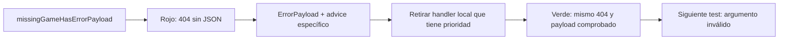

# Sesión 5 — Errores HTTP coherentes con un advice global

**Proyecto:** `02-ejemplos/bshipAlong/`, Boot **4.1.1**, Java 25.
**Entrada:** checkpoint completo de [04b](04b-reglas-de-negocio.md), con 29 pruebas
verdes. No se empieza este documento si todavía faltan reglas de ese tramo.

> Battleship es el code-along. El avance final sigue siendo **Mini Tasks
> individual**, iniciado desde cero en un repositorio propio. Book Catalog se
> realizará después en grupo; no es necesario abrirlo para seguir esta sesión.

## 1. Qué cambiamos y qué conservamos

Ya existen tres handlers **locales en `GameController`** que devuelven códigos
correctos pero sin un cuerpo común. Vamos a conservar esos códigos y dar a los
errores de la aplicación esta representación:

```json
{"error":"NOT_FOUND","message":"Game not found: 999","timestamp":"2026-10-22T10:00:00Z"}
```

El timestamp del ejemplo es ilustrativo; en ejecución se genera en cada respuesta.

| Causa | Código | Campo `error` |
|---|---|---|
| `GameNotFoundException` | 404 | `NOT_FOUND` |
| `IllegalArgumentException`, regla incumplida | 400 | `BAD_REQUEST` |
| `IllegalStateException`, operación incompatible con el estado | 409 | `CONFLICT` |
| Fallo de `@Valid` | 400 | `VALIDATION_ERROR` |
| JSON ilegible o tipo incorrecto de parámetro | 400 | `BAD_REQUEST` |
| Fallo inesperado | 500 | `INTERNAL_ERROR`, mensaje público genérico |

**No traducimos todos los argumentos inválidos a 404.** Una partida inexistente
no es lo mismo que colocar un barco fuera del tablero. No cambiamos el servicio,
las migraciones, los DTOs de éxito ni las rutas que ya funcionan.

```text
Petición → controlador → servicio → excepción específica
                ↓
      advice global → código HTTP + ErrorPayload
```

## 2. Primer test: el 404 también debe tener JSON

Añade este método **dentro de `GameControllerTest`**, antes de la última llave.
El archivo ya importa la excepción, Mockito y los helpers de MockMvc de 04b.

<!-- añadir: src/test/java/es/daw2a/bshipalong/web/GameControllerTest.java -->
```java
    @Test void missingGameHasErrorPayload() throws Exception {
        when(service.getGame(999L)).thenThrow(new GameNotFoundException(999L));
        mvc.perform(get("/api/games/999"))
                .andExpect(status().isNotFound())
                .andExpect(content().contentTypeCompatibleWith("application/json"))
                .andExpect(jsonPath("$.error").value("NOT_FOUND"))
                .andExpect(jsonPath("$.message").value("Game not found: 999"))
                .andExpect(jsonPath("$.timestamp").isNotEmpty());
    }
```

```bash
./mvnw -Dtest=GameControllerTest#missingGameHasErrorPayload test
```
<!-- comprobar: rojo GameControllerTest#missingGameHasErrorPayload -->

Rojo: el handler local devuelve 404 pero sin contenido. El test anterior que
comprobaba solo el código no detectaba esta diferencia.

## 3. Crear el payload y el primer handler global

Este record define el contrato de salida. El constructor de dos argumentos
delega en el constructor canónico de tres; **no es un constructor compacto**.

<!-- archivo: src/main/java/es/daw2a/bshipalong/dto/ErrorPayload.java -->
```java
package es.daw2a.bshipalong.dto;

import java.time.Instant;

public record ErrorPayload(String error, String message, String timestamp) {
    public ErrorPayload(String error, String message) {
        this(error, message, Instant.now().toString());
    }
}
```

<!-- archivo: src/main/java/es/daw2a/bshipalong/web/GlobalExceptionHandler.java -->
```java
package es.daw2a.bshipalong.web;

import es.daw2a.bshipalong.domain.exceptions.GameNotFoundException;
import es.daw2a.bshipalong.dto.ErrorPayload;
import org.springframework.http.ResponseEntity;
import org.springframework.web.bind.annotation.ExceptionHandler;
import org.springframework.web.bind.annotation.RestControllerAdvice;

@RestControllerAdvice
public class GlobalExceptionHandler {
    @ExceptionHandler(GameNotFoundException.class)
    public ResponseEntity<ErrorPayload> missing(GameNotFoundException ex) {
        return ResponseEntity.status(404).body(new ErrorPayload("NOT_FOUND", ex.getMessage()));
    }
}
```

`@RestControllerAdvice` se detecta mediante el escaneo de componentes y escribe
el resultado en el cuerpo HTTP. Afecta a los controladores del contexto, no solo
a un método. Pero **el handler local tiene prioridad sobre el global**:

```bash
./mvnw -Dtest=GameControllerTest#missingGameHasErrorPayload test
```
<!-- comprobar: rojo GameControllerTest#missingGameHasErrorPayload -->

El test sigue rojo mientras exista `missing(...)` en el controlador. No es
necesario desactivar filtros ni cambiar el servicio para resolverlo.

## 4. Quitar los handlers locales sin perder endpoints

Sustituye `GameController.java` por este archivo completo. Conserva creación,
consulta, filtro, barcos, ataques y cancelación; desaparecen sus tres handlers.
El 400/409 uniforme se construirá en los siguientes ciclos.

<!-- archivo: src/main/java/es/daw2a/bshipalong/web/GameController.java -->
```java
package es.daw2a.bshipalong.web;

import es.daw2a.bshipalong.domain.GameStatus;
import es.daw2a.bshipalong.dto.*;
import es.daw2a.bshipalong.service.GameService;
import jakarta.validation.Valid;
import org.springframework.http.ResponseEntity;
import org.springframework.web.bind.annotation.*;
import java.net.URI;
import java.util.List;

@RestController
@RequestMapping("/api/games")
public class GameController {
    private final GameService service;
    public GameController(GameService service) { this.service = service; }

    private ResponseEntity<GameResponseDTO> created(GameResponseDTO game) {
        return ResponseEntity.created(URI.create("/api/games/" + game.id())).body(game);
    }
    @PostMapping
    public ResponseEntity<GameResponseDTO> create(@Valid @RequestBody CreateGameDTO dto) {
        return created(service.createGame(dto));
    }
    @GetMapping("/{id}")
    public GameResponseDTO get(@PathVariable("id") Long id) { return service.getGame(id); }
    @GetMapping
    public List<GameResponseDTO> list(
            @RequestParam(name = "status", required = false) GameStatus status) {
        return service.listGames(status);
    }
    @PostMapping("/{id}/ships")
    public ResponseEntity<GameResponseDTO> place(
            @PathVariable("id") Long id, @Valid @RequestBody PlaceShipDTO dto) {
        return created(service.placeShip(id, dto));
    }
    @PostMapping("/{id}/attacks")
    public ResponseEntity<GameResponseDTO> attack(
            @PathVariable("id") Long id, @Valid @RequestBody AttackDTO dto) {
        return created(service.attack(id, dto));
    }
    @DeleteMapping("/{id}")
    public ResponseEntity<Void> cancel(@PathVariable("id") Long id) {
        service.cancelGame(id);
        return ResponseEntity.noContent().build();
    }
}
```

```bash
./mvnw -Dtest=GameControllerTest#missingGameHasErrorPayload test
```
<!-- comprobar: verde GameControllerTest#missingGameHasErrorPayload -->



Lectura sin visor: **test → rojo → implementación mínima → verde → refactor**.
En este punto el resto de la suite puede detectar los mapeos 400/409 que acabamos
de retirar: se recuperan inmediatamente en los próximos dos ciclos. No se da
por terminada la extracción hasta que toda la suite vuelva a verde.

## 5. Regla incumplida: 400 con mensaje público

Añade al test web:

<!-- añadir: src/test/java/es/daw2a/bshipalong/web/GameControllerTest.java -->
```java
    @Test void invalidPlacementHasBadRequestPayload() throws Exception {
        var ship = new PlaceShipDTO("A", 2, 7, 0, true);
        when(service.placeShip(1L, ship))
                .thenThrow(new IllegalArgumentException("Ship does not fit horizontally"));
        mvc.perform(post("/api/games/1/ships").contentType("application/json").content("""
                {"shipName":"A","length":2,"startX":7,"startY":0,"isHorizontal":true}
                """))
                .andExpect(status().isBadRequest())
                .andExpect(jsonPath("$.error").value("BAD_REQUEST"))
                .andExpect(jsonPath("$.message").value("Ship does not fit horizontally"));
    }
```

```bash
./mvnw -Dtest=GameControllerTest#invalidPlacementHasBadRequestPayload test
```
<!-- comprobar: rojo GameControllerTest#invalidPlacementHasBadRequestPayload -->

Añade este método dentro del advice, antes de su última llave:

<!-- añadir: src/main/java/es/daw2a/bshipalong/web/GlobalExceptionHandler.java -->
```java
    @ExceptionHandler(IllegalArgumentException.class)
    public ResponseEntity<ErrorPayload> badRequest(IllegalArgumentException ex) {
        return ResponseEntity.badRequest().body(new ErrorPayload("BAD_REQUEST", ex.getMessage()));
    }
```

```bash
./mvnw -Dtest=GameControllerTest#invalidPlacementHasBadRequestPayload test
```
<!-- comprobar: verde GameControllerTest#invalidPlacementHasBadRequestPayload -->

El mensaje viene de una regla que hemos diseñado para ser comunicada. Esto no
autoriza a devolver indiscriminadamente detalles internos de cualquier excepción.

## 6. Estado incompatible: 409

<!-- añadir: src/test/java/es/daw2a/bshipalong/web/GameControllerTest.java -->
```java
    @Test void invalidStateHasConflictPayload() throws Exception {
        when(service.attack(1L, new AttackDTO(0, 0)))
                .thenThrow(new IllegalStateException("Game is not in progress"));
        mvc.perform(post("/api/games/1/attacks").contentType("application/json")
                .content("{\"x\":0,\"y\":0}"))
                .andExpect(status().isConflict())
                .andExpect(jsonPath("$.error").value("CONFLICT"))
                .andExpect(jsonPath("$.message").value("Game is not in progress"));
    }
```

```bash
./mvnw -Dtest=GameControllerTest#invalidStateHasConflictPayload test
```
<!-- comprobar: rojo GameControllerTest#invalidStateHasConflictPayload -->

<!-- añadir: src/main/java/es/daw2a/bshipalong/web/GlobalExceptionHandler.java -->
```java
    @ExceptionHandler(IllegalStateException.class)
    public ResponseEntity<ErrorPayload> conflict(IllegalStateException ex) {
        return ResponseEntity.status(409).body(new ErrorPayload("CONFLICT", ex.getMessage()));
    }
```

```bash
./mvnw -Dtest=GameControllerTest#invalidStateHasConflictPayload test
```
<!-- comprobar: verde GameControllerTest#invalidStateHasConflictPayload -->

### Punto de corte si esta sesión se empieza al terminar 04b

```bash
./mvnw test
```
<!-- comprobar: verde * -->

Aquí la suite completa tiene **32 pruebas verdes**: 404/400/409 ya se mapean
globalmente y devuelven el payload. Es un checkpoint posible si no queda tiempo
para todo el documento. El payload uniforme de validación, las entradas ilegibles
y el 500 todavía no se han construido; se retoman en el apartado 7. No detenerse
justo después de quitar los handlers locales sin restaurar sus tres mapeos.

## 7. Datos inválidos y solicitudes ilegibles no son un 500

Primero comprobamos que el fallo de Bean Validation tenga nuestro payload:

<!-- añadir: src/test/java/es/daw2a/bshipalong/web/GameControllerTest.java -->
```java
    @Test void validationHasErrorPayload() throws Exception {
        mvc.perform(post("/api/games").contentType("application/json")
                .content("{\"boardSize\":0}"))
                .andExpect(status().isBadRequest())
                .andExpect(jsonPath("$.error").value("VALIDATION_ERROR"))
                .andExpect(jsonPath("$.message").isNotEmpty())
                .andExpect(jsonPath("$.timestamp").isNotEmpty());
        verifyNoInteractions(service);
    }
```

```bash
./mvnw -Dtest=GameControllerTest#validationHasErrorPayload test
```
<!-- comprobar: rojo GameControllerTest#validationHasErrorPayload -->

Añade el handler. Escribimos el tipo de excepción completo para que el paso no
dependa de un import omitido:

<!-- añadir: src/main/java/es/daw2a/bshipalong/web/GlobalExceptionHandler.java -->
```java
    @ExceptionHandler(org.springframework.web.bind.MethodArgumentNotValidException.class)
    public ResponseEntity<ErrorPayload> validation(
            org.springframework.web.bind.MethodArgumentNotValidException ex) {
        String message = ex.getBindingResult().getAllErrors().getFirst().getDefaultMessage();
        return ResponseEntity.badRequest().body(new ErrorPayload("VALIDATION_ERROR", message));
    }
```

```bash
./mvnw -Dtest=GameControllerTest#validationHasErrorPayload test
```
<!-- comprobar: verde GameControllerTest#validationHasErrorPayload -->

Otro caso: JSON incompleto o un id que no es numérico. No han alcanzado el servicio:

<!-- añadir: src/test/java/es/daw2a/bshipalong/web/GameControllerTest.java -->
```java
    @Test void malformedInputsHaveBadRequestPayload() throws Exception {
        mvc.perform(post("/api/games").contentType("application/json").content("{"))
                .andExpect(status().isBadRequest())
                .andExpect(jsonPath("$.error").value("BAD_REQUEST"));
        mvc.perform(get("/api/games/not-a-number"))
                .andExpect(status().isBadRequest())
                .andExpect(jsonPath("$.error").value("BAD_REQUEST"));
        verifyNoInteractions(service);
    }
```

```bash
./mvnw -Dtest=GameControllerTest#malformedInputsHaveBadRequestPayload test
```
<!-- comprobar: rojo GameControllerTest#malformedInputsHaveBadRequestPayload -->

<!-- añadir: src/main/java/es/daw2a/bshipalong/web/GlobalExceptionHandler.java -->
```java
    @ExceptionHandler({org.springframework.http.converter.HttpMessageNotReadableException.class,
            org.springframework.web.method.annotation.MethodArgumentTypeMismatchException.class})
    public ResponseEntity<ErrorPayload> malformed(Exception ex) {
        return ResponseEntity.badRequest()
                .body(new ErrorPayload("BAD_REQUEST", "Malformed request input"));
    }
```

```bash
./mvnw -Dtest=GameControllerTest#malformedInputsHaveBadRequestPayload test
```
<!-- comprobar: verde GameControllerTest#malformedInputsHaveBadRequestPayload -->

## 8. Fallo inesperado y conservación de errores del protocolo

Añade dos pruebas: una para el 500 genérico y otra para no romper 405/415/406
cuando incorporemos el handler de último recurso. La segunda es una regresión
de comportamiento HTTP, no una funcionalidad que tengamos que romper a propósito.

<!-- añadir: src/test/java/es/daw2a/bshipalong/web/GameControllerTest.java -->
```java
    @Test void unexpectedFailureHidesInternalDetails() throws Exception {
        when(service.getGame(77L)).thenThrow(new RuntimeException("Internal database detail"));
        mvc.perform(get("/api/games/77"))
                .andExpect(status().isInternalServerError())
                .andExpect(jsonPath("$.error").value("INTERNAL_ERROR"))
                .andExpect(jsonPath("$.message").value("Unexpected error"))
                .andExpect(jsonPath("$.timestamp").isNotEmpty());
    }

    @Test void protocolErrorsKeepTheirStatus() throws Exception {
        mvc.perform(put("/api/games"))
                .andExpect(status().isMethodNotAllowed());
        mvc.perform(post("/api/games").contentType("text/plain").content("not JSON"))
                .andExpect(status().isUnsupportedMediaType());
        when(service.getGame(17L)).thenReturn(pending(17L));
        mvc.perform(get("/api/games/17").accept("image/png"))
                .andExpect(status().isNotAcceptable());
    }
```

```bash
./mvnw -Dtest=GameControllerTest#unexpectedFailureHidesInternalDetails test
```
<!-- comprobar: rojo GameControllerTest#unexpectedFailureHidesInternalDetails -->

Sustituye el advice por esta versión completa. Además del fallback, conserva
los errores de protocolo para que una solicitud no admitida no se convierta en
500. Un 406 no lleva JSON porque el cliente no acepta esa representación.

<!-- archivo: src/main/java/es/daw2a/bshipalong/web/GlobalExceptionHandler.java -->
```java
package es.daw2a.bshipalong.web;

import es.daw2a.bshipalong.domain.exceptions.GameNotFoundException;
import es.daw2a.bshipalong.dto.ErrorPayload;
import org.springframework.http.ResponseEntity;
import org.springframework.http.converter.HttpMessageNotReadableException;
import org.springframework.web.HttpMediaTypeNotAcceptableException;
import org.springframework.web.HttpMediaTypeNotSupportedException;
import org.springframework.web.HttpRequestMethodNotSupportedException;
import org.springframework.web.bind.MethodArgumentNotValidException;
import org.springframework.web.bind.annotation.ExceptionHandler;
import org.springframework.web.bind.annotation.RestControllerAdvice;
import org.springframework.web.method.annotation.MethodArgumentTypeMismatchException;

@RestControllerAdvice
public class GlobalExceptionHandler {
    @ExceptionHandler(GameNotFoundException.class)
    public ResponseEntity<ErrorPayload> missing(GameNotFoundException ex) {
        return ResponseEntity.status(404).body(new ErrorPayload("NOT_FOUND", ex.getMessage()));
    }
    @ExceptionHandler(IllegalArgumentException.class)
    public ResponseEntity<ErrorPayload> badRequest(IllegalArgumentException ex) {
        return ResponseEntity.badRequest().body(new ErrorPayload("BAD_REQUEST", ex.getMessage()));
    }
    @ExceptionHandler(IllegalStateException.class)
    public ResponseEntity<ErrorPayload> conflict(IllegalStateException ex) {
        return ResponseEntity.status(409).body(new ErrorPayload("CONFLICT", ex.getMessage()));
    }
    @ExceptionHandler(MethodArgumentNotValidException.class)
    public ResponseEntity<ErrorPayload> validation(MethodArgumentNotValidException ex) {
        String message = ex.getBindingResult().getAllErrors().getFirst().getDefaultMessage();
        return ResponseEntity.badRequest().body(new ErrorPayload("VALIDATION_ERROR", message));
    }
    @ExceptionHandler({HttpMessageNotReadableException.class, MethodArgumentTypeMismatchException.class})
    public ResponseEntity<ErrorPayload> malformed(Exception ex) {
        return ResponseEntity.badRequest()
                .body(new ErrorPayload("BAD_REQUEST", "Malformed request input"));
    }
    @ExceptionHandler(HttpRequestMethodNotSupportedException.class)
    public ResponseEntity<ErrorPayload> method(HttpRequestMethodNotSupportedException ex) {
        return ResponseEntity.status(405).headers(ex.getHeaders())
                .body(new ErrorPayload("METHOD_NOT_ALLOWED", "HTTP method not supported"));
    }
    @ExceptionHandler(HttpMediaTypeNotSupportedException.class)
    public ResponseEntity<ErrorPayload> unsupported(HttpMediaTypeNotSupportedException ex) {
        return ResponseEntity.status(415)
                .body(new ErrorPayload("UNSUPPORTED_MEDIA_TYPE", "Unsupported request content type"));
    }
    @ExceptionHandler(HttpMediaTypeNotAcceptableException.class)
    public ResponseEntity<Void> notAcceptable(HttpMediaTypeNotAcceptableException ex) {
        return ResponseEntity.status(406).build();
    }
    @ExceptionHandler(Exception.class)
    public ResponseEntity<ErrorPayload> unexpected(Exception ex) {
        return ResponseEntity.internalServerError()
                .body(new ErrorPayload("INTERNAL_ERROR", "Unexpected error"));
    }
}
```

```bash
./mvnw -Dtest=GameControllerTest test
```
<!-- comprobar: verde GameControllerTest -->

Spring elige el handler más específico, **no el primero escrito**. El fallback
está al final por legibilidad. Si más adelante se incorpora seguridad, habrá
que añadir su tratamiento específico de 401/403; no basta con este handler de MVC.

## 9. Verificación real de errores y suite completa

No cambiamos artificialmente el servicio para provocar fallos de producción.
El 500 se fuerza con un mock en el test web; los errores esperables se prueban
también con servicio y base reales:

<!-- archivo: src/test/java/es/daw2a/bshipalong/web/GameErrorsIntegrationTest.java -->
```java
package es.daw2a.bshipalong.web;

import org.junit.jupiter.api.Test;
import org.springframework.beans.factory.annotation.Autowired;
import org.springframework.boot.test.context.SpringBootTest;
import org.springframework.boot.webmvc.test.autoconfigure.AutoConfigureMockMvc;
import org.springframework.test.web.servlet.MockMvc;
import org.springframework.transaction.annotation.Transactional;
import static org.springframework.test.web.servlet.request.MockMvcRequestBuilders.*;
import static org.springframework.test.web.servlet.result.MockMvcResultMatchers.*;

@SpringBootTest @AutoConfigureMockMvc @Transactional
class GameErrorsIntegrationTest {
    @Autowired MockMvc mvc;

    @Test void expectedErrorsHaveSamePublicShape() throws Exception {
        String game = mvc.perform(post("/api/games").contentType("application/json")
                .content("{\"boardSize\":8}"))
                .andExpect(status().isCreated()).andReturn().getResponse().getHeader("Location");
        mvc.perform(post(game + "/attacks").contentType("application/json")
                .content("{\"x\":0,\"y\":0}"))
                .andExpect(status().isConflict())
                .andExpect(jsonPath("$.error").value("CONFLICT"))
                .andExpect(jsonPath("$.timestamp").isNotEmpty());
        mvc.perform(post("/api/games").contentType("application/json")
                .content("{\"boardSize\":0}"))
                .andExpect(status().isBadRequest())
                .andExpect(jsonPath("$.error").value("VALIDATION_ERROR"));
        mvc.perform(delete(game)).andExpect(status().isNoContent());
        mvc.perform(get(game)).andExpect(status().isNotFound())
                .andExpect(jsonPath("$.error").value("NOT_FOUND"))
                .andExpect(jsonPath("$.message").isNotEmpty());
    }
}
```

```bash
./mvnw test
```
<!-- comprobar: verde * -->

**Checkpoint de salida: 37 pruebas verdes**. Las reglas y las migraciones de
04b no cambian. El controlador no conserva handlers locales ni conoce cómo
se construye el payload; el servicio sigue sin importar tipos HTTP.

## 10. Mini Tasks individual — avance de manejo de errores

Continúa el proyecto que estás construyendo desde cero. Si 04b quedó pendiente,
termina primero la operación idempotente de completar (`done=true`) sin sustituir
`toggle` ni abrir todavía Book Catalog.

1. Define `TaskNotFoundException` y lánzala desde el servicio al consultar o
   completar una tarea inexistente. El servicio no devuelve `ResponseEntity`.
2. Test MVC: recurso inexistente → `404` con `error`, `message` y `timestamp`.
3. Construye el DTO de error y el advice global. Retira el mapeo local anterior
   para que no tenga prioridad sobre el advice.
4. Conserva los casos de éxito y añade un caso de entrada inválida → `400`, sin
   convertir todos los fallos en `404`. Ejecuta la suite completa.
5. Guarda código, pruebas, commits y `aprendizaje.md` en tu repositorio propio;
   misma tarea individual y URL de Moodle, sin otro ítem de nota.

Book Catalog será la siguiente práctica **en grupo**, una vez cerrada Mini Tasks.
Sus entregas 5/6 consolidan excepción específica, mapeo local y advice; no son
nuevas tareas que haya que entregar hoy además de Mini Tasks.
