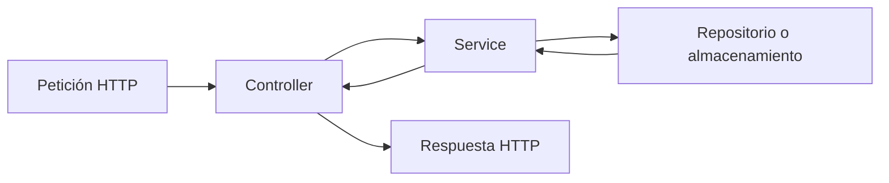
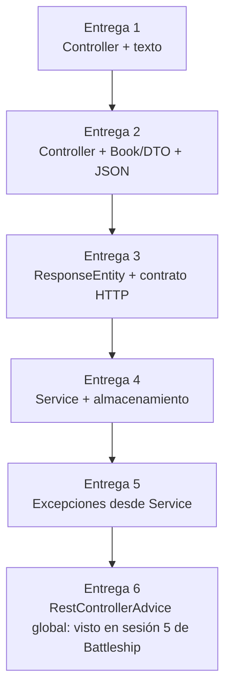

# Orientación de Book Catalog con los contenidos de Battleship hasta la sesión 5

## Objetivo y regla de trabajo

Construye la API de forma incremental, entendiendo cada decisión y entregando
un cambio pequeño cada vez. **Antes de pasar a la siguiente entrega, ejecuta
los tests de la entrega actual y verifica que están en verde.** No copies una
solución completa sin poder explicar sus capas, su contrato HTTP y su test.

La práctica es **en grupo** y se empieza después de cerrar Mini Tasks individual.
El número de entrega de Book Catalog no es el número de sesión de Battleship:
la **sesión 5 de Battleship explica el advice global**, que se aplica en la
**entrega 6 de Book Catalog**. Esta orientación no abre una entrega adicional.

## Roadmap de las seis entregas

| Entrega | Objetivo y capas/slice | Test semilla relevante | Evidencia y commit |
|---|---|---|---|
| 1 | Echo text: un controlador atiende la ruta inicial y devuelve texto plano. | Test del endpoint de eco y su respuesta. | Test verde, `git diff` claro y `Entrega 1: echo text`. |
| 2 | JSON: introduce `Book` y los DTOs necesarios; el slice sigue concentrado en el controlador y su representación HTTP. | Tests de alta/consulta en JSON y estructura de la respuesta. | Test verde, ejemplos del contrato y `Entrega 2: JSON`. |
| 3 | ResponseEntity: expresa estados y cabeceras con precisión, incluyendo creación, borrado y `Location` cuando corresponda. | Tests de códigos `201`, `204` y `Location` del starter. | Test verde, contrato documentado y `Entrega 3: ResponseEntity`. |
| 4 | Servicio: separa la lógica de negocio del controlador; el slice pasa por Controller → Service → almacenamiento. | Tests que verifican la delegación y el comportamiento del servicio. | Test verde, responsabilidades explicadas y `Entrega 4: servicio`. |
| 5 | Excepciones: define excepciones propias y las lanza desde el servicio para casos de negocio como recurso no encontrado. | Tests de errores y excepciones esperadas por el contrato actual. | Test verde, casos de error documentados y `Entrega 5: excepciones`. |
| 6 | Advice global: centraliza el mapeo de excepciones y la forma del error JSON. | Test del advice y regresión de los casos de éxito. | Test verde, errores documentados y `Entrega 6: advice global`. |

El `@RestControllerAdvice` global corresponde a la **entrega 6** y utiliza lo
aprendido en la sesión 5 de Battleship. Antes de ese checkpoint basta con cumplir
el contrato y los tests de las entregas actuales.

Cuando el contrato evolucione, habrá expectativas anteriores que deban
actualizarse: por ejemplo, el eco de texto deja de ser la salida del listado al
pasar a JSON y la creación pasa de `200` a `201`. No se exige satisfacer a la vez
dos respuestas incompatibles. Conserva en Git la evolución y los tests de los
comportamientos que siguen vigentes.

## Cómo repartir un slice vertical

Un slice vertical recorre una funcionalidad de extremo a extremo, en lugar de
construir primero toda una capa para después conectar las demás:



- **Controller**: traduce HTTP (ruta, parámetros, cuerpo y estado) al lenguaje
  de la aplicación y convierte el resultado en una respuesta HTTP. No debe
  contener reglas de negocio.
- **Service**: coordina la operación y aplica reglas de negocio; decide cuándo
  lanzar una excepción propia. No debería conocer detalles de HTTP.
- **Repositorio/almacenamiento**: conserva y recupera libros. Puede ser una
  abstracción o una implementación sencilla en memoria.

En las entregas 2 y 3 se puede usar memoria. Un repositorio real no es
obligatorio hasta que el diseño lo requiera: no inventes JPA, entidades de
persistencia ni configuración de base de datos si el starter no lo pide. Añade
la capa que el contrato y los tests necesiten, no una infraestructura por
anticipación.

La evolución esperada puede visualizarse así:



## Códigos HTTP y `Location`

| Código | Uso habitual en este ejercicio |
|---|---|
| `200 OK` | Consulta o modificación con representación en la respuesta. |
| `201 Created` | Alta correcta; incluye `Location` apuntando al recurso creado cuando el contrato lo establezca. |
| `204 No Content` | Operación correcta sin cuerpo, normalmente borrado o actualización sin representación. |
| `400 Bad Request` | Petición inválida según el contrato (formato o datos no aceptables). |
| `404 Not Found` | El libro solicitado no existe. |
| `409 Conflict` | Opcional: úsalo solo si el contrato y los tests requieren un conflicto identificable. |

`Location` debe ser una cabecera de la respuesta `201` y señalar la URL del
nuevo recurso, no un texto inventado ni una URL de la interfaz de administración.

## Comandos y evidencias

Ejecuta desde la raíz del repositorio de grupo creado con **Use this template**
en [Book Catalog](https://github.com/IES-Rafael-Alberti/book-catalog-template).
La plantilla usa Boot 4.1.1, Java 25 e incluye Maven Wrapper 3.9.11. Para cambiar
de checkpoint, activa una sola semilla y ejecuta las pruebas:

```bash
java classroom/ActivarEntrega.java 2
./mvnw test
./mvnw -Dtest=NombreDelTest test
git status
git diff
git diff --check
```

En Windows:

```bat
mvnw.cmd test
mvnw.cmd -Dtest=NombreDelTest test
```

Sustituye `NombreDelTest` por la clase del test de la entrega actual. Si el
checkpoint es otro, cambia también el número `2` del activador por `1`–`6`.
No copies todos los tests a `src/test`. El activador solo sustituye sus archivos
semilla y conserva los tests propios con otros nombres; si has editado una
semilla, guarda primero esos cambios como test propio. No hay perfiles Maven
para seleccionar entregas. Su contrato detallado está en `classroom/entregas.md`.

## Checklists

Para cada entrega:

- [ ] He leído el test semilla y entiendo el contrato que verifica.
- [ ] El cambio está limitado al objetivo de esta entrega.
- [ ] He visto el rojo del comportamiento nuevo; si el caso ya venía resuelto,
  no lo presento como TDD propio.
- [ ] Los tests actuales están verdes.
- [ ] El contrato HTTP (ruta, cuerpo, código y cabeceras) es coherente.
- [ ] Cada capa conserva su responsabilidad.
- [ ] README y evidencias están actualizados si corresponde.
- [ ] He completado la declaración de uso de IA.
- [ ] He creado `Entrega X: ...` (por ejemplo, `Entrega 3: ResponseEntity`).

Antes de entregar:

- [ ] Las seis entregas tienen commits separados y comprensibles al cerrar la práctica.
- [ ] He ejecutado los tests de la entrega final y no quedan cambios sin revisar.
- [ ] `git status`, `git diff` y `git diff --check` no muestran sorpresas.
- [ ] Puedo explicar el slice vertical sin atribuir reglas HTTP al servicio.
- [ ] La declaración de IA acompaña al repositorio.

## Bloqueos frecuentes y preguntas guía

- **Falla un test de estado o cabecera**: ¿qué exige exactamente el test y qué
  representa la operación: crear, consultar, actualizar o borrar?
- **El controlador crece demasiado**: ¿qué regla de negocio puede moverse al
  servicio sin llevar tipos HTTP con ella?
- **No sé si crear un repositorio**: ¿lo exige el starter, el test o el diseño
  actual? Si no, empieza con memoria y deja explícita la decisión.
- **No sé qué excepción usar**: ¿qué condición de negocio se ha producido y
  qué capa puede detectarla?
- **Un cambio rompe una entrega anterior**: ¿el nuevo slice conserva el
  contrato previo? Vuelve al último test verde antes de avanzar.

Preguntas guía: ¿qué entra y sale de cada capa?, ¿quién decide el código HTTP?,
¿qué evidencia demuestra que funciona?, ¿puedo explicar este cambio sin
ocultar decisiones detrás de una herramienta de IA?
